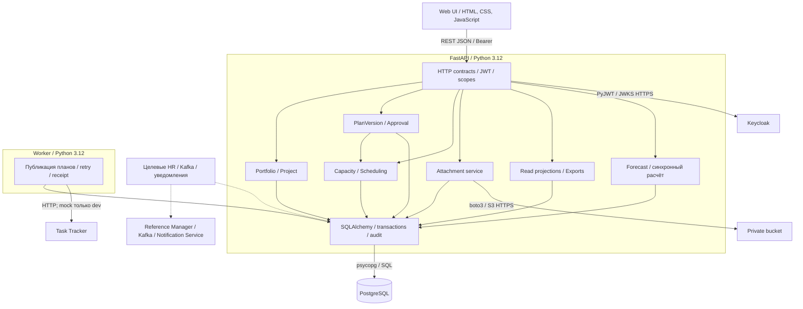

# 150 — Компоненты Planning System

Редакция 1.1, 18.10.2026. C4 Component исполняемой поставки, [ADR-016](145.architecture-decisions.md#adr-016).
[Логические потоки](146.logic-scheme.md), [развёртывание](165.deployment-diagram.md).
API и worker собираются из одного образа; браузер получает статические файлы API.
Пунктиром показаны ещё не подключённые адаптеры общего стенда.

| Компонент | Технология / файл | Ответственность и состояние | ADR / требования |
| --- | --- | --- | --- |
| Web UI | HTML/CSS/JavaScript, ui/app | 12 экранов; серверные формы, согласование, файлы, OIDC PKCE и dev-роли | 006/016; NFR-12 |
| Controllers + auth | FastAPI, app.py / auth.py / runtime.py | JSON Schema, JWT/JWKS, роли/области/денежные поля, If-Match и повторы | 001/009/016; NFR-02/03/10 |
| Portfolio / Project | Python, app.py / runtime.py | CRUD проектов, программы, фильтры, пагинация, архив | 003; FR-01 |
| PlanVersion / Approval | Python, app.py | Копирование, contentRevision/round, неизменяемая baseline и активация | 003; FR-02/09 |
| Capacity / Scheduling | Python, domain.py | Дневные часы, FS по будням, цикл, перегрузка/дефицит; полный рабочий календарь ещё не реализован | 002/010; FR-04–07 |
| Forecast | Python, domain.py / app.py | Факт + ручной ETC, стоимость и PARTIAL; сейчас синхронно в API, отдельный worker остаётся целевым | 002/011/016; FR-08/10 |
| Read projections / Exports | Python, app.py / runtime.py | Личный календарь, QA, Reports, immutable batch pages и manifest | 012; FR-15/INT-07/08 |
| Attachment service | Python/boto3, integrations.py | MIME/размер, область владельца, S3; локальные файлы только development | 007; FR-13 |
| Publication worker | Python/httpx, worker.py | Сохранённые операции публикации, retry/receipt; TT mapping требует принятия | 004/008; FR-11/12 |
| Repositories / audit | SQLAlchemy/psycopg, storage.py + migrations | JSONB snapshots, revisions, транзакции; PostgreSQL-триггеры baseline и аудита | 003/005/015; NFR-04/05/14 |
| HR sync | Целевой Python REST adapter | Чтение HR/НСИ, resource name/etag и rename; пока fixture-входы, реальный adapter не поставлен | 010; INT-02 |
| Kafka / Notification policy | Целевые Python adapters | Broker/inbox/outbox, DLQ и доставка адресату; код их сквозной стыковки ещё не поставлен | 004/008; INT-03/04 |

Unit/API-тесты проверяют расчёты, права, повторы и переходы. Browser E2E проверяет
планирование, конфликт, согласование, сценарий и вложение на локальном сервере.
Реальные T-INT, полный рабочий календарь, нагрузка и restore общего стенда —
отдельные проверки [095](095.requirements-check.md)/[160](160.integration-plan.md).
Наличие dev-модуля не подтверждает готовность целевых адаптеров. CI, seed, Compose,
minikube и безопасность перечислены в [165](165.deployment-diagram.md).
