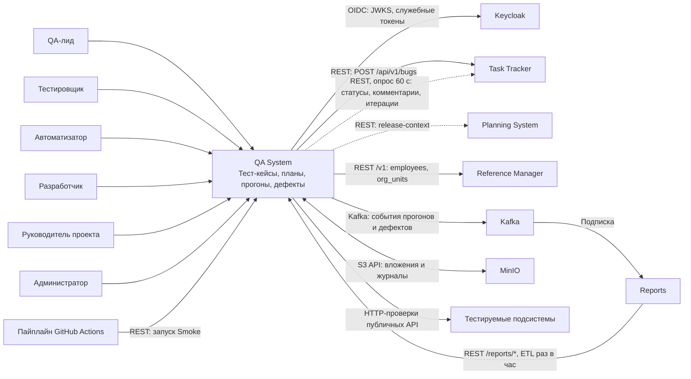

# 020 — System Context

> Формат — см. [состав документов](documents-composition.md), документ 020.
> Источник — [vision, разделы 1.2–1.4, 4.5, 4.6, 8](vision.md). Термины — [010](010.glossary.md), акторы — [030](030.actors.md), обоснование способов обмена — [162](162.integration-spec.md).

## 1. Назначение и граница

QA System — система управления тестированием — хранит тест-кейсы, собирает их в планы, проводит ручные и автоматические прогоны и заводит дефекты по провалам. Вторая задача модуля — приёмочный контур проекта: стартовый набор из 25 кейсов проверяет соседние подсистемы на общем стенде ([vision 4.6](vision.md#46-приёмка-стенда)).

| Внутри QA System | За пределами модуля |
| --- | --- |
| Тест-кейсы, шаги, версии, шаблоны, импорт и экспорт | Задачи, итерации, канбан, статусы и приоритеты задач — Task Tracker |
| Наборы и тест-планы, их привязка к релизу, вехе и итерации | Проекты, релизы, вехи, эпики, фичи — Planning System |
| Прогоны, результаты кейсов и шагов, повторные прогоны, приёмка стенда | HR-профили сотрудников, подразделения — Reference Manager |
| Исполнитель автотестов и стартовый набор автотестов | Учётные записи, пароли, роли — Keycloak |
| Дефекты, их QA-поля, статусы тестирования, история и перепроверка | Задача «Ошибка», её статусы разработки и приоритет исправления — Task Tracker |
| Классификаторы серьёзности, приоритета кейса, типов кейсов, окружений; таблица маппинга статусов | Метрики качества, отчёты, аналитическое хранилище — Reports |
| Метаданные вложений и права на них | Файловые объекты — MinIO; брокер событий — Kafka; развёртывание и пайплайны — Infra |
| Сводки плана и прогона, вердикт приёмки | Нагрузочное тестирование и проверки через браузер — вне первой версии |

QA System не читает и не изменяет чужие базы данных. Единственная запись в чужие данные — создание задачи «Ошибка» через API Task Tracker.

## 2. Контекстная диаграмма

Уровень C4 Context: QA System показана одним блоком. Сплошная стрелка — обмен, для которого у владельца есть опубликованный контракт; пунктирная — обмен, который ещё согласуется (раздел 5).

## 3. Внешние системы

| ID | Система | Роль | Что передаём | Что получаем | Тип интеграции | Состояние на 2026-10-12 |
| --- | --- | --- | --- | --- | --- | --- |
| S-01 | Keycloak | Поставщик идентичности: учётные записи и роли | Запросы ключей и служебных токенов | Токены пользователей и сервисов, `sub`, клиентские роли, JWKS | OIDC / OAuth 2.0, HTTPS | Предусмотрено [vision Infra](../../infra/vision.md); клиенты QA описаны в [заявке](infra-request.md) — Q-06 |
| S-02 | Task Tracker | Владелец задачи «Ошибка», её статусов, приоритета и итераций | Создание «Ошибки» | Идентификатор и ссылку на задачу; статус, исполнителя, приоритет, комментарии, итерации — опросом | REST `POST /api/v1/bugs`, идемпотентно по `(externalSource, externalDefectId)`; чтение — `GET` раз в 60 секунд | Создание есть в [контракте](../../task-tracker/docs/block-g-api-and-events/130.api-contracts.md) и в коде; опрос выбран Task Tracker как временный механизм ([его 162](../../task-tracker/docs/block-i-integration-and-deployment/162.integration-spec.md#уточнение-выбора-на-12102026)), нужна учётная запись чтения — Q-09 |
| S-03 | Planning System | Владелец проектов, релизов, вех, эпиков и фич | — | `release-context`: релизы, вехи, эпики, фичи и проекция итераций Task Tracker из утверждённой версии плана | REST `GET /api/v1/projects/{projectId}/release-context`, роль `qa.read` | Контракт описан в [130 Planning System](../../planning-system/docs/130.api-contracts.md) и [162, INT-07](../../planning-system/docs/162.integration-spec.md#int-07--qa-system); кода нет — Q-04 |
| S-04 | Reference Manager | Владелец HR-профилей сотрудников и оргструктуры | — | `employees`, `org_units` | REST `/v1`, роль `reference-reader`, кэш у нас | Сотрудники в составе модуля с 2026-10-02 ([его 020](../../reference-manager/documents/020.system-context.md)); QA — потребитель I-12 их [плана](../../reference-manager/documents/160.integration-plan.md); коллекции ещё не реализованы |
| S-05 | Reports | Потребитель данных тестирования, владелец метрик качества | Тест-кейсы, планы, прогоны, результаты, дефекты | Запросы ETL и сверки | Kafka (события) и REST read-only раз в час | Reports принял контракт ([его 162, раздел 7](../../reports/docs/162.integration-spec.md#7-qa-system-события-и-rest)); ресурс `test-cases` добавлен у нас — Q-13 |
| S-06 | Пайплайн GitHub Actions | Запуск «Smoke» после развёртывания стенда | Вердикт и ссылку на прогон | Команду запуска набора | REST, служебный клиент `qa-ci` | Workflow QA не создан; правило блокировки — Q-08 |
| S-07 | MinIO (Object Storage) | Хранение файлов | Вложения, журналы автотестов | Файл по ключу | S3 API, бакет `arch-dev-qa` | Бакета нет в перечне Infra; заявка оформлена — [infra-request.md](infra-request.md), Q-06 |
| S-08 | Kafka | Транспорт событий | События QA System | — | Kafka, `SASL_SSL`, at-least-once | Топики описаны в той же заявке — Q-06 |
| S-09 | Тестируемые подсистемы | Объект проверки автотестами и приёмкой стенда | HTTP-запросы и тестовые данные с префиксом | Ответы | REST под служебной записью `qa-executor` | API есть у Reference Manager и Task Tracker; окружение — Q-07 |

При недоступности Task Tracker дефект сохраняется у нас с отметкой незавершённой синхронизации и досылается позже. При недоступности источника справочных данных работа продолжается на кэше с датой актуальности. Недоступность тестируемой подсистемы даёт результат «Провален» или «Заблокирован» с причиной.

### 3.1. Откуда берутся люди

Для назначения ответственного за план и тестировщиков на прогон и кейс (FR-TP-03, FR-RUN-02) нужны два источника, и у каждого свой владелец:

| Что нужно | Источник | Как используется |
| --- | --- | --- |
| Кто вошёл и что ему можно | Keycloak: `sub` токена и клиентские роли `qa-system` | Проверка прав на каждый запрос; автор записей и истории |
| Кого можно назначить и как его показать | Reference Manager: HR-профиль `employees` (ФИО, подразделение, состояние занятости, `account_user_id`) и `org_units` | Список кандидатов на назначение и отображаемые имена |
| Связь двух источников | `employees.account_user_id` = `sub` | Назначенный сотрудник находит свои кейсы после входа |

Кандидат на назначение — активный сотрудник с заполненным `account_user_id`. Уволенный сотрудник сохраняется в старых записях, но не предлагается для новых назначений. Модуль справочников классификаторы тестирования не ведёт, но сотрудников ведёт: эта граница закреплена Reference Manager 2026-10-02. Срок и ответственные интеграции — I-04 в [160](160.integration-plan.md).

### 3.2. Аналитический контур

Reports получает данные QA System двумя путями: события Kafka — для оперативных отчётов (не позже 2 минут), и задание ETL раз в час — постраничное чтение `/api/v1/reports/{test-cases, test-plans, test-runs, test-results, defects}` с `updatedSince` в аналитическое хранилище. Метрики качества считает Reports. Пакетных файлов QA System не формирует — см. [vision 8.4](vision.md#84-участие-в-аналитическом-контуре-reports) и [162](162.integration-spec.md).

### 3.3. Тестируемые подсистемы как объект проверки

Reference Manager, Task Tracker, Planning System, Reports и Infra — не только соседи по обмену, но и объект проверки: по каждой пять кейсов стартового набора. QA System обращается к ним только через публичные API под служебной учётной записью `qa-executor`, данные создаёт с префиксом прогона и убирает за собой. Провал кейса превращается в «Ошибку» у команды-владельца подсистемы.

## 4. Акторы

Люди: **H-01** QA-лид, **H-02** тестировщик, **H-03** автоматизатор, **H-04** разработчик, **H-05** руководитель проекта, **H-06** администратор. Системы: **S-01…S-09** из раздела 3 и **S-10** исполнитель автотестов. Цели и действия каждого — в [030](030.actors.md), права — в [070](070.role-matrix.md).

Infra — команда-поставщик окружения, а не самостоятельный бизнес-актор.

## 5. Открытые договорённости

Полный реестр с ответственными с обеих сторон, сроками и критериями закрытия ведётся в [160, раздел 5](160.integration-plan.md#5-открытые-вопросы-и-ответственные). Здесь — краткая сводка для чтения остальных документов: колонка «Принято в комплекте» — рабочее допущение, на котором построены документы 040–165.

| ID | Тема | Принято в комплекте | Состояние |
| --- | --- | --- | --- |
| Q-01 | Обмен статусами и комментариями «Ошибки» | Из Task Tracker — опрос REST (Q-09); в Task Tracker пишется только создание; закрытие и переоткрытие отражаются в трекере вручную по таблице маппинга | Открыт |
| Q-02 | Шкала серьёзности и приоритет | Blocker и Critical → `critical`, Major → `high`, Minor → `medium`, Trivial → `low`; приоритет «Ошибки» ведёт Task Tracker | Ждёт DEC-TT-04 Task Tracker |
| Q-03 | Чтение итераций | Итерации — из проекции `release-context` Planning System или прямым чтением Task Tracker; до решения — ручной ввод с отметкой «не проверена» | Открыт, D-09 Planning System |
| Q-04 | API Planning System | `release-context` по их 130; кэш наполняется после реализации | Контракт описан, кода нет |
| Q-05 | Контракт для Reports | Четыре события и REST `/reports/*` | Закрыт: Reports принял |
| Q-06 | Ресурсы Infra | Бакет, топики, клиенты Keycloak, БД, пространство имён — [заявка](infra-request.md) | Заявка оформлена, ответа нет |
| Q-07 | Окружение для автотестов | Общий `staging` с префиксом данных | Открыт |
| Q-08 | Набор для пайплайна и блокировка выпуска | По [vision 4.6](vision.md#46-приёмка-стенда) | Ждёт подтверждения Infra |
| Q-09 | Учётная запись чтения в Task Tracker | Отдельный клиент `qa-tracker-reader` без ролей `testing-service` и `reports-service` | Открыт |
| Q-10 | Понятие «релиз» | Релиз — `RELEASE` Planning System | Закрыт 2026-10-12 |
| Q-11 | Стек и формат автотестов | [ADR-001, ADR-005](145.architecture-decisions.md) | Решение команды QA до И-M1 |
| Q-12 | Единое имя подсистемы в документах соседей | «QA System — система управления тестированием» | Просьба отправляется командам |
| Q-13 | Ресурс `test-cases` для ETL и база defect density | Добавлен в `/reports/*`; база — согласуется с Reports | Открыт |

Внешние продукты заказчика (системы управления задачами и планирования итераций) в проект не возвращаются: их роль выполняют Task Tracker и Planning System.

## 6. Расхождения vision с документами и кодом соседей

В версии vision 0.3 (2026-10-12) расхождения прошлой редакции устранены. Таблица оставлена для истории изменений.

| ID | Что было в vision 0.2 | Что у соседа | Как устранено |
| --- | --- | --- | --- |
| K-01 | TC-RM-01 обращается к `/livez` и `/readyz` | В коде Reference Manager — `/v1/health/livez` и `/v1/health/readyz` | Пути исправлены в vision 7.1 |
| K-02 | TC-RM-02…04: «версия 1», «код записи» | Контракт по Google AIP: имя `currencies/PLN`, ревизии, `409 ALREADY_EXISTS` | Формулировки исправлены в vision 7.1; операции восстановления в спецификации пока нет — TC-RM-04 помечен «API нет» |
| K-03 | Классификаторы тестирования «по заявке» из Reference Manager | Reference Manager их не ведёт (решение 2026-10-02) | Vision 4.5; [ADR-009](145.architecture-decisions.md) |
| K-04 | События из Task Tracker о статусах дефектов | Task Tracker события наружу не публикует; временный механизм — опрос REST | Vision 4.4 и 8.2; Q-01, Q-09 |
| K-05 | Бакет `arch-dev-qa` «нужна заявка» | В перечне Infra бакета нет | Заявка оформлена: [infra-request.md](infra-request.md) |
| K-06 | TC-PS-04, TC-PS-05, TC-REP-02 — межсистемные | Обмен Planning System ↔ Task Tracker сам не согласован (D-01 у Planning System) | Кейсы помечены «API нет» в vision 7; зависимость — в [160](160.integration-plan.md) |
| K-07 | Сотрудники — от модуля справочников «по заявке» | До 2026-10-02 Reference Manager исключал сотрудников; теперь ведёт HR-профили | Источник людей — раздел 3.1 |
| K-08 | Вопрос об интеграции с внешним трекером дефектов | Постановка заменяет внешние продукты модулями системы | Вопрос снят, переформулирован как Q-01 |
