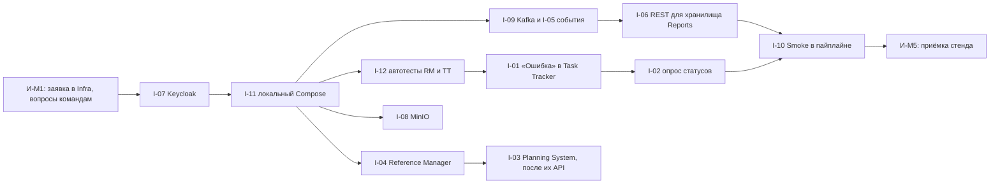

# 160 — Integration Plan

> Формат — см. [состав документов](documents-composition.md), документ 160.
> Сценарии — [155](155.sequence-diagrams.md), контракты — [130](130.api-contracts.md) и [135](135.event-catalog.md), обоснование способов обмена — [162](162.integration-spec.md), заявка в Infra — [infra-request.md](infra-request.md).

Ответственные указаны по ролям в командах, а не по именам: со стороны QA — роль в команде QA, с другой стороны — команда-контрагент. Состояние — на 2026-10-12.

## 1. Вехи интеграций

Даты выровнены с планом Reports ([его 160, раздел 3](../../reports/docs/160.integration-plan.md#3-вехи-интеграций)), чтобы общие интеграции проверялись в одну веху.

| Веха | Срок | Содержание | Связь с вехами разработки |
| --- | --- | --- | --- |
| И-M1 | До 2026-10-19 | Заявка в Infra подана; вопросы Q-01…Q-13 отправлены командам с этим комплектом; стек автотестов утверждён (Q-11) | до M4 |
| И-M2 | До 2026-11-02 | Получены доступы Infra; согласованы шкала серьёзности и учётная запись чтения Task Tracker; QA System поднимается локально в Compose | M4 |
| И-M3 | До 2026-11-16 | Контрактный стенд: каждая интеграция проверена на заглушке или реальном соседе; замеры NFR-01, NFR-09, NFR-15 | M5 |
| И-M4 | До 2026-11-30 | Устойчивость: тайм-ауты, повторы, работа при недоступном соседе; учебное восстановление (NFR-17) | M5 |
| И-M5 | До 2026-12-14 | Сквозные сценарии на общем стенде; «Smoke» в пайплайне; приёмка стенда на демонстрационных данных | M5, приёмка |

## 2. Интеграции

| ID | Контрагент | Что получаем | Что отдаём | Способ и протокол | Веха | Ответственный от QA | Ответственный с той стороны | Критерий готовности |
| --- | --- | --- | --- | --- | --- | --- | --- | --- |
| I-01 | Task Tracker: создание «Ошибки» | Идентификатор и ссылку задачи | Дефект: заголовок, описание, серьёзность, окружение, версия, ссылки | REST `POST /api/v1/bugs`, идемпотентно | И-M2 согласование шкалы; И-M3 стенд; И-M4 повторы | Разработчик QA, модуль дефектов | Команда Task Tracker (их DEC-TT-04) | `201` и повтор `200` без дубликата; `422` переводит синхронизацию в `FAILED`; при недоступном Task Tracker дефект сохранён и досылается; шкала серьёзности согласована (Q-02) |
| I-02 | Task Tracker: статусы, приоритет, комментарии, итерации | Статус, приоритет, исполнителя, комментарии «Ошибки»; итерации | — | REST, опрос раз в 60 секунд под учётной записью чтения; Kafka — после DEC-TT-02 | И-M2 учётная запись; И-M3 стенд | Разработчик QA, Tracker Sync | Команда Task Tracker | Смена статуса «Ошибки» отражается в дефекте не позже 2 минут; повторное чтение не создаёт записей истории; несопоставленный статус виден администратору (Q-01, Q-09) |
| I-03 | Planning System: релизы, вехи, эпики, фичи | `release-context` утверждённой версии плана | — | REST `GET /api/v1/projects/{projectId}/release-context`, роль `qa.read` | И-M1 запрос роли; И-M3 после реализации у Planning System | Разработчик QA, Directory Service | Команда Planning System (их INT-07, D-09) | План привязывается к релизу по `logicalItemId`; новая версия плана не меняет привязку; черновик не читается; недоступность не блокирует сохранение (Q-03, Q-04) |
| I-04 | Reference Manager: сотрудники и подразделения | `employees`, `org_units` | — | REST `/v1`, роль `reference-reader`, кэш | И-M2 доступ; И-M3 стенд; И-M4 кэш | Разработчик QA, Directory Service | Команда справочников (их I-12) | Постраничное чтение с `show_deleted`; сотрудник находится по `account_user_id`; кандидаты на назначение — только активные с учётной записью; при недоступности работает кэш |
| I-05 | Reports: события | — | `TestRunStarted`, `TestResultRecorded`, `TestRunCompleted`, `DefectChanged` | Kafka, топики `dev.qa.test-run.v1`, `dev.qa.defect.v1` | И-M3 стенд | Разработчик QA, Outbox Relay | Команда Reports (их I-08) | События проходят проверку по схемам [140](140.event-schema.md); дубль отбрасывается по `eventId`; результат кейса в витрине Reports не позже 2 минут |
| I-06 | Reports: аналитическое хранилище | Запросы ETL | Кейсы, планы, прогоны, результаты, дефекты | REST `/api/v1/reports/*` с `updatedSince`, роль `qa-reports-reader`, раз в час | И-M3 | Разработчик QA, HTTP-слой | Команда Reports (их I-09) | Пять ресурсов читаются постранично; повтор страницы возвращает те же строки; без роли — `403`; база defect density согласована (Q-13) |
| I-07 | Keycloak | Токены, роли, JWKS | Запросы служебных токенов | OIDC, client credentials | И-M1 заявка; И-M2 доступ | Архитектор QA | Команда Infra | Клиенты `qa-system`, `qa-executor`, `qa-ci`, `qa-tracker-reader` и роли R-01…R-07 созданы, роль `qa-reports-reader` выдана клиенту Reports; недействительный токен — `401`, нет роли — `403` |
| I-08 | MinIO | Файлы по ключу | Вложения, журналы | S3 API, бакет `arch-dev-qa` | И-M1 заявка; И-M3 | Разработчик QA, Attachment Service | Команда Infra | Свой объект пишется и читается; чужой бакет недоступен; бакет не публичный; квота и сроки хранения из заявки применены |
| I-09 | Kafka | — | События QA | Kafka, `SASL_SSL`, ACL | И-M1 заявка; И-M2 топики | Разработчик QA, Outbox Relay | Команда Infra | Топики созданы; `qa-system` пишет, `reports-qa-ingest` читает, чужой principal получает отказ |
| I-10 | Пайплайн GitHub Actions | Команду запуска «Smoke» | Вердикт и ссылку на прогон | REST, клиент `qa-ci` | И-M3 workflow; И-M5 после развёртывания стенда | Автоматизатор QA | Команда Infra | Шаг пайплайна запускает «Smoke» с ключом идемпотентности, получает вердикт; повторный запуск идущего набора — `409`; при `RED` шаг красный (Q-08) |
| I-11 | Развёртывание | Образы, секреты, окружение | Compose-сервисы, манифесты | Docker Compose, GitHub Actions, GHCR; кластер — манифесты | И-M2 локально; И-M4 общий стенд | Архитектор QA | Команда Infra | QA включена в общий `compose.yaml`; образы собираются по commit SHA; миграции до запуска; `/readyz` в проверке готовности; манифесты разворачиваются в локальном кластере |
| I-12 | Тестируемые подсистемы | Ответы публичных API | Тестовые запросы и данные с префиксом | REST под `qa-executor` | По мере появления API, раздел 4 | Автоматизатор QA | Команды подсистем, Infra | Служебная запись имеет минимальные права; автотесты создают данные с префиксом и убирают их (Q-07) |

## 3. Порядок реализации

1. Подать заявку в Infra и отправить вопросы соседям (И-M1): без клиентов Keycloak не работает ничего, остальное начинается на заглушках.
2. Подключить Keycloak и поднять систему локально в общем `compose.yaml`.
3. Автоматизировать кейсы, для которых API уже есть: TC-RM-01…03, TC-RM-05, TC-TT-01, TC-TT-03…05.
4. Создание «Ошибки» — против заглушки по `openapi.yaml` Task Tracker, затем против его стенда; затем опрос статусов.
5. Kafka и события, затем REST для хранилища Reports.
6. Параллельно — кэш Reference Manager и вложения; Planning System — после реализации их API.
7. Включить «Smoke» в пайплайн и провести приёмку стенда на демонстрационных данных.

## 4. Автоматизация стартового набора

План и факт по каждому кейсу — [vision, раздел 7](vision.md#7-стартовый-набор-тест-кейсов). На 2026-10-12 ни один автотест QA System не написан.

| Кейсы | Подсистема | API на 2026-10-12 | Срок автотеста | Ответственный от QA | Зависимость |
| --- | --- | --- | --- | --- | --- |
| TC-RM-01, TC-RM-02, TC-RM-03, TC-RM-05 | Reference Manager | Есть: служебные точки и справочник валют | И-M2 | Автоматизатор | Служебная учётная запись `qa-executor` с ролью чтения и записи справочника |
| TC-RM-04 | Reference Manager | Нет операции восстановления | После появления операции | Автоматизатор | Команда справочников |
| TC-TT-01, TC-TT-03, TC-TT-04, TC-TT-05 | Task Tracker | Есть | И-M3 | Автоматизатор | Права `qa-executor` в Task Tracker |
| TC-TT-02 | Task Tracker | Есть интерфейс | Ручной | Тестировщик | — |
| TC-PS-01…03 | Planning System | Нет | После публикации API | Автоматизатор | Команда Planning System |
| TC-PS-04, TC-PS-05 | Planning System ↔ Task Tracker | Нет; обмен не согласован (их D-01) | После их соглашения | Автоматизатор | Planning System и Task Tracker |
| TC-REP-01, 03, 04, 05 | Reports | Нет | После публикации API | Автоматизатор | Команда Reports |
| TC-REP-02 | Task Tracker → Reports | Нет | После I-02 у Reports | Автоматизатор | Task Tracker и Reports |
| TC-INF-01, 03, 04, 05 | Infra | Стенд не развёрнут | И-M4 | Автоматизатор | Команда Infra |
| TC-INF-02 | Infra | Пересоздание контейнера | Ручной | Тестировщик | — |

Кейс отмечается автоматизированным в QA System только после того, как автотест написан и прошёл на стенде.

## 5. Открытые вопросы и ответственные

Сюда перенесены восемь открытых вопросов vision 0.2 и договорённости комплекта. Вопрос закрывается, когда выполнен критерий закрытия и решение записано ссылкой на документ, issue или pull request контрагента.

| ID | Вопрос | Вопрос vision 0.2 | Ответственный от QA | Контрагент | Срок | Критерий закрытия | Состояние на 2026-10-12 |
| --- | --- | --- | --- | --- | --- | --- | --- |
| Q-01 | Достаточно ли API и событий Task Tracker для статусов и комментариев дефекта; появится ли запись статуса и комментария от внешней системы | 3, 8 | Аналитик QA | Команда Task Tracker | И-M2 | Task Tracker письменно подтверждает: чтение опросом для QA допускается; план по записи статусов и комментариев либо явный отказ, после которого ручное закрытие «Ошибки» фиксируется как постоянное правило | Открыт. Временный опрос выбран Task Tracker, запись не предусмотрена |
| Q-02 | Шкала серьёзности и таблица маппинга статусов | 2 | Аналитик QA | Команда Task Tracker (DEC-TT-04, контрольная дата 2026-10-16), Reports | И-M2 | Task Tracker подтверждает преобразование Blocker и Critical → `critical`, Major → `high`, Minor → `medium`, Trivial → `low` и таблицу маппинга из [vision 4.4](vision.md#44-жизненный-цикл-дефекта) | Ждёт ответа |
| Q-03 | Источник итераций: проекция Planning System или прямое чтение Task Tracker | — | Аналитик QA | Planning System, Task Tracker (их D-09) | И-M3 | Выбран один источник итераций для привязки плана, проверен сценарием SD-07 | Открыт |
| Q-04 | Реализация `release-context` и роль `qa.read` для QA | 1 | Разработчик QA | Команда Planning System | И-M3 | Запрос возвращает релизы проекта на стенде; клиент QA получает роль | Контракт описан, кода нет |
| Q-05 | Контракт событий и REST для Reports | — | Аналитик QA | Команда Reports | — | Reports принял контракт | Закрыт: их 162, раздел 7 |
| Q-06 | Ресурсы Infra: бакет, топики, клиенты Keycloak, БД, пространство имён | — | Архитектор QA | Команда Infra | Подача — до 2026-10-19, ответ — И-M2 | Заявка [infra-request.md](infra-request.md) подана issue в монорепозиторий; Infra создала ресурсы и проверила доступ: свой пишет, чужой получает отказ | Заявка оформлена, ждёт подачи и ответа |
| Q-07 | Отдельное окружение для автотестов | 6 | Архитектор QA | Infra, команды подсистем | И-M3 | Решение записано в vision Infra или здесь: общий `staging` с префиксом данных либо отдельное окружение | Открыт; работаем на общем стенде |
| Q-08 | Шаг «Smoke» в общем пайплайне и правило блокировки | 7 | Автоматизатор QA | Команда Infra | И-M3 | Infra согласна с правилами [vision 4.6](vision.md#46-приёмка-стенда); шаг добавлен в workflow развёртывания | Решение QA предложено |
| Q-09 | Учётная запись чтения `qa-tracker-reader` в Task Tracker | 3 | Разработчик QA | Команда Task Tracker, Infra | И-M2 | Учётная запись выдана; `GET /work-items/{id}` и комментарии читаются; `POST /bugs` этой записью — `403` | Открыт |
| Q-10 | Понятие «релиз» | 1 | Аналитик QA | Команда Planning System | — | Определение и идентификатор зафиксированы в 010, 050, 060, 120, 155 | Закрыт 2026-10-12 по их 050 и 162 |
| Q-11 | Стек и формат автотестов | 5 | Команда QA | — | И-M1 | ADR-001 и ADR-005 переведены в «принято» | Предложение |
| Q-12 | Единое имя «QA System — система управления тестированием» в документах соседей | — | Аналитик QA | Task Tracker, Reports, Reference Manager, Planning System | И-M2 | В глоссариях соседей стоит единое имя или синоним со ссылкой на [наш глоссарий](010.glossary.md#3-имя-подсистемы) | Просьба готова к отправке |
| Q-13 | Ресурс `test-cases` для ETL и база объёма для defect density | — | Аналитик QA | Команда Reports | И-M3 | Reports читает `/reports/test-cases`; база defect density записана в их документах | Открыт |

Вопрос 4 vision 0.2 (ведёт ли Reference Manager классификаторы тестирования) закрыт 2026-10-02 решением Reference Manager и в реестр не перенесён.
