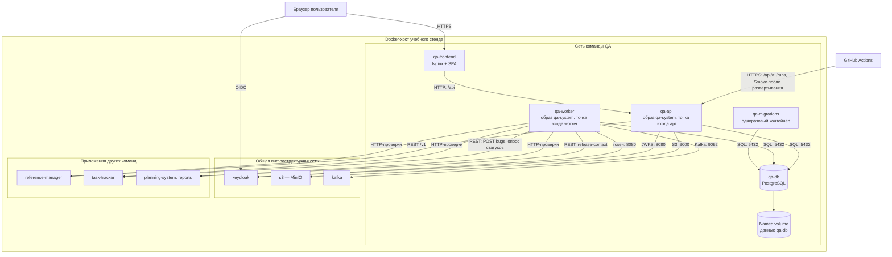
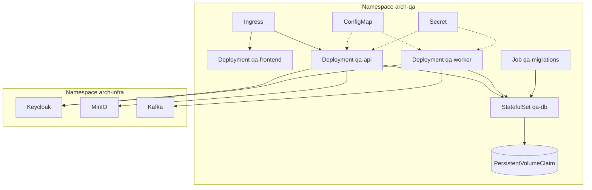

# 165 — Deployment Diagram

> Формат — см. [состав документов](documents-composition.md), документ 165.
> Компоненты — [150](150.component-diagram.md). Правила окружения — [vision Infra](../../infra/vision.md): основной способ запуска — Docker Compose, Kubernetes — упрощённое представление.

Диаграммы описывают целевое размещение. На 2026-10-12 общий `compose.yaml` пуст (`services: {}`), в общих workflow модуля QA нет, кода и контейнеров QA System нет; ресурсы описаны в [заявке Infra](infra-request.md) (Q-06). Что нужно сделать, чтобы схема стала реальностью, — раздел 7.

## 1. Docker Compose: локальное окружение и общий стенд

## 2. Узлы

| Узел | Вид | Образ | Что размещает | Проверка и порядок запуска |
| --- | --- | --- | --- | --- |
| `qa-frontend` | Контейнер | Собственный: Nginx со статикой SPA | SPA; проксирует `/api` на `qa-api` | Запускается после готовности `qa-api` |
| `qa-api` | Контейнер, без состояния | `qa-system`, выпуск по commit SHA | HTTP-слой и все сервисы модулей | `/livez`, `/readyz`; запускается после успешного `qa-migrations` |
| `qa-worker` | Контейнер, без состояния; число экземпляров ≥ 1 | Тот же `qa-system` с автотестами из `qa/autotests` | Executor, Autotest Runner, Outbox Relay, Task Tracker Client, Tracker Sync, Scheduler | Отметка активности в БД; запускается после успешного `qa-migrations` |
| `qa-migrations` | Одноразовый контейнер | Тот же `qa-system` | Миграции схемы | `service_completed_successfully`; запускается после готовности `qa-db` |
| `qa-db` | Контейнер с постоянным томом | `postgres` той же мажорной версии, что у Infra | База QA System: данные, очередь заданий, исходящие сообщения | `pg_isready`; порт на хост не публикуется на общем стенде |
| Named volume | Том Docker | — | Файлы `qa-db` | Обновление не выполняет `down -v` |
| `keycloak`, `s3`, `kafka` | Контейнеры Infra | По матрице версий Infra | Вход, бакет `arch-dev-qa`, топики QA | Поднимает и настраивает Infra |

При нескольких экземплярах `qa-worker` расписания и отправку сообщений выполняет один: остальные получают отказ при попытке взять блокировку в БД и продолжают исполнять задания.

## 3. Соответствие компонентов и узлов

| Компонент из [150](150.component-diagram.md) | Узел |
| --- | --- |
| SPA | `qa-frontend` |
| HTTP-слой и авторизация, Test Case Service, Plan and Suite Service, Attachment Service, Import / Export, Acceptance | `qa-api` |
| Run Service, Defect Service, Directory Service | `qa-api` и `qa-worker` |
| Executor, Autotest Runner, Outbox Relay, Task Tracker Client, Tracker Sync, Scheduler | `qa-worker` |
| Слой доступа к данным (миграции) | `qa-migrations` |
| PostgreSQL | `qa-db` |

## 4. Окружения

| Окружение | Где | Состав | Данные и доступы | Назначение |
| --- | --- | --- | --- | --- |
| dev (локальное) | Компьютер разработчика, `compose.yaml` + `compose.dev.yaml` | Все узлы QA; Keycloak и каркас Reference Manager; Task Tracker и Kafka — заглушки, пока соседи не готовы | Тестовые данные; секреты в локальном `.env`, не в репозитории; порты на `127.0.0.1` | Разработка, контрактные тесты, отладка автотестов |
| staging (общий стенд) | Docker-хост учебного стенда, развёртывание через GitHub Actions | Все узлы QA и реальные сервисы соседей и Infra | Секреты из хранилища GitHub Actions; TLS на входе; своя БД и бакет с префиксом окружения | Интеграционные и сквозные проверки; здесь же гоняются автотесты: «Smoke» после каждого развёртывания и в 06:00, «Приёмка стенда» перед вехой. Отдельного окружения для автотестов нет, пока не решён Q-07: автотесты создают данные с префиксом прогона и убирают их |
| production | В учебном объёме не разворачивается | Целевая схема — раздел 5 | — | Описано для полноты: показывает, как узлы переносятся в Kubernetes |

Конфигурация одинакова во всех окружениях и задаётся переменными: адреса Keycloak, Kafka, MinIO, Task Tracker и Reference Manager, имена бакета и топиков, секреты клиентов, флаг приёма изменений из Task Tracker, тайм-ауты. Адреса тестируемых подсистем хранятся не в конфигурации, а в сущности «Окружение».

## 5. Kubernetes: упрощённое представление

| Ресурс | Что размещается |
| --- | --- |
| `Namespace arch-qa` | Все ресурсы команды; в перечне Infra пространства имён для QA пока нет (Q-06) |
| `Deployment` | `qa-frontend`, `qa-api`, `qa-worker` — по одной реплике, readiness и liveness, requests и limits |
| `StatefulSet` + `PersistentVolumeClaim` | `qa-db`, одна реплика; удаление пода не удаляет данные |
| `Job` | Миграции перед обновлением `Deployment` |
| `ConfigMap` | Несекретные адреса, имена бакета и топиков, тайм-ауты |
| `Secret` | Пароль БД, секреты клиентов `qa-executor` и справочников, ключи S3, учётные данные Kafka; не коммитятся |
| `Service` | ClusterIP для `qa-api`, `qa-frontend`, `qa-db` |
| `NetworkPolicy` | Доступ к `qa-db` только из `qa-api`, `qa-worker`, `qa-migrations`; исходящие — в Keycloak, Kafka, MinIO и к сервисам подсистем |

## 6. Выпуск и откат

1. Pull request запускает проверки и сборку образов QA.
2. После слияния в `main` образ `qa-system` и образ интерфейса публикуются в GHCR с тегом commit SHA.
3. Развёртывание выполняет миграции, затем обновляет `qa-api` и `qa-worker` и ждёт `/readyz`.
4. После успешного развёртывания стенда CI запускает набор «Smoke» (I-10 в [160](160.integration-plan.md)).

Возврат к прошлому образу возможен только при совместимой схеме: миграции пишутся в два шага — сначала добавление, удаление старого — следующим выпуском. Автоматического отката БД нет.

## 7. Технический бэклог

Технические требования к модулю ещё не реализованы. Ниже — что должно появиться, где и к какой вехе; критерий выполнения проверяется на чистой машине.

| ID | Что | Где | Веха | Критерий выполнения |
| --- | --- | --- | --- | --- |
| TECH-01 | Контейнеризация: `Dockerfile` образа `qa-system` (точки входа `api`, `worker`, `migrate`) и образа интерфейса | `qa/backend`, `qa/frontend` | M4, И-M2 | `docker compose up` на чистой машине поднимает узлы раздела 2 (NFR-08) |
| TECH-02 | Включение в общий `compose.yaml` сервисами `qa-frontend`, `qa-api`, `qa-worker`, `qa-migrations`, `qa-db` и в `compose.dev.yaml` | Корень репозитория | M4, И-M2 | Сервисы QA есть в общем файле, зависят от `keycloak`, `s3`, `kafka` по проверкам готовности |
| TECH-03 | Свой workflow сборки и проверок: линтер, модульные и контрактные тесты, сканер секретов, сборка образов | `.github/workflows/qa-checks.yaml` | M4 | Pull request с изменением в `qa/` запускает workflow; падение теста или найденный секрет делает его красным |
| TECH-04 | Модульные тесты логики: версии кейсов, расчёт сводки и вердиктов, автосоздание дефекта и дедупликация, переходы статусов, применение маппинга; тесты API по OpenAPI | `qa/backend/tests` | M4 | 100 % переходов из [050](050.entities.md) покрыты (NFR-13) |
| TECH-05 | Манифесты кластера: `Namespace arch-qa`, `Deployment`, `StatefulSet`, `Job` миграций, `Service`, `Ingress` с маршрутами `/qa/` и `/qa/api/`, `NetworkPolicy`, `ConfigMap`, ссылки на `Secret` | `qa/deploy/k8s` | M5, И-M4 | Манифесты применяются в локальном кластере; `/qa/api/readyz` отвечает через Ingress |
| TECH-06 | Шаг «Smoke» в workflow развёртывания общего стенда | Общий workflow Infra | M5, И-M5 | После развёртывания шаг получает вердикт и красный при `RED` (Q-08) |
| TECH-07 | Демонстрационные данные чистой среды: 25 кейсов стартового набора, шаблоны, классификаторы и окружения, таблица маппинга, наборы «Smoke» и «Приёмка стенда», заполненный тест-план с привязкой к релизу | `qa/dev/demo-seed` | M4 | После первого запуска на чистой машине приёмку можно показать без ручного ввода |
| TECH-08 | Проверка безопасности по чек-листу и отчёт | [security-check.md](security-check.md) | M5 | Все пункты S-01…S-14 имеют результат, дату и версию образа |
| TECH-09 | Keycloak: защищённые эндпоинты, проверка ролей, служебные клиенты `qa-executor`, `qa-ci`, `qa-tracker-reader` | `qa/backend`, заявка Infra | M4, И-M2 | Матричный тест ролей проходит (T-NFR-06) |
| TECH-10 | Базовые элементы веб-приложения: CRUD и пагинация кейсов, планов, прогонов и дефектов | `qa/backend`, `qa/frontend` | M4 | Списки постраничны по правилам [130](130.api-contracts.md#2-общие-правила) |
