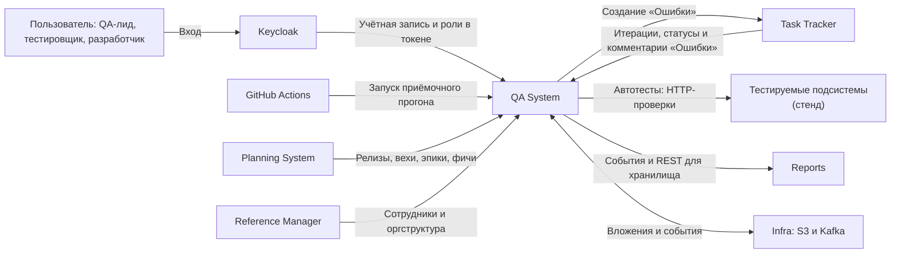
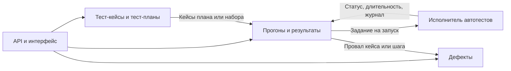
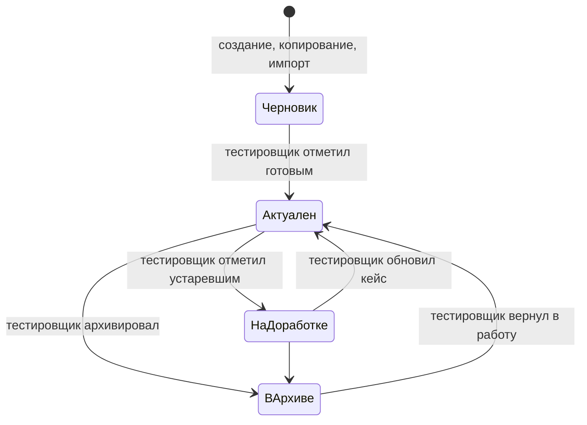
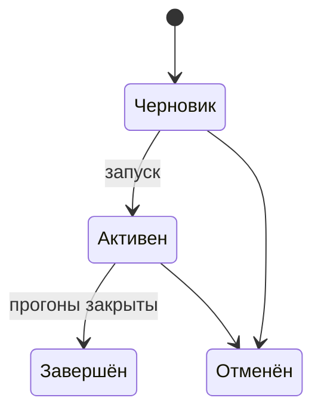
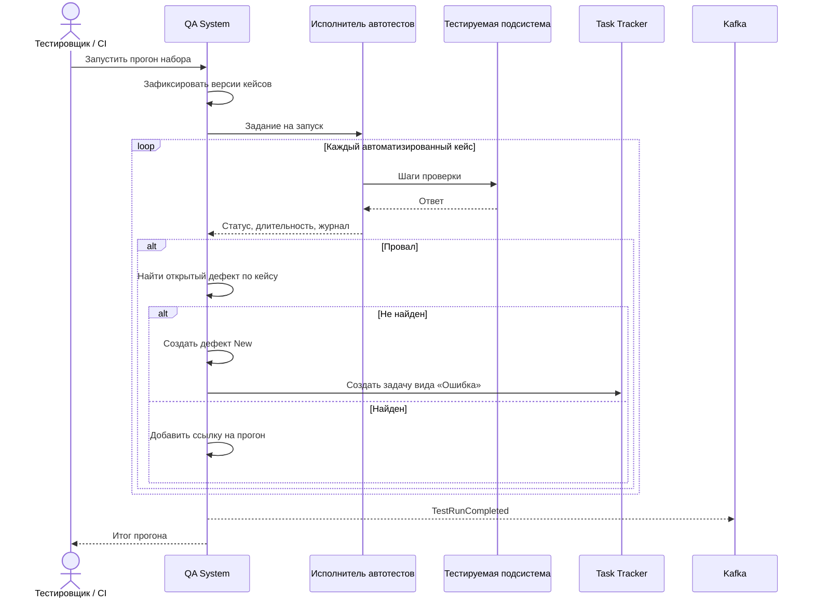
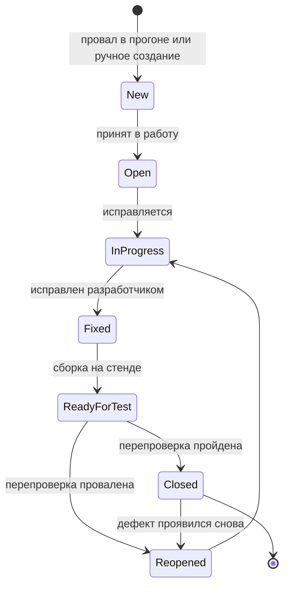

# QA System — система управления тестированием

| Поле | Значение |
| --- | --- |
| Проект | Трекер задач (arch-info-system-monorepo) |
| Подсистема | QA System — система управления тестированием |
| Команда | команда QA |
| Версия документа | 0.3 |
| Дата | 2026-10-12 |
| Статус | на согласование |

Единое имя подсистемы — **QA System — система управления тестированием**, коротко QA System. В документах соседей встречаются «сервис тестирования» (Task Tracker), «управление тестированием и качеством» (постановка, Reference Manager) и «система управления тестированием» (Reports): это одна и та же подсистема. Имя закреплено в [глоссарии](010.glossary.md#3-имя-подсистемы); просьба выровнять ссылки отправляется командам по [плану интеграций](160.integration-plan.md#5-открытые-вопросы-и-ответственные), вопрос Q-12.

**Изменения в версии 0.3** (по замечаниям от 01.10.2026 и 12.10.2026): определены релиз и источник данных о людях; фактический результат оформлен как осознанное отклонение от перечня полей; добавлена таблица маппинга статусов дефекта; описан приёмочный процесс стенда; добавлены измеримые нефункциональные требования; в стартовом наборе разделены «план» и «факт» автоматизации; описано участие в аналитическом контуре Reports; открытые вопросы перенесены в [план интеграций](160.integration-plan.md) с ответственными и критериями закрытия; убраны упоминания внешних продуктов заказчика.

## 1. Общее описание

### 1.1. Назначение

QA System хранит тест-кейсы, собирает их в тест-планы, проводит прогоны и заводит дефекты по упавшим проверкам. Автотесты запускаются из самой системы: пользователь нажимает «Запустить», исполнитель прогоняет привязанные к тест-кейсам автотесты против развёрнутых подсистем, результаты записываются в прогон, а на каждый провал открывается баг.

Тест-кейс здесь — постоянно проверяемый путь пользователя или сервиса. Часть кейсов гоняется на каждом выпуске (регрессия и smoke), часть — по плану к конкретной итерации или релизу. Поэтому кейс живёт дольше любого плана и прогона: его копируют, версионируют и архивируют, но не удаляют.

У системы две задачи. Первая — продукт для QA-команды в составе общего трекера, по требованиям заказчика. Вторая — реальная проверка соседних подсистем: мы пишем и прогоняем по пять тест-кейсов на каждую из них (раздел 7), и именно QA System показывает, работает ли собранный стенд. Тем самым QA System — приёмочный контур проекта: кто, когда и по какому правилу принимает стенд, описано в разделе 4.6.

### 1.2. Место в системе

Пользователь входит через [Keycloak](../../keycloak/README.md): учётная запись и роли берутся из токена. Профиль сотрудника и оргструктура, нужные для назначения тестировщиков, — из [Reference Manager](../../reference-manager/README.md), который с 2026-10-02 ведёт HR-профили. Релизы, вехи, эпики и фичи — из [Planning System](../../planning-system/README.md), итерации — из [Task Tracker](../../task-tracker/README.md). Классификаторы тестирования (серьёзность, типы кейсов, окружения) QA System ведёт сама. Дефекты публикуются в Task Tracker как задачи вида «Ошибка»: роль системы управления задачами-дефектами в проекте выполняет модуль учёта работ. Результаты тестирования забирает [Reports](../../reports/docs/vision.md): событиями — для оперативных отчётов, запросами REST раз в час — для аналитического хранилища (раздел 8.4). Вложения лежат в S3, события идут через Kafka, развёртывание обеспечивает [Infra](../../infra/vision.md).

На схеме QA System показана одним блоком: видно только, с кем она обменивается данными.

### 1.3. Состав подсистемы

Внутри QA System пять частей. API и интерфейс принимают запросы пользователей и CI. Тест-кейсы и планы описывают, что проверять. Прогоны хранят результаты и передают автоматизированные кейсы исполнителю. Исполнитель гоняет автотесты против стенда и возвращает результаты. Дефекты заводятся по провалам и синхронизируются с Task Tracker.

### 1.4. Границы подсистемы

Входит в состав:

- тест-кейсы, шаблоны, версии и история изменений, импорт и экспорт;
- тест-планы и их связь с итерациями и релизами;
- прогоны: ручное выполнение, запуск автотестов, повторный прогон упавших;
- дефекты с жизненным циклом и синхронизацией с Task Tracker;
- исполнитель автотестов и стартовый набор автотестов для подсистем проекта.

Не входит:

- ведение задач, итераций и проектов: они принадлежат Task Tracker и Planning System, QA System ссылается на них по идентификаторам;
- отчётность по качеству: показатели считает Reports по нашим данным, внутри QA System остаются только сводки плана и прогона;
- нагрузочное тестирование и тестирование интерфейса через браузер в первой версии;
- управление пользователями и ролями: это Keycloak.

### 1.5. Термины

Полный глоссарий с синонимами и терминами соседей — [010](010.glossary.md). Ниже — термины, без которых не читается этот документ.

| Термин | Определение |
| --- | --- |
| QA System | Единое имя подсистемы: «QA System — система управления тестированием». Синонимы в документах соседей — «сервис тестирования», «управление тестированием и качеством». |
| Тест-кейс | Описание проверки: предусловия, шаги, ожидаемый результат. Может быть ручным или иметь привязанный автотест. |
| Шаг | Отдельное действие тест-кейса со своим ожидаемым результатом. Провал фиксируется с точностью до шага. |
| Шаблон | Заготовка тест-кейса с предзаполненными полями и шагами, например «Проверка CRUD справочника». |
| Автотест | Исполняемый сценарий в репозитории, связанный с тест-кейсом по ключу. Его запускает исполнитель. |
| Набор | Сохранённая выборка тест-кейсов по фильтру или вручную, например «Smoke Reference Manager». |
| Тест-план | Перечень тест-кейсов, которые нужно пройти к итерации, релизу, проекту или модулю, с ответственным и сроками. |
| Прогон | Одно выполнение тест-плана или набора. Хранит результат каждого кейса на момент запуска. |
| Результат | Статус тест-кейса в прогоне: «Пройден», «Провален», «Заблокирован», «Не выполнен», «Пропущен». |
| Дефект (баг) | Зафиксированное расхождение фактического результата с ожидаемым. Связан с кейсом, шагом и прогоном. |
| Серьёзность | Влияние дефекта на систему (Blocker, Critical, Major, Minor, Trivial). Отличается от приоритета — очерёдности исправления. Серьёзность ведёт QA System, приоритет исправления «Ошибки» — Task Tracker (раздел 5.4). |
| Окружение | Именованный стенд с адресами тестируемых подсистем, на котором выполняется прогон, например `dev` или `staging`. Ведёт администратор QA System. |
| Версия сборки | То, что именно проверялось: версии образов тестируемых подсистем и commit SHA автотестов. Фиксируется в прогоне и переносится в дефект. |
| Релиз | Контейнер релизных рамок проекта в Planning System: элемент плана типа `RELEASE` с устойчивым идентификатором (`logicalItemId`), названием, датами и дочерними вехами, эпиками и фичами. Живёт в утверждённой версии плана; QA System ссылается на него по паре «проект + `logicalItemId`» и читает через `release-context` Planning System. |
| Итерация | Отрезок работы команды в Task Tracker с датами и составом задач. Не равна релизу: один релиз обычно покрывает несколько итераций. |
| Веха | Контрольная точка проекта в Planning System с датой; может входить в релиз. Не имеет состава задач. |
| Сводка прогона | Счётчики результатов прогона по статусам, длительность, список упавших кейсов и связанных дефектов. Сводка плана — последний результат каждого кейса плана по всем его прогонам. |
| Метрика качества | Показатель, который считает Reports по данным QA System: **pass rate** — доля «Пройден» среди выполненных кейсов прогона или плана; **reopened rate** — доля дефектов, хотя бы раз перешедших в «Reopened», среди закрытых за период; **defect density** — число дефектов на единицу объёма проверяемой подсистемы (база объёма согласуется с Reports). Внутри QA System считаются только сводки. |
| Приёмка стенда | Прогон набора «Приёмка стенда» из 25 кейсов раздела 7 с вердиктом «принят» или «не принят» по правилам раздела 4.6. |

## 2. Ключевые возможности

- **Тест-кейс как постоянный актив.** Кейс копируется, версионируется и архивируется; прогон ссылается на конкретную версию, поэтому старые результаты не «переписываются» после правки кейса.
- **Одна кнопка для автотестов.** Прогон набора запускается из интерфейса, по расписанию или из GitHub Actions после развёртывания. Ручные и автоматические кейсы живут в одном плане.
- **Баг без ручного переноса.** Тестировщику не нужно переписывать упавший кейс в баг. Когда шаг или кейс проваливается, система сама заводит дефект. Шаги воспроизведения — это шаги кейса до упавшего включительно. Ожидаемый результат берётся из шага, фактический — из ответа системы или записи тестировщика. Серьёзность и приоритет наследуются от кейса. К дефекту прикладываются окружение, версия сборки, журнал и ссылка на прогон. Сразу после этого в Task Tracker появляется задача вида «Ошибка». Как заполняется каждое поле, описано в разделе 4.4.
- **Сквозная связь.** Из дефекта видно кейс, прогон, итерацию и задачу в Task Tracker; из итерации — какой план её проверял и что в нём упало.
- **Повторный прогон упавших.** После исправления из прогона создаётся новый только по провалившимся и заблокированным кейсам.

## 3. Пользователи

| Роль | Что делает в подсистеме |
| --- | --- |
| QA-лид | Ведёт тест-планы, назначает тестировщиков и сроки, смотрит итог прогона и решает, готова ли итерация |
| Тестировщик | Пишет тест-кейсы, выполняет ручные кейсы, запускает автотесты, заводит и перепроверяет дефекты |
| Автоматизатор | Пишет автотесты и связывает их с тест-кейсами |
| Разработчик | Получает дефекты через Task Tracker, переводит их в работу и в «Fixed» |
| Руководитель проекта | Смотрит состояние тестирования по итерации или релизу и итог приёмки стенда |
| Сервис пайплайна | Запускает набор «Smoke» после развёртывания стенда и получает вердикт (раздел 4.6) |
| Исполнитель автотестов | Системный актор: берёт задания из очереди, гоняет автотесты против стенда под служебной учётной записью, записывает результаты |
| Администратор | Ведёт шаблоны, справочники значений (серьёзность, типы кейсов, окружения), таблицу маппинга статусов и расписания; роли выдаются в Keycloak |

## 4. Основные процессы

### 4.1. Работа с тест-кейсами

Тестировщик создаёт кейс с нуля, из шаблона или копированием существующего. Копия получает новый ID, статус «Черновик» и ссылку на исходный кейс. Кейс группируется по модулю, фиче, эпику и требованию; эпики и фичи берутся из Planning System. Каждое сохранение создаёт новую версию, история показывает, кто и что поменял. Кейс, который больше не нужен, архивируется: в новые планы он не попадает, но остаётся в старых прогонах.

Статус кейса меняет сам тестировщик. Система не проводит ревью и не согласует изменения: что править и когда кейс готов к использованию, решает тестировщик.

Поля тест-кейса: ID, название, описание, предусловия, шаги с ожидаемым результатом каждого, приоритет, серьёзность, тип (функциональный, регрессионный, smoke, интеграционный, негативный), статус (черновик, актуален, на доработке, в архиве), признак автоматизации и ключ автотеста, автор, дата изменения, вложения.

**Отклонение от перечня полей постановки: фактический результат.** Постановка перечисляет фактический результат среди полей тест-кейса. В QA System он хранится не в карточке кейса, а в результате прогона — у кейса в целом и у каждого шага. Причина: фактический результат зависит от прогона, окружения и версии сборки; если хранить его в кейсе, каждый следующий прогон перезаписывал бы историю, а дефект ссылался бы на значение, которого уже нет. Пользователь видит фактический результат в двух местах:

- в карточке кейса — блок «Последний результат» только для чтения: статус, фактический результат и упавший шаг из последнего прогона, в котором кейс получил результат, время выполнения, окружение и ссылка на прогон;
- в истории результатов кейса — все прогоны с их фактическими результатами.

Решение оформлено в [ADR-014](145.architecture-decisions.md) и требованием FR-TC-10.

### 4.2. Тест-план

Тест-план отвечает на вопрос «что проверяем к этой итерации или релизу». QA-лид добавляет в план кейсы вручную или фильтром (например, все smoke-кейсы Reference Manager), назначает ответственного и сроки. План привязывается к релизу Planning System, к итерации Task Tracker и (или) к вехе Planning System.

Релиз, итерация и веха — разные вещи, и у каждой свой владелец:

| Понятие | Где живёт | Как QA System на него ссылается | Чем отличается |
| --- | --- | --- | --- |
| Релиз | Planning System, элемент плана типа `RELEASE` в утверждённой версии плана | `planning_project_id` + `planning_release_id` (`logicalItemId`, не меняется между версиями плана) + `planning_plan_version_id` — версия, на которой сделана привязка | Рамки выпуска: даты, вехи, эпики и фичи; не содержит задач |
| Итерация | Task Tracker | `tracker_iteration_id` | Отрезок работы с задачами; один релиз покрывает несколько итераций |
| Веха | Planning System, элемент плана типа `MILESTONE` | `planning_milestone_id` | Контрольная дата; может входить в релиз |

Список релизов, вех и связанных с релизом итераций QA System читает запросом `GET /api/v1/projects/{projectId}/release-context` Planning System. Читается только утверждённая версия плана, черновик — никогда. Новая версия плана в Planning System не меняет уже сделанную привязку: релиз находится по `logicalItemId`. Определение релиза и контракт предложены Planning System (их [050, раздел 6](../../planning-system/docs/050.entities.md#6-уточнения-для-qa-и-физическая-модель) и [162, INT-07](../../planning-system/docs/162.integration-spec.md#int-07--qa-system)); команда QA его принимает, вопрос Q-10 закрыт.

Ответственный за план и тестировщики выбираются из сотрудников Reference Manager, у которых есть учётная запись Keycloak (связь — `account_user_id` профиля равен `sub` токена). Права на действия проверяются по ролям в токене, а не по профилю.

### 4.3. Прогон и автоматический запуск

Прогон создаётся из плана или набора и замораживает версии кейсов на момент создания. Ручные кейсы распределяются между тестировщиками. Для автоматизированных исполнитель ставит задание в очередь, запускает автотесты против выбранного окружения и записывает по каждому кейсу статус, длительность, журнал и вложения. Тестировщик может массово сменить статус группы кейсов, например отметить «Заблокирован» всё, что зависит от недоступного Keycloak.

При провале система создаёт дефект. Если по этому же кейсу уже есть открытый дефект, новый не создаётся: к существующему добавляется ссылка на прогон и комментарий. Иначе после первого же красного прогона стенда в Task Tracker появится двадцать одинаковых багов.

После исправлений из прогона создаётся повторный, в который попадают только кейсы со статусами «Провален» и «Заблокирован». Исходный прогон не меняется.

### 4.4. Жизненный цикл дефекта

Дефект создаётся автоматически из прогона или вручную из кейса, шага или прогона. Поля: ID, заголовок, описание, шаги воспроизведения, ожидаемый и фактический результат, серьёзность, приоритет, статус, окружение, версия сборки, автор, исполнитель, связи с кейсом, прогоном, требованием, задачей и эпиком.

При автоматическом создании поля заполняются так:

| Поле дефекта | Откуда берётся |
| --- | --- |
| Заголовок | ID и название кейса, номер упавшего шага: «[TC-RM-03] Шаг 3: создание записи с занятым кодом» |
| Шаги воспроизведения | Предусловия и шаги кейса до упавшего включительно, в той версии, что зафиксирована в прогоне |
| Ожидаемый результат | Ожидаемый результат упавшего шага |
| Фактический результат | У автотеста — сообщение проверки и фрагмент ответа (код, тело); у ручного кейса — то, что записал тестировщик |
| Серьёзность | Наследуется от кейса; тестировщик может изменить её после создания |
| Приоритет | Предлагается из приоритета кейса и уходит в описание «Ошибки»; после создания «Ошибки» приоритет исправления ведёт Task Tracker, QA System показывает его только для чтения |
| Окружение и версия | Окружение прогона, commit SHA автотестов и версия тестируемой подсистемы |
| Вложения | Журнал автотеста и файлы, приложенные к результату |
| Связи | Кейс, шаг, прогон, план; через план — итерация или веха; эпик и требование — из группировки кейса |
| Автор | Тестировщик, запустивший прогон, или служебная учётная запись CI |
| Исполнитель | Не назначается: исполнителя выбирают в Task Tracker |
| Статус | «New» |

Если по кейсу уже есть незакрытый дефект, новый не создаётся: в существующий добавляются ссылка на прогон и комментарий с фактическим результатом.

Статусы делятся между системами по тому, кто ими управляет: статусы разработки ставит разработчик в Task Tracker, статусы тестирования — тестировщик в QA System. Набор статусов задачи в Task Tracker настраивается его администратором ([050 Task Tracker](../../task-tracker/docs/block-b-domain-analysis/050.entities.md)), поэтому соответствие хранится в QA System таблицей, которую ведёт администратор. Значения по умолчанию:

| Статус в QA System | Статус «Ошибки» в Task Tracker | Кто меняет | Как изменение попадает в другую систему |
| --- | --- | --- | --- |
| `NEW` | — (задачи ещё нет), затем «Бэклог» | QA System при провале; тестировщик при ручном создании | QA System создаёт «Ошибку» запросом `POST /api/v1/bugs`; Task Tracker ставит начальный статус |
| `OPEN` | «Бэклог» с назначенным исполнителем | Разработчик или тимлид в Task Tracker | QA System читает задачу опросом REST раз в 60 секунд и переводит дефект |
| `IN_PROGRESS` | «В работе» | Разработчик в Task Tracker | То же |
| `FIXED` | «На проверке» | Разработчик в Task Tracker | То же |
| `READY_FOR_TEST` | «На проверке» (не меняется) | Тестировщик или QA-лид в QA System, когда исправление развёрнуто на стенде | В Task Tracker не передаётся: такого статуса у него нет; виден в QA System и в событиях для Reports |
| `CLOSED` | «Завершена» | Тестировщик в QA System или система по пройденной перепроверке; в Task Tracker карточку закрывает разработчик или тимлид | Task Tracker не принимает смену статуса от внешней системы: QA System показывает расхождение «закрыт в QA, открыт в трекере», тимлид закрывает карточку вручную |
| `REOPENED` | «В работе» | Тестировщик или система по проваленной перепроверке; в Task Tracker — разработчик | То же: расхождение видно в QA System и в списке «требует действия в трекере» |

«Архивирована» в Task Tracker (отмена без исправления) не меняет статус дефекта автоматически: QA-лид видит отметку и решает, закрыть дефект или открыть новую «Ошибку». Комментарии разработчиков QA System читает тем же опросом; свои комментарии QA System в Task Tracker не пишет, пока у него нет такого API. Ограничения и путь к двустороннему обмену — вопрос Q-01 в [плане интеграций](160.integration-plan.md#5-открытые-вопросы-и-ответственные).

### 4.5. Справочники значений и их владельцы

Серьёзность, приоритеты и статусы встречаются в трёх подсистемах. Чтобы одно значение не жило в трёх местах с разным смыслом, владельцы разделены так (решение Reference Manager от 2026-10-02 — его [020](../../reference-manager/documents/020.system-context.md) и [160](../../reference-manager/documents/160.integration-plan.md); Reports — его Q-REP-07):

| Справочник | Владелец | Значения | Как получают остальные |
| --- | --- | --- | --- |
| Серьёзность дефекта | QA System | Blocker, Critical, Major, Minor, Trivial | Reports — в событиях QA System; Task Tracker — преобразованием в свою шкалу при создании «Ошибки» (раздел 8.2) |
| Статусы дефекта (тестирования) | QA System | `NEW`…`REOPENED`, раздел 4.4 | Reports — в событиях QA System |
| Статусы задачи, в том числе «Ошибки» | Task Tracker | Настраиваются его администратором | QA System — опросом REST, через таблицу маппинга |
| Приоритет исправления «Ошибки» | Task Tracker | Его шкала | QA System — только для чтения |
| Приоритет тест-кейса, типы кейсов, окружения | QA System | Ведёт администратор QA System | Reports — в событиях |

Reference Manager ни один из этих справочников не ведёт. Новые значения серьёзности или статусов дефекта добавляются только согласованно с Reports, потому что от них зависят отчёты R-05, R-07, R-08 и R-09.

### 4.6. Приёмка стенда

Стартовый набор из 25 кейсов (раздел 7) — приёмочный контур проекта: по нему видно, работает ли собранный стенд. Для этого в QA System два набора:

- **«Smoke»** — набор по фильтру: кейсы стартового набора, у которых автотест реализован (раздел 7, колонка «Факт»). Только автоматические проверки.
- **«Приёмка стенда»** — все 25 кейсов: автоматические и ручные.

| Кто и когда | Что запускается | Чем заканчивается |
| --- | --- | --- |
| Пайплайн развёртывания общего стенда — после каждого успешного развёртывания | «Smoke» на окружении `staging`, ключ идемпотентности — commit SHA развёртывания | Вердикт пайплайну; шаг пайплайна красный при любом «Провален» |
| Расписание — ежедневно в 06:00 | «Smoke» на `staging` | Видно, что стенд «сломался» между развёртываниями |
| QA-лид — перед каждой демонстрацией вехи и по запросу руководителя проекта | «Приёмка стенда»: автоматические кейсы исполнитель, ручные — назначенные тестировщики | Решение о приёмке стенда |
| Тестировщик — вручную | Любой из наборов на любом окружении | Отладка и перепроверка |

**Что считается приёмкой.** Стенд принят, если в прогоне «Приёмка стенда»: прогон завершён; каждый кейс, для которого проверка реализована, получил результат «Пройден»; нет незакрытых дефектов серьёзности Blocker и Critical по кейсам набора. Кейсы, проверка которых ещё невозможна (нет API подсистемы), получают «Пропущен» с причиной и перечисляются в сводке как «не проверено» — они не засчитываются ни как пройденные, ни как провал. Вердикт ставит QA-лид в сводке прогона; доля непроверенных кейсов видна рядом с вердиктом.

**Красный прогон.** Провал кейса заводит дефект, а через него — «Ошибку» в Task Tracker у команды-владельца подсистемы. Для обычного развёртывания красный «Smoke» не откатывает стенд автоматически: шаг пайплайна становится красным, в его итоге — ссылка на прогон и дефекты, решение об откате принимают Infra и команда-владелец. Для выпуска стенда к демонстрации вехи красный прогон «Приёмки стенда» — блокирующий: стенд не считается принятым, демонстрация проводится только после повторного прогона упавших кейсов.

**Где смотреть результат.** Экран «Состояние тестирования» и сводка прогона в QA System; ссылка на прогон в итоге шага пайплайна; отчёты Reports по событиям QA System.

## 5. Функциональные требования

### 5.1. Тест-кейсы

- **FR-TC-01.** Система должна поддерживать создание, просмотр, изменение, копирование и архивирование тест-кейсов. Физическое удаление кейса, участвовавшего в прогоне, не допускается.
- **FR-TC-02.** Тест-кейс должен содержать поля из раздела 4.1; название и хотя бы один шаг с ожидаемым результатом обязательны для перевода в статус «Актуален».
- **FR-TC-03.** Копия кейса должна получать новый ID, статус «Черновик» и ссылку на исходный кейс; поддерживается массовое копирование.
- **FR-TC-04.** Каждое сохранение кейса должно создавать новую версию; история должна показывать автора, время и изменённые поля.
- **FR-TC-05.** К кейсу и к отдельному шагу должны прикрепляться файлы: скриншоты, журналы, документы.
- **FR-TC-06.** Администратор должен иметь возможность вести шаблоны тест-кейсов; пользователь — создавать кейс из шаблона.
- **FR-TC-07.** Кейсы должны группироваться по модулю, фиче, эпику и требованию и фильтроваться по любому из полей.
- **FR-TC-08.** Система должна импортировать и экспортировать кейсы в `.csv` и `.xlsx`; неизменённый экспорт импортируется обратно без потери данных, импорт проверяет файл до записи и выдаёт отчёт.
- **FR-TC-09.** Автоматизированный кейс должен ссылаться на автотест по ключу; система должна показывать кейсы, у которых ключ не найден среди автотестов.
- **FR-TC-10.** Карточка кейса должна показывать последний фактический результат только для чтения — статус, фактический результат, упавший шаг, время, окружение и ссылку на прогон; в самом кейсе фактический результат не хранится (раздел 4.1).

### 5.2. Тест-планы и наборы

- **FR-TP-01.** Тест-план создаётся на релиз, итерацию, проект или модуль.
- **FR-TP-02.** Кейсы добавляются в план вручную или по фильтру; фильтр можно сохранить как набор.
- **FR-TP-03.** План назначается на ответственного и команду, имеет даты начала и окончания.
- **FR-TP-04.** Статусы плана: черновик, активен, завершён, отменён.
- **FR-TP-05.** План связывается с релизом и (или) вехой Planning System и с итерацией Task Tracker по их идентификаторам; релиз — по паре «проект + `logicalItemId`» (раздел 4.2).
- **FR-TP-06.** Выбор релиза и вехи предлагается из утверждённой версии плана Planning System; новая версия плана не меняет сделанную привязку, черновик плана для выбора недоступен.

### 5.3. Прогоны

- **FR-RUN-01.** Прогон создаётся на основе тест-плана или набора и фиксирует версии кейсов на момент создания.
- **FR-RUN-02.** На прогон и на отдельные кейсы прогона назначаются тестировщики. Кандидаты — активные сотрудники Reference Manager с привязанной учётной записью Keycloak; права исполнителя проверяются по ролям токена.
- **FR-RUN-03.** Результат кейса: «Пройден», «Провален», «Заблокирован», «Не выполнен», «Пропущен»; результат можно указать для каждого шага.
- **FR-RUN-04.** К результату добавляются комментарий, фактический результат и вложения.
- **FR-RUN-05.** Система должна поддерживать массовое изменение статусов выбранных кейсов прогона.
- **FR-RUN-06.** Система должна фиксировать время начала, окончания и длительность выполнения каждого кейса и прогона.
- **FR-RUN-07.** Из прогона создаётся повторный прогон по провалившимся и заблокированным кейсам.
- **FR-RUN-08.** Автоматизированные кейсы запускаются кнопкой из интерфейса, по расписанию и вызовом API из CI; выбирается целевое окружение.
- **FR-RUN-09.** Исполнитель должен записывать журнал выполнения автотеста и прикладывать его к результату; превышение тайм-аута фиксируется как «Провален» с указанием причины.
- **FR-RUN-10.** Один и тот же набор не должен запускаться повторно на том же окружении, пока предыдущий запуск не завершён.
- **FR-RUN-11.** Приёмка стенда выполняется по разделу 4.6: набор «Smoke» запускается пайплайном после развёртывания и по расписанию, набор «Приёмка стенда» — QA-лидом; сводка прогона показывает вердикт и число непроверенных кейсов.

### 5.4. Дефекты

- **FR-DEF-01.** Дефект создаётся вручную из тест-кейса, шага или прогона.
- **FR-DEF-02.** При провале шага или кейса система создаёт дефект автоматически, заполняя шаги воспроизведения, ожидаемый и фактический результат, окружение и версию из прогона.
- **FR-DEF-03.** Если по кейсу уже есть незакрытый дефект, новый не создаётся; к существующему добавляется ссылка на прогон.
- **FR-DEF-04.** Дефект связывается с тест-кейсом, прогоном, требованием, задачей и эпиком.
- **FR-DEF-05.** Жизненный цикл дефекта соответствует разделу 4.4; недопустимые переходы отклоняются.
- **FR-DEF-06.** Дефект создаётся в Task Tracker как задача вида «Ошибка»; изменения статуса и комментарии синхронизируются в обе стороны. В первой версии из Task Tracker в QA System — опросом REST, из QA System в Task Tracker — только создание «Ошибки», остальное — по мере появления API Task Tracker (вопрос Q-01).
- **FR-DEF-09.** Соответствие статусов дефекта статусам «Ошибки» задаётся таблицей маппинга из раздела 4.4, которую ведёт администратор; расхождение статусов в двух системах показывается в дефекте и в списке «требует действия в трекере».
- **FR-DEF-07.** История изменений дефекта хранит автора, время, поле, старое и новое значение, включая изменения, пришедшие из Task Tracker.
- **FR-DEF-08.** Дефекты ищутся и фильтруются по проекту, итерации, тестировщику, статусу и серьёзности.

### 5.5. Доступ и данные

- **FR-SEC-01.** Все обращения выполняются с действительным токеном Keycloak; права проверяются на сервере.
- **FR-SEC-02.** Исполнитель автотестов обращается к тестируемым подсистемам под отдельной служебной учётной записью с минимальными правами.
- **FR-DAT-01.** QA System хранит данные в собственной БД и не обращается к базам других подсистем.
- **FR-DAT-02.** Идентификаторы итераций, проектов, релизов, вех, эпиков, задач и сотрудников хранятся как внешние ссылки; их владельцы — Task Tracker, Planning System и Reference Manager.
- **FR-DAT-03.** Тест-кейсы, тест-планы, прогоны, результаты и дефекты отдаются аналитическому контуру Reports запросами REST `/api/v1/reports/*` с отбором по времени изменения (раздел 8.4); метрики качества считает Reports.

## 6. Нефункциональные требования

Каждое требование имеет метрику и порог. Колонка «Основание» говорит, откуда число: **расчёт** — следует из устройства системы или решения Infra и проверяется тестом; **предложение** — ориентир команды QA, который подтверждается замером на стенде к указанной дате. Подробности, способы проверки и связь с решениями — в [075](075.nfr.md).

| ID | Характеристика | Метрика и порог | Основание |
| --- | --- | --- | --- |
| NFR-01 | Скорость прогона | Автоматическая часть стартового набора (раздел 7) проходит на стенде не дольше 5 минут | Предложение; замер до И-M3 (2026-11-16) |
| NFR-02 | Изоляция | 0 кейсов, упавших из-за соседнего автотеста: набор проходит одинаково в прямом, обратном и случайном порядке; все данные автотестов имеют префикс прогона | Расчёт |
| NFR-03 | Устойчивость | Недоступность тестируемой подсистемы даёт «Провален» или «Заблокирован» с причиной не позже тайм-аута задания (10 минут); 0 прогонов в статусе «Выполняется» дольше тайм-аута плюс 1 минута | Расчёт |
| NFR-04 | Идемпотентность | Повторное получение одного и того же изменения из Task Tracker (опросом или событием) даёт 0 повторных записей в истории дефекта | Расчёт |
| NFR-05 | Неизменность истории | 100 % попыток изменить результат завершённого прогона, версию кейса или запись истории отклоняются | Расчёт |
| NFR-06 | Безопасность | 0 секретов в репозитории (сканер в пайплайне) и в выборке журналов автотестов; 100 % защищённых операций отклоняют запрос без права; проверка по чек-листу XSS, CSRF, инъекций — [отчёт](security-check.md) | Расчёт |
| NFR-07 | Воспроизводимость | 100 % автоматических прогонов хранят commit SHA автотестов и версии образов подсистем | Расчёт |
| NFR-08 | Развёртывание | `docker compose up` на чистой машине поднимает API, исполнитель и БД не дольше 3 минут после загрузки образов; `/readyz` отвечает 503 при недоступной БД | Предложение; замер до И-M2 (2026-11-02) |
| NFR-09 | Время отклика | 95 % запросов списков кейсов, планов, прогонов и дефектов (страница 50 строк) — не дольше 500 мс; карточка кейса — 500 мс; запись результата — 300 мс; на объёме NFR-10 | Предложение; замер до И-M3 (2026-11-16) |
| NFR-10 | Объём данных | 5 000 кейсов, 50 000 версий, 300 планов, 2 000 прогонов, 200 000 результатов, 2 000 дефектов, 20 000 вложений, 50 пользователей | Предложение: десятикратный запас к стартовому объёму; генератор данных до И-M3 |
| NFR-11 | Независимость от соседей | При недоступных Task Tracker, Kafka и Reference Manager запись результата и создание дефекта успешны; после восстановления отложенные сообщения доставляются, потерь 0 | Расчёт |
| NFR-12 | Наблюдаемость | 100 % ответов несут идентификатор запроса; число и возраст неотправленных сообщений видны администратору | Расчёт |
| NFR-13 | Сопровождаемость | Расхождение реализации с OpenAPI ломает сборку; 100 % переходов статусов покрыты модульными тестами | Расчёт |
| NFR-14 | Совместимость файлов | Неизменённый экспорт импортируется с результатом «0 создано, 0 обновлено»; файл открывается в Excel и LibreOffice | Расчёт |
| NFR-15 | Параллельные прогоны | До 10 одновременно выполняющихся прогонов, из них до 2 автоматических заданий на один экземпляр исполнителя; один набор на одном окружении — не больше одного (FR-RUN-10) | Предложение; замер до И-M3 (2026-11-16) |
| NFR-16 | Доступность | Не ниже доступности общего стенда: 95 % успешных проверок `/readyz` раз в минуту за рабочую неделю; после перезапуска хоста готовность не дольше 2 минут. Стенд — один узел, Infra SLA не заявляет | Предложение; измерение с И-M3 (2026-11-16) |
| NFR-17 | Восстановление (RPO, RTO) | RPO ≤ 24 часов: ежедневная резервная копия БД; RTO ≤ 4 часов: восстановление БД из копии и развёртывание образа по commit SHA | Предложение; зависит от регламента копирования Infra; учебное восстановление до И-M4 (2026-11-30) |
| NFR-18 | Сроки хранения | Журналы автотестов — 90 суток после завершения прогона; журнал результата со связанным незакрытым дефектом — до закрытия дефекта плюс 90 суток; вложения кейсов, результатов и дефектов — пока существует владелец; логически удалённые вложения физически удаляются через 30 суток; незавершённые загрузки — через 1 сутки | Предложение; квота бакета 20 ГБ в [заявке Infra](infra-request.md) |
| NFR-19 | Лимиты вложений | Файл — не больше 10 МиБ, журнал автотеста — не больше 5 МиБ (длиннее — обрезается с отметкой); не больше 20 файлов на объект; разрешены PNG, JPEG, GIF, WebP, PDF, TXT и LOG, JSON, XML, CSV, XLSX; SVG, HTML и исполняемые файлы запрещены; тип проверяется по содержимому, а не по расширению | Расчёт |

## 7. Стартовый набор тест-кейсов

По заданию команда QA пишет по пять тест-кейсов на каждую из пяти подсистем: 25 кейсов, проверено подсчётом строк таблиц 7.1–7.5. Кейсы собраны из требований и vision соседних команд; перед автоматизацией их формулировки сверяются с опубликованными API.

План и факт разделены:

- **План** — каким способом кейс должен проверяться: «Авто» — автотестом, «Ручной» — тестировщиком, «межсистемный» — проверяет обмен двух подсистем.
- **API на 12.10.2026** — есть ли в `main` то, что нужно проверять. Сведения взяты из кода и спецификаций соседей.
- **Автотест (факт)** — написан ли автотест. На 12.10.2026 у QA System нет ни одного написанного автотеста: каталог `qa/autotests` ещё не создан. Кейс считается автоматизированным только после того, как автотест написан и прошёл на стенде.

| Подсистема | Кейсов | План «Авто» | План «Ручной» | API есть | Автотест написан |
| --- | --- | --- | --- | --- | --- |
| Reference Manager | 5 | 5 | 0 | 4 | 0 |
| Task Tracker | 5 | 4 | 1 | 5 | 0 |
| Planning System | 5 | 5 | 0 | 0 | 0 |
| Reports | 5 | 5 | 0 | 0 | 0 |
| Infra | 5 | 4 | 1 | 0 | 0 |
| **Итого** | **25** | **23** | **2** | **9** | **0** |

### 7.1. Reference Manager

| ID | Проверка | Ожидаемый результат | План | API на 12.10.2026 | Автотест (факт) |
| --- | --- | --- | --- | --- | --- |
| TC-RM-01 | Запрос `/v1/health/livez` и `/v1/health/readyz` к запущенному сервису с доступной БД | Оба отвечают успехом; при остановленной БД `/readyz` сообщает о неготовности | Авто | Есть | Не написан |
| TC-RM-02 | Создать запись справочника и прочитать её по имени | Запись в состоянии ACTIVE, первая ревизия, поля совпадают с отправленными | Авто | Есть (валюты) | Не написан |
| TC-RM-03 | Удалить запись, прочитать список и запись по имени, создать новую с тем же идентификатором | Запись в DELETED, в списке по умолчанию отсутствует, по имени доступна; создание с тем же идентификатором отклонено | Авто | Есть (валюты) | Не написан |
| TC-RM-04 | Вернуть удалённую запись в работу | Запись снова ACTIVE, ревизия увеличена | Авто | Нет: операции восстановления в спецификации пока нет | Не написан |
| TC-RM-05 | Запрос без токена; выгрузка списка в `.xlsx` | Без токена — отказ в доступе; с токеном — файл с заголовками и строками по фильтру | Авто | Есть (валюты) | Не написан |

### 7.2. Task Tracker

| ID | Проверка | Ожидаемый результат | План | API на 12.10.2026 | Автотест (факт) |
| --- | --- | --- | --- | --- | --- |
| TC-TT-01 | Создать задачу без наименования, затем со сроком раньше даты начала | Оба запроса отклонены с указанием поля | Авто | Есть | Не написан |
| TC-TT-02 | Переместить задачу в другую колонку канбан-доски и открыть карточку | Новый статус сохранён и совпадает с колонкой | Ручной | Есть интерфейс | Не требуется |
| TC-TT-03 | Задать план 10 ч, зарегистрировать 4 ч и 8 ч | Факт 12 ч, остаток −2 ч отображается как перерасход | Авто | Есть | Не написан |
| TC-TT-04 | Включить задачу во вторую незавершённую итерацию | Операция отклонена | Авто | Есть | Не написан |
| TC-TT-05 | Экспортировать задачи в `.xlsx` и импортировать файл без изменений | Импорт без ошибок, 0 созданных, данные задач не изменились | Авто | Есть | Не написан |

### 7.3. Planning System

| ID | Проверка | Ожидаемый результат | План | API на 12.10.2026 | Автотест (факт) |
| --- | --- | --- | --- | --- | --- |
| TC-PS-01 | Создать проект и декомпозировать его на этап, веху, эпик и фичу | Структура сохранена и отображается в иерархии | Авто | Нет: только спецификация | Не написан |
| TC-PS-02 | Назначить сотрудника на объём сверх его доступности в календаре | Система показывает конфликт загрузки | Авто | Нет | Не написан |
| TC-PS-03 | Создать сценарий «что если» и изменить в нём сроки | Утверждённая базовая линия не изменилась | Авто | Нет | Не написан |
| TC-PS-04 | Утвердить базовую линию | Проект с внешним идентификатором появляется в Task Tracker | Авто, межсистемный | Нет | Не написан |
| TC-PS-05 | Зарегистрировать время по задаче проекта в Task Tracker | Planning System обновляет факт и прогноз остатка | Авто, межсистемный | Нет | Не написан |

### 7.4. Reports

| ID | Проверка | Ожидаемый результат | План | API на 12.10.2026 | Автотест (факт) |
| --- | --- | --- | --- | --- | --- |
| TC-REP-01 | Запросить отчёт без токена и с токеном без прав на проект | Отказ в доступе в обоих случаях | Авто | Нет: только спецификация | Не написан |
| TC-REP-02 | Зарегистрировать в Task Tracker 3 записи времени и сформировать R-01 за период | Сумма часов в отчёте равна сумме записей после истечения лага витрины | Авто, межсистемный | Нет | Не написан |
| TC-REP-03 | Сформировать отчёт по параметрам, для которых нет данных | Явное сообщение об отсутствии данных | Авто | Нет | Не написан |
| TC-REP-04 | Доставить одно событие трудозатрат дважды | Часы в отчёте учтены один раз | Авто | Нет | Не написан |
| TC-REP-05 | Выгрузить отчёт в `.xlsx` | Файл содержит параметры формирования, дату и автора | Авто | Нет | Не написан |

### 7.5. Infra (Keycloak, MinIO, Kafka)

| ID | Проверка | Ожидаемый результат | План | API на 12.10.2026 | Автотест (факт) |
| --- | --- | --- | --- | --- | --- |
| TC-INF-01 | Получить служебный токен по client credentials в realm `arch-info-system` | Токен выдан, подпись проверяется по JWKS | Авто | Нет: общий стенд не развёрнут, `compose.yaml` пуст | Не написан |
| TC-INF-02 | Создать пользователя, пересоздать контейнер Keycloak, войти | Пользователь сохранился, вход успешен | Ручной | Нет | Не требуется |
| TC-INF-03 | Записать и прочитать объект в своём бакете, прочитать объект чужого бакета | Свой объект доступен, чужой — отказ | Авто | Нет | Не написан |
| TC-INF-04 | Отправить событие разрешённым producer и прочитать consumer; отправить от чужого principal | Событие получено; чужой principal получает отказ | Авто | Нет | Не написан |
| TC-INF-05 | Повторно выполнить инициализацию realm, бакетов и топиков | Ресурсы не задублированы, данные не удалены | Авто | Нет | Не написан |

Межсистемные кейсы (TC-PS-04, TC-PS-05, TC-REP-02) заодно проверяют интеграции, то есть то, что каждая команда по отдельности у себя не увидит. Порядок автоматизации и сроки — в [плане интеграций](160.integration-plan.md#4-автоматизация-стартового-набора); первыми автоматизируются кейсы, для которых API уже есть: TC-RM-01…03, TC-RM-05, TC-TT-01, TC-TT-03…05.

## 8. Требования к интеграциям

### 8.1. Общие принципы

- QA System не пишет в чужие данные, кроме одного согласованного исключения: создание задач вида «Ошибка» в Task Tracker через его API.
- Прямой доступ к БД других подсистем не используется ни QA System, ни автотестами: автотесты проверяют систему так же, как её видит клиент.
- События публикуются с `eventId`; обработка входящих изменений идемпотентна, как требует контракт Kafka в [vision Infra](../../infra/vision.md).
- Контракты версионируются по semver с мажорной версией в пути и в имени топика; изменения согласуются с потребителями заранее ([130](130.api-contracts.md), [140](140.event-schema.md)).

### 8.2. Состав интеграций

Обоснование выбора способа обмена по каждой связи — [162](162.integration-spec.md), сроки и ответственные — [160](160.integration-plan.md).

| Смежная система | Что получаем или передаём | Способ обмена | Режим | Критичность |
| --- | --- | --- | --- | --- |
| Task Tracker | Передаём: создание «Ошибки». Получаем: статус, исполнителя, приоритет и комментарии «Ошибки», итерации | REST `POST /api/v1/bugs`; чтение — опрос REST раз в 60 секунд под отдельной учётной записью чтения; события Kafka — после решения Task Tracker DEC-TT-02 | Запись «Ошибки», чтение остального | Критичная для раздела 4.4 |
| Planning System | Релизы, вехи, эпики, фичи и проекция итераций для группировки кейсов и привязки планов | REST `GET /api/v1/projects/{projectId}/release-context`; событие `PlanActivated` — сигнал перечитать | Чтение | Средняя: без неё ссылки вводятся вручную и помечаются непроверенными |
| Reference Manager | Сотрудники и оргструктура для назначения тестировщиков | REST `/v1/employees`, `/v1/org_units` с кэшем | Чтение | Средняя: при недоступности работает кэш |
| Keycloak | Учётные записи и роли в токене; служебные клиенты QA System, исполнителя и пайплайна | OIDC, JWKS, client credentials | Чтение | Критичная |
| Reports | Тест-кейсы, планы, прогоны, результаты, дефекты с историей статусов | События Kafka для оперативных отчётов; REST `/api/v1/reports/*` раз в час для аналитического хранилища (раздел 8.4) | Чтение со стороны Reports | Критичная для R-05, R-07…R-09 |
| Infra — S3 | Вложения тест-кейсов, результатов и дефектов, журналы автотестов | S3, бакет `arch-dev-qa`; заявка оформлена — [infra-request.md](infra-request.md), результат фиксируется в [160](160.integration-plan.md) (I-08) | Запись и чтение своих объектов | Высокая |
| Infra — Kafka | Топики событий QA System | Kafka, топики `dev.qa.test-run.v1` и `dev.qa.defect.v1`; заявка — в том же документе | Запись | Высокая |
| Infra — пайплайн | Запуск «Smoke» после развёртывания стенда | GitHub Actions → REST QA System, клиент `qa-ci` | Запуск | Средняя |
| Тестируемые подсистемы | HTTP-проверки публичных API | REST под служебной учётной записью `qa-executor` | Чтение и запись тестовых данных | Критичная для автотестов |

### 8.3. События QA System

| Событие | Когда публикуется | Основные поля |
| --- | --- | --- |
| `TestRunStarted` | Прогон запущен | ID прогона, план или набор, окружение, время |
| `TestResultRecorded` | Кейс в прогоне получил результат | ID прогона, ID и версия кейса, статус, длительность |
| `TestRunCompleted` | Прогон завершён | ID прогона, число кейсов по статусам, итерация, релиз или веха |
| `DefectChanged` | Дефект создан или изменён | ID дефекта, статус, серьёзность, ID задачи в Task Tracker, связи |

Этого достаточно, чтобы Reports считал pass rate и reopened rate без собственных догадок: признак повторного открытия — это переход в «Reopened», серьёзность ведёт QA System. Reports принял контракт (его [162, раздел 7](../../reports/docs/162.integration-spec.md#7-qa-system-события-и-rest)).

### 8.4. Участие в аналитическом контуре Reports

По матрице обмена QA System отдаёт в хранилище отчётности тест-кейсы, прогоны, дефекты и метрики качества. Способ выбран вместе с командой Reports (её [162, разделы 2 и 7](../../reports/docs/162.integration-spec.md)):

- **оперативный контур** — четыре события раздела 8.3; результат кейса виден в отчётах не позже 2 минут;
- **аналитическое хранилище** — задание ETL Reports раз в час читает постранично `GET /api/v1/reports/{test-cases, test-plans, test-runs, test-results, defects}?updatedSince=…` и загружает строки в своё хранилище. Это и есть пакетная выгрузка; отдельных файлов или партий QA System не формирует;
- **метрики качества** (pass rate, reopened rate, defect density) считает Reports по этим данным. QA System отдаёт сырые факты и историю переходов дефектов, а не готовые показатели, чтобы метрика считалась в одном месте.

Отдельная пакетная выгрузка файлами QA System не нужна: объём учебного проекта укладывается в постраничное чтение, а повтор страницы безопасен. Если Reports перейдёт на партии с manifest, как у Planning System, это будет новый контракт версии `v2`.

## 9. Предположения, зависимости и ограничения

**Предположения**

- Соседние команды публикуют OpenAPI своих сервисов; автотесты пишутся по ним.
- Автотесты работают на общем стенде `staging`, создают данные с префиксом прогона и убирают их за собой, пока не решено, выделяется ли отдельное окружение (Q-07).

**Зависимости**

- Автотест для подсистемы появляется не раньше её API. На 12.10.2026 API есть у Reference Manager (служебные точки и справочник валют) и Task Tracker (задачи, итерации, трудозатраты, создание «Ошибки»); у Planning System, Reports и Infra — только спецификации.
- Обратный поток статусов и комментариев зависит от учётной записи чтения в Task Tracker (Q-09), запись статусов и комментариев в Task Tracker — от расширения его API (Q-01).
- Межсистемные кейсы зависят от интеграций Planning System ↔ Task Tracker и Task Tracker → Reports.

**Ограничения**

- Исполнитель в первой версии запускает только API-автотесты; проверки через браузер не поддерживаются.
- Одно окружение стенда: параллельные прогоны разных наборов возможны, но могут мешать друг другу через общие данные.
- Task Tracker не принимает от внешней системы смену статуса и комментарии: закрытие и переоткрытие в QA System отражаются в Task Tracker вручную (раздел 4.4).

## 10. Открытые вопросы

Вопросы этого раздела перенесены в [план интеграций, раздел 5](160.integration-plan.md#5-открытые-вопросы-и-ответственные): там у каждого есть ответственные с обеих сторон, срок и критерий закрытия. Здесь — только итог на 12.10.2026.

| № в версии 0.2 | Вопрос | Итог | Запись в плане |
| --- | --- | --- | --- |
| 1 | Нужно ли понятие «релиз» и где оно живёт | Закрыт: релиз — элемент `RELEASE` в Planning System, раздел 4.2 | Q-10 |
| 2 | Кто мастер дефекта и как сопоставить статусы | Решение QA: раздельное владение и таблица маппинга (раздел 4.4); ждёт подтверждения Task Tracker | Q-01, Q-02 |
| 3 | Даёт ли Task Tracker API и события для дефектов | Частично: создание «Ошибки» есть; чтение — опросом REST, нужна учётная запись чтения; событий пока нет | Q-01, Q-09 |
| 4 | Ведёт ли Reference Manager классификаторы тестирования | Закрыт 2026-10-02: не ведёт, классификаторы ведёт QA System (раздел 4.5) | — |
| 5 | Формат автотестов | Предложение: `qa/autotests`, pytest, JUnit XML ([ADR-005](145.architecture-decisions.md)) | Q-11 |
| 6 | Отдельное окружение для автотестов | Открыт; до решения — общий стенд с префиксом данных | Q-07 |
| 7 | Какой набор запускает пайплайн и блокирует ли красный прогон выпуск | Решение QA: раздел 4.6; ждёт подтверждения Infra | Q-08 |
| 8 | Достаточно ли API и событий Task Tracker для статусов и комментариев дефекта | Открыт: согласуется с командой Task Tracker (вопрос переформулирован) | Q-01 |
