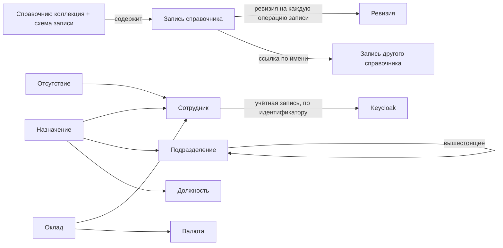
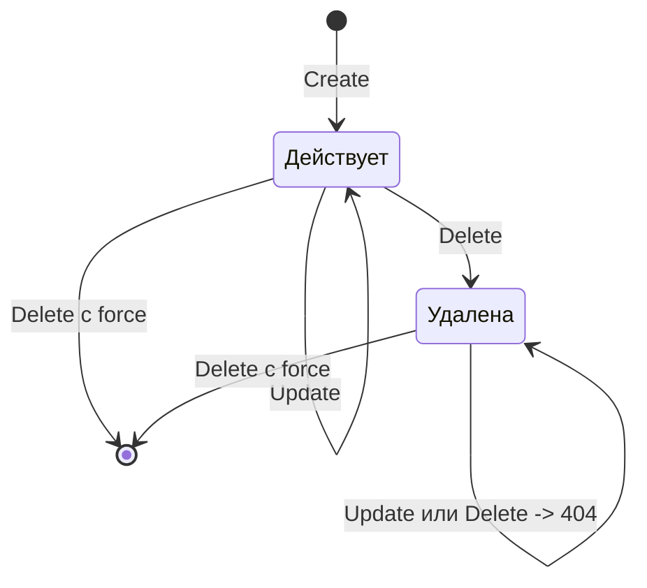
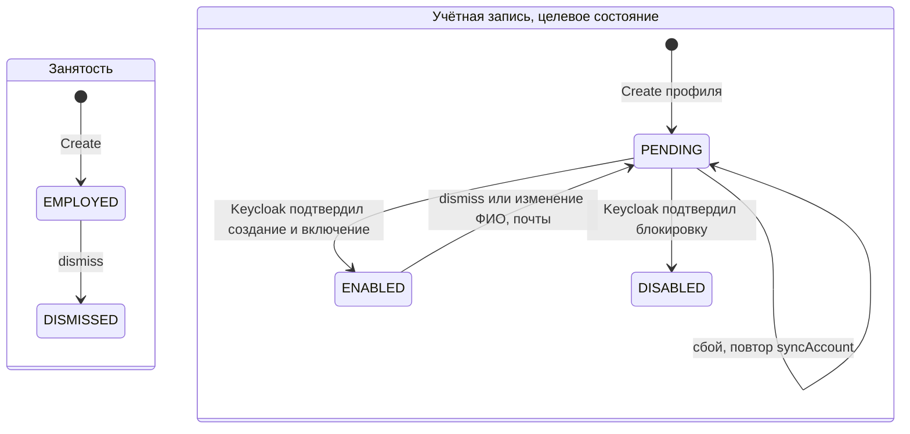

# 050 - Entities + Lifecycle

> Формат - см. [состав документов](documents-composition.md), документ 050.
> Источник - [системные требования, разделы 4, 6, 9](system-requirements.md), [видение](vision.md), [Event Storming](040.event-storming.md).

## 1. Обзор

Сущности: **Справочник** (коллекция ресурсов со схемой записи; существует как версия сервиса и спецификация, не как данные), **Запись справочника** (агрегат, изменяемый через API), **Ревизия** (элемент истории записи, только добавляется). История ведётся для каждого справочника отдельно.

Кадровая область добавляет шесть справочников. **Сотрудник**, **Подразделение** и **Должность** - обычные записи со своими полями. **Назначение**, **Оклад** и **Отсутствие** - датированные записи: у каждой есть ссылка на сотрудника и период действия.

## 2. Справочник

| Атрибут | Тип | Ограничения | Связи |
| --- | --- | --- | --- |
| Коллекция | строка | Латиница в нижнем регистре, множественное число, например `currencies`; неизменяема после выпуска (BR-RM-07) | Путь `/v1/{коллекция}` |
| Название и назначение | строка | Из описания в спецификации | - |
| Группа доступа | перечисление | Общие классификаторы, кадровые справочники, оклады и отсутствия (BR-RM-13) | Матрица прав в [070](070.role-matrix.md) |
| Схема записи | набор полей | Общие поля плюс поля справочника с типами и ограничениями; поля только добавляются (FR-RM-36) | Одна схема на справочник в OpenAPI |
| Фильтры и сортировки | набор полей | Подмножество полей записи, доступное в `filter` и `order_by` | Параметры `List` |

Жизненный цикл: зафиксирован в составе первой версии -> реализован -> доступен в API. Обратных переходов нет: справочник не удаляется, ненужные записи удаляются по правилам записи.

## 3. Запись справочника

### 3.1. Общие поля

Одинаковы во всех справочниках и доступны только для чтения (FR-RM-34).

| Поле | Тип | Семантика |
| --- | --- | --- |
| `id` | целое | Идентификатор; назначает сервис при создании, никогда не меняется (BR-RM-02) |
| `is_deleted` | логическое | Признак мягкого удаления (FR-RM-09) |
| `revision` | целое | Номер последней ревизии; операция записи с занятым следующим номером отклоняется как параллельное изменение (FR-RM-14) |
| `last_changer` | UUID | Актор последнего изменения из токена |
| `created_at`, `updated_at` | время | Время ревизии 1 и последней ревизии |
| `deleted_at` | время | Время ревизии, пометившей запись удалённой; нулевое значение, если запись не удалялась |

Кто и когда создал или изменил запись, в записи не хранится: значения вычисляются по ревизиям (раздел 5).

### 3.2. Поля классификаторов

Типизированы и ограничены схемой справочника (FR-RM-35).

| Справочник | Поле | Тип | Ограничения | Семантика |
| --- | --- | --- | --- | --- |
| `currencies` | `code` | строка | Обязательно, три заглавные буквы, уникально | Буквенный код ISO 4217 |
| `currencies` | `number` | строка | Обязательно, три цифры, уникально | Числовой код ISO 4217 |
| `currencies` | `name` | строка | Обязательно | Наименование |
| `currencies` | `decimals` | целое | Обязательно, 0..4 | Число знаков дробной части |
| `countries` | `alpha2`, `alpha3`, `numeric_code` | строка | Обязательно, коды ISO 3166-1, уникально | Коды страны |
| `countries` | `name` | строка | Обязательно | Наименование |
| `countries` | `currency_id` | идентификатор | Необязательно, ссылка на неудалённую валюту | Основная валюта страны |
| `project_roles`, `grades`, `org_units`, `positions` | `code` | строка | Обязательно; строчная латиница, цифры, дефис; уникально | Стабильный код |
| `project_roles`, `grades`, `org_units`, `positions` | `name` | строка | Обязательно | Наименование |
| `project_roles` | `description` | строка | Необязательно, до 512 символов | Описание роли |
| `grades` | `rank` | целое | Обязательно, 1..100 | Порядок грейда |

### 3.3. Инварианты

| Инвариант | Правило | Где проверяется |
| --- | --- | --- |
| Деловой ключ уникален, включая удалённые записи | BR-RM-03, FR-RM-05 | Хранилище; ответ 409 |
| Идентификатор неизменяем | BR-RM-02, FR-RM-07 | Общие поля не принимаются в маске; ответ 400 |
| Запись либо действует, либо удалена | BR-RM-05 | `is_deleted` только для чтения |
| Удалённая запись не изменяется | FR-RM-11 | Сервисный слой; удалённая запись не видна методам записи, ответ 404 |
| Каждая операция записи создаёт ревизию и увеличивает её номер | BR-RM-10, FR-RM-14 | Сервисный слой в той же транзакции; занятый номер - ответ 409 |
| Физического удаления в штатной работе нет | BR-RM-04 | Только `force=true` администратором группы справочника |
| Ссылки на другие справочники существуют и не удалены | FR-RM-35 | Сервисный слой; ответ 400 по полю |

## 4. Кадровые сущности

### 4.1. Сотрудник (`employees`)

HR-профиль. Пароля и ролей доступа не содержит (BR-RM-08, FR-RM-58).

| Поле | Тип | Ограничения | Семантика |
| --- | --- | --- | --- |
| `personnel_number` | строка | Обязательно, 1..10 цифр, уникально | Табельный номер |
| `family_name`, `given_name` | строка | Обязательно | Фамилия и имя |
| `middle_name` | строка | Необязательно | Отчество |
| `email` | строка | Обязательно, формат адреса, уникально | Адрес почты; передаётся в учётную запись |
| `username` | строка | Обязательно, уникально; строчная латиница, цифры, точка, дефис; после создания не меняется | Логин в Keycloak |
| `hire_date` | дата | Обязательно | Дата приёма |
| `employment_state` | перечисление | Только чтение; EMPLOYED или DISMISSED | Состояние занятости; меняется увольнением |
| `dismissal_date` | дата | Только чтение; заполнено в DISMISSED, не раньше `hire_date` | Дата увольнения |
| `org_unit_id`, `position_id` | идентификатор | Только чтение | Подразделение и должность из назначения, действующего на дату запроса; пусто, если назначения нет |
| `account_state`, `account_user_id` | - | Появятся с учётными записями (FR-RM-53..58), в коде нет | Состояние и идентификатор учётной записи |

Инварианты сотрудника:

| Инвариант | Правило | Где проверяется |
| --- | --- | --- |
| Увольнение закрывает действующие назначение и оклад | FR-RM-54 | Сервисный слой в одной транзакции; ревизия на каждую закрытую запись |
| Повторное увольнение отклоняется | FR-RM-54 | Сервисный слой; ответ 400 |
| Дата увольнения не раньше даты приёма | FR-RM-49 | Сервисный слой и хранилище; ответ 400 по полю |
| Учётная запись создаётся вместе с профилем, повтор не создаёт дубль, увольнение блокирует её, профиль с включённой учётной записью не удаляется, пароль не хранится | FR-RM-53, 55..58, BR-RM-15 | Планируется (раздел 7); в коде нет |

### 4.2. Подразделение (`org_units`) и должность (`positions`)

| Справочник | Поле | Тип | Ограничения | Семантика |
| --- | --- | --- | --- | --- |
| `org_units` | `code` | строка | Обязательно; строчная латиница, цифры, дефис; уникально | Код подразделения |
| `org_units` | `name` | строка | Обязательно | Название подразделения |
| `org_units` | `kind` | перечисление | Обязательно; DEPARTMENT или TEAM | Отдел или команда |
| `org_units` | `parent_id` | идентификатор | Необязательно, ссылка на неудалённое подразделение; ссылка на себя или на подчинённое подразделение отклоняется (FR-RM-50) | Вышестоящее подразделение |
| `positions` | `code` | строка | Обязательно; строчная латиница, цифры, дефис; уникально | Код должности |
| `positions` | `name` | строка | Обязательно | Название должности |

### 4.3. Датированные записи

Идентификатор назначает сервис, как и у всех записей (FR-RM-51). Поля `name` нет. Ссылка на сотрудника после создания не меняется. Новое назначение и новый оклад принимаются только для работающего сотрудника.

| Справочник | Поле | Тип | Ограничения | Семантика |
| --- | --- | --- | --- | --- |
| `assignments` | `employee_id` | идентификатор | Обязательно, ссылка на сотрудника | Чьё назначение |
| `assignments` | `org_unit_id` | идентификатор | Обязательно, ссылка на неудалённое подразделение | Подразделение |
| `assignments` | `position_id` | идентификатор | Обязательно, ссылка на неудалённую должность | Должность |
| `assignments` | `start_date` | дата | Обязательно | Действует с даты |
| `assignments` | `end_date` | дата | Необязательно; не раньше `start_date`; пусто - действует сейчас | Действует по дату включительно |
| `salaries` | `employee_id` | идентификатор | Обязательно, ссылка на сотрудника | Чей оклад |
| `salaries` | `amount` | число с двумя знаками | Обязательно, больше нуля | Размер оклада за месяц |
| `salaries` | `currency_id` | идентификатор | Обязательно, ссылка на неудалённую валюту | Валюта оклада |
| `salaries` | `start_date`, `end_date` | дата | Как у назначения | Период действия |
| `absences` | `employee_id` | идентификатор | Обязательно, ссылка на сотрудника | Кто отсутствует |
| `absences` | `kind` | перечисление | Обязательно; VACATION, SICK_LEAVE или OTHER | Вид отсутствия |
| `absences` | `start_date`, `end_date` | дата | Обе обязательны; `end_date` не раньше `start_date` | Период отсутствия |

Инварианты датированных записей:

| Инвариант | Правило | Где проверяется |
| --- | --- | --- |
| Периоды назначений одного сотрудника не пересекаются | FR-RM-52 | Хранилище, ограничение исключения; ответ 400 с сообщением о пересечении |
| Периоды окладов одного сотрудника не пересекаются | FR-RM-52 | То же |
| Прежнее значение не перезаписывается | BR-RM-16 | Смена должности или оклада - закрытие действующей записи датой и создание новой |
| У сотрудника не больше одного действующего назначения и одного действующего оклада | следствие FR-RM-52 | Из назначения берутся `org_unit_id` и `position_id` сотрудника |

## 5. Ревизия

| Атрибут | Тип | Семантика |
| --- | --- | --- |
| `id` | целое | Идентификатор ревизии |
| `{справочник}_id` | целое | Запись, к которой относится ревизия, например `country_id` |
| `revision_number` | целое | Номер по порядку внутри записи, с 1 |
| `change` | JSON Patch | Операции RFC 6902 относительно предыдущего состояния записи: собственные поля и `is_deleted`; ревизия 1 описывает создание относительно пустого документа |
| `changed_by` | UUID | Актор из токена |
| `changed_at` | время | Когда выполнена операция |

Ревизия неизменяема. Удаление даёт `replace` для `/is_deleted`, увольнение - `replace` для `/employment_state` и `add` для `/dismissal_date`, закрытие периода - изменение `/end_date`. Состояние записи на ревизию сервис не восстанавливает (FR-RM-47 отозвано): потребитель применяет операции ревизий 1..N к пустому документу сам. Отклонение от AIP-162: ревизия несёт различие, а не снимок.

## 6. Жизненный цикл записи

| Состояние | Описание | Вход в состояние | Что доступно |
| --- | --- | --- | --- |
| Действует (`is_deleted: false`) | Запись в обороте | Create | Get, попадает в List по умолчанию, Update, Delete, история, выгрузка |
| Удалена (`is_deleted: true`) | Значение больше не используется или создано по ошибке | Delete | Get и List только с `allowDeleted=true`, история; Update и Delete отвечают 404; восстановления нет |

Триггеры переходов - только запросы администратора своей группы справочников. Автоматических переходов и сроков хранения нет. Удаление с `force=true` убирает запись вместе с историей (BR-RM-04).

## 7. Жизненный цикл сотрудника

У записи сотрудника кроме признака удаления есть состояние занятости. Состояние учётной записи появится с реализацией FR-RM-53..58.

| Состояние | Описание | Триггер перехода |
| --- | --- | --- |
| EMPLOYED | Сотрудник работает; для него принимаются назначения и оклады | `Create` записи сотрудника HR-администратором |
| DISMISSED | Сотрудник уволен; запись остаётся и читается по идентификатору, действующие назначение и оклад закрыты датой увольнения | `POST /v1/employees/{employeeID}/dismiss` с датой увольнения |
| PENDING, ENABLED, DISABLED | Состояния учётной записи в Keycloak | Целевое поведение, в коде нет |

## 8. Связи

| Связь | Кратность | Реализация в модели | Примечание |
| --- | --- | --- | --- |
| Справочник -> Запись | 1 : N | Коллекция | Записи не переносятся между справочниками |
| Запись -> Ревизия | 1 : N | Вложенная коллекция `revisions` | История своего справочника |
| Запись -> Запись другого справочника | N : 1 | Поле с именем записи | Ссылка на удалённую запись остаётся корректной |
| Сотрудник -> Назначение, Оклад, Отсутствие | 1 : N | Поле `employee` датированной записи | Периоды назначений и окладов не пересекаются |
| Подразделение -> Подразделение | N : 1 | Поле `parent` | Иерархия без циклов |
| Сотрудник -> Учётная запись Keycloak | 1 : 1 | Поле `account_user_id` и атрибут учётной записи со ссылкой на профиль | Связь поддерживается интеграцией (BR-RM-15) |

Детальная модель хранения - в [120](120.data-model.md).
