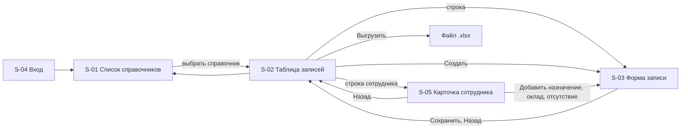

# 110 - UI/UX прототип

> Формат - см. [состав документов](documents-composition.md), документ 110.
> Источник - [системные требования, разделы 4.7 и 8](system-requirements.md#8-требования-к-интерфейсу), [RBAC](070.role-matrix.md), [US-AD-07](080.admin-user-stories.md), [US-HR](080.hr-admin-user-stories.md), [UC-13](060.use-cases.md).

Интерфейс относится к срезу 3 (веха M5) и поставляется отдельным компонентом: свой образ, своё развёртывание, с сервисом он общается только через REST API (решение 2026-10-02, ADR-017). Работа шла в два шага. Шаг 1 (2026-10-13) - админ-панель на имитированных данных: все экраны и переходы без обращения к API. Шаг 2 (2026-10-31, #148) - та же панель на API сервиса по контракту ADR-022 и вход через Keycloak. Панель лежит в `frontend/admin/` и описана в [115](115.live-prototype.md). 2026-11-04 по оценке интерфейсов добавлены состояния экранов, доступность, узкий экран, форматы, тема (раздел 7), срез на момент и выгрузка отбора (S-02), групповые операции подразделения (раздел 8).

Пользователи интерфейса - администратор справочников и HR-администратор. Читатели работают в интерфейсах своих подсистем. Стек фронтенда выбирается ADR до начала шага 2, а здесь описаны экраны и поведение, независимые от стека.

## 1. Принципы

- **Форма из контракта.** Список справочников, столбцы таблицы, поля формы и фильтры строятся по спецификации OpenAPI: новый справочник появляется в интерфейсе без изменения кода интерфейса (FR-RM-29, FR-RM-38).
- **Консистентность.** Все справочники выглядят и ведут себя одинаково; различаются только поля (NFR-RM-40).
- **Обратная связь.** Каждое действие даёт результат на экране: сохранено, удалено, восстановлено, отклонено с указанием полей. Ошибки API показываются у полей, к которым относятся.
- **Предсказуемость и защита от ошибок.** Удаление, восстановление и увольнение требуют подтверждения; поля только для чтения показаны как таковые; удалённые записи видны только по явному флагу.
- **Минимум когнитивной нагрузки.** Один справочник - одна таблица - одна форма. Нет вложенных мастеров и модальных цепочек.
- **Доступность.** Навигация с клавиатуры, подписи у всех полей, контраст текста, состояния ошибок не только цветом.
- **Права на сервере.** Интерфейс скрывает действия по ролям, но ответы UNAUTHENTICATED и PERMISSION_DENIED обрабатываются как штатные состояния (FR-RM-28).
- **Незавершённая операция видна.** Состояние учётной записи PENDING показано в таблице и в карточке сотрудника вместе с действием повтора.

## 2. Экраны

### S-01 Список справочников

- **Структура:** шапка с названием сервиса, именем пользователя и выходом; таблица справочников по группам (кадровые, классификаторы): коллекция, название, число активных записей; переход к S-02.
- **Функциональные элементы:** строка поиска по названию справочника.
- **Источник:** коллекции и описания из спецификации OpenAPI.
- **Состояния:** loading; empty (спецификация без справочников - только на пустом стенде); error (спецификация недоступна).
- **Контекстное управление:** справочники `salaries` и `absences` показаны только ролям с доступом к ним.
- **Истории:** US-AD-07 AC-1.

### S-02 Таблица записей справочника

- **Структура:** заголовок с названием справочника; панель отбора: строка фильтра в синтаксисе AIP-160 с подсказками по полям, флаг "показывать удалённые", выбор сортировки; таблица с общими полями (`id`, `name`, `is_deleted`) и полями справочника; постраничный вывод с `pageSize` 20 по умолчанию и `nextPageToken`; поле "На момент" для среза (`readTime`); действия "Создать запись" и "Выгрузить в Excel" (неудалённые записи текущего отбора: фильтр, сортировка, момент, без истории; при отборе кнопка называется "Выгрузить отобранное в Excel"); переход к S-03 по строке, для сотрудников - к S-05.
- **Состояния:** loading; пустой справочник с подсказкой и "Создать запись" для роли с уровнем create; пустой отбор - "Ничего не найдено" и "Сбросить отбор"; срез - баннер с моментом; error с идентификатором трассы и повтором; неверный фильтр - подсветка строки фильтра и текст причины под ней (раздел 7).
- **Контекстное управление:** кнопка "Создать" видна только роли с уровнем create на группу справочника, иначе строки только для чтения; удалённые записи выделены и помечены DELETED; у сотрудников показаны состояние занятости и состояние учётной записи.
- **Истории:** US-AD-07, US-RD-01..04 (через выгрузку), US-HR-07.

### S-03 Форма записи

- **Структура:** две зоны. Слева поля: `name`, затем поля справочника по схеме (число, дата, ссылка на другой справочник с выбором по имени и наименованию, перечисление). Справа сведения: `id`, `is_deleted`, `deleted_at`, `revision`, `last_changer`. Ниже панель истории: ревизии от новой к старой с действием, автором, временем и списком изменений; выбор ревизии показывает её операции JSON Patch; выгрузки истории нет. Внизу действия: "Сохранить", "Удалить" (для ACTIVE), "Удалить окончательно" (для DELETED, восстановления нет по ADR-022), "Назад". Форма подразделения дополнена групповыми операциями (раздел 8).
- **Поведение:** сохранение вызывает `Create` или `Update` только с изменёнными полями в `updateMask`. Ошибка 400 с `details` раскладывается по полям, 409 и прочие ошибки показываются баннером с пояснением. Удаление требует подтверждения. После действия форма перечитывает запись и историю. При ответе 409 форма предлагает перечитать запись.
- **Состояния:** loading; saving с блокировкой кнопок; error; read-only для роли без уровня update и для DELETED (кроме восстановления).
- **Истории:** US-AD-01..05, US-AD-07 AC-2, AC-3, US-AD-08, US-HR-02..04.

### S-04 Вход и отказ в доступе

- **Структура:** перенаправление в Keycloak (Authorization Code с PKCE); после возврата - S-01. Экран отказа при отсутствии ролей сервиса с указанием, к кому обратиться.
- **Состояния:** сессия истекла - повторный вход с возвратом на прежний экран.
- **Реализация (2026-10-31):** без токена панель перенаправляет в Keycloak (Authorization Code с PKCE S256) и после возврата открывает прежний экран; токен хранится в памяти вкладки и обновляется до истечения; ответ 401 ведёт к повторному входу; учётная запись без ролей сервиса видит экран отказа с выходом.

### S-05 Карточка сотрудника

- **Структура:** форма записи S-03 для справочника `employees`, дополненная тремя блоками. Блок состояния: `employment_state`, дата приёма, дата увольнения, `account_state`, идентификатор учётной записи. Блок действующих значений: подразделение, должность, оклад. Блок периодов: вкладки "Назначения", "Оклады", "Отсутствия" со списками датированных записей сотрудника от новых к старым и действием "Добавить".
- **Функциональные элементы:** "Уволить" с вводом даты и подтверждением; "Повторить операцию с учётной записью" при `account_state` PENDING; после создания профиля однократный показ временного пароля, если принят этот способ выдачи (вопрос 18 требований).
- **Поведение:** создание профиля ждёт подтверждения Keycloak. При ответе UNAVAILABLE карточка открывается с состоянием PENDING и пояснением, что профиль сохранён, а учётная запись ещё не создана. Добавление назначения или оклада при незакрытом действующем предлагает сначала закрыть его датой.
- **Состояния:** loading; saving; error; PENDING с баннером и кнопкой повтора; read-only для ролей без уровня update на кадровые справочники.
- **Контекстное управление:** вкладки "Оклады" и "Отсутствия" и блок оклада видны только ролям `reference-hr-admin` и `reference-hr-reader`.
- **Истории:** US-HR-01..06, US-HR-08.

## 3. Навигация

Адреса экранов: `/admin/`, `/admin/{коллекция}`, `/admin/{коллекция}/{идентификатор}`, `/admin/{коллекция}/new`. Интерфейс и API публикуются под одним адресом через маршрутизацию входящих запросов: путь `/admin/` ведёт в компонент интерфейса, путь `/v1/` в сервис (NFR-RM-35). Фильтр, сортировка и страница хранятся в строке запроса, чтобы ссылку можно было передать коллеге.

## 4. Видимость по ролям

| Элемент | reader | hr-reader | admin | hr-admin |
| --- | --- | --- | --- | --- |
| Список справочников, таблица, форма в режиме чтения | да, кроме окладов и отсутствий | да | да, кроме окладов и отсутствий | да |
| Флаг "показывать удалённые", панель истории, выгрузка | да | да | да | да |
| Создать, Сохранить, Удалить, Восстановить в классификаторах | скрыто | скрыто | да | скрыто |
| Создать, Сохранить, Удалить, Восстановить в кадровых справочниках | скрыто | скрыто | скрыто | да |
| Уволить, Повторить операцию с учётной записью | скрыто | скрыто | скрыто | да |
| Вкладки "Оклады" и "Отсутствия" | скрыто | да, чтение | скрыто | да |

## 5. UX-особенности

- Автосохранения нет: справочные данные меняются осознанно, каждое сохранение - отдельная ревизия.
- Черновик формы сохраняется в браузере до ухода со страницы, чтобы отказ по полям не стирал введённое.
- Выгрузка запускается в фоне с индикатором; при отказе сверх предела предлагается уменьшить отбор, при недоступности - повторить позже.
- Подтверждение удаления показывает имя и наименование записи и напоминает, что идентификатор останется занятым.
- Подтверждение увольнения показывает ФИО, дату и предупреждает, что вход сотрудника будет закрыт, а назначение и оклад закрыты этой датой.
- Ссылочные поля предлагают выбор из целевого справочника с поиском; в форме показывается имя и наименование, сохраняется имя.
- Даты и время показываются в местной зоне пользователя с подсказкой UTC-значения. Даты периодов действия показываются без времени.
- Временный пароль показывается один раз и не сохраняется в браузере.

## 6. Привязка экранов к требованиям и историям

| Экран | Требования | Use Case | Истории |
| --- | --- | --- | --- |
| S-01 | FR-RM-29, раздел 8.1 | UC-13 | US-AD-07 AC-1 |
| S-02 | FR-RM-08, FR-RM-29, FR-RM-40, 61, 62, раздел 8.2, NFR-RM-51 | UC-08, UC-09, UC-13 | US-AD-07, US-RD-01..04, US-HR-07 |
| S-03 | FR-RM-05, 07, 10, 12, 35, 46, 47, 51, 52, 63, 64, разделы 8.3, 8.5 | UC-03..06, UC-14, UC-15, UC-19, UC-20 | US-AD-01..05, US-AD-07, US-AD-08, US-RD-05, US-HR-02..04 |
| S-04 | FR-RM-28, FR-RM-21..23 | UC-10 | US-AD-07 |
| S-05 | FR-RM-49, 53..58, раздел 8.4 | UC-16..18 | US-HR-01, 05, 06, 08 |

## 7. Состояния, доступность и узкий экран

Доработка 2026-11-04 по оценке интерфейсов руководителем проекта от 2026-11-01 (29 из 50 баллов, слабые места - состояния, доступность, адаптивность и форматы). Требование - NFR-RM-51.

| Тема | Как сделано |
| --- | --- |
| Загрузка | Экран, который грузится дольше 200 мс, показывает индикатор с текстом "Загрузка…", `#view` получает `aria-busy`. Счётчики записей на S-01 грузятся отдельно и тоже показывают индикатор |
| Пустой справочник | Пояснение и кнопка "Создать запись" для роли с уровнем create, для читателя только пояснение |
| Пустой отбор | "Ничего не найдено" с кнопкой "Сбросить отбор". Пустой срез на момент объясняет, что таких записей тогда не было |
| Ошибка | Карточка с причиной и идентификатором трассы. Временные отказы (нет связи, 429, 5xx, 503) получают кнопку "Повторить", отказ в доступе - отдельную карточку "Нет доступа" |
| Поля формы | Подпись над полем, звёздочка у обязательного, подсказка и ошибка под полем связаны с ним через `aria-describedby`. Поле с ошибкой получает `aria-invalid` и фокус |
| Клавиатура | Первая ссылка страницы "Перейти к содержимому". После перехода фокус переходит на заголовок нового экрана. В диалоге подтверждения фокус стоит на "Отмена" |
| Разметка | Путь - список с `aria-current` на текущем экране, таблицы с подписью для экранного диктора, вкладки периодов с ролями `tablist`, `tab`, `tabpanel` |
| Узкий экран | Точки перелома 900 и 600 пикселей. До 900 пикселей одна колонка. До 600 пикселей строки таблиц становятся карточками "название столбца - значение", панели действий и формы выстраиваются в один столбец |
| Форматы | Даты `ДД.ММ.ГГГГ`, время `ДД.ММ.ГГГГ, ЧЧ:ММ` в зоне браузера с UTC-значением в подсказке, суммы с разделением разрядов и копейками. Поля ввода и строка фильтра сохраняют запись API |
| Строки таблиц | Щелчок в любом месте строки открывает запись, ссылки и элементы управления внутри строки работают как обычно, выделение текста не считается щелчком, Ctrl или средняя кнопка открывают новую вкладку. С клавиатуры строка открывается ссылкой в первой ячейке |
| Таблицы на странице | Таблица растёт вместе со страницей без собственной прокрутки, шапка таблицы остаётся под верхней панелью. Чередующиеся строки заметно темнее фона. Ссылочные ячейки показывают наименование без кода, полная подпись в подсказке. Столбец удаления виден только при показе удалённых. Даты, идентификаторы и состояния не переносятся. При ширине окна до 1100 пикселей широкая таблица прокручивается вбок внутри своей рамки |
| Версии файлов | nginx панели отдаёт файлы с `Cache-Control: no-cache`: браузер сверяет каждый файл по ETag и не смешивает новую версию панели со скриптами прежней |
| Тема | Переменные оформления в `frontend/admin/theme.css` по общему стилю (имена `--bg`, `--card`, `--line`, `--text`, `--muted`, `--accent`, `--ok`, `--warn`, `--danger` с вариантами `-soft`, шкала отступов 4..32, радиусы 6, 10, 14, размеры шрифта 12..24). Тёмная тема включается настройкой системы или кнопкой "Тема", выбор хранится в браузере |
| Тесты | Модульные тесты моделей экранов (`views.js`: состояния, модель формы по роли и состоянию записи, ячейки таблицы) и форматов. Браузерные тесты `frontend/e2e` на локальном стенде проходят сценарии P-01..P-14 из [115](115.live-prototype.md) |

## 8. Групповые операции подразделения

Форма подразделения (S-03 для `org_units`) для роли `reference-hr-admin` содержит блок "Групповые операции подразделения" с двумя формами (FR-RM-63, FR-RM-64).

- **Новые оклады с даты:** дата начала, изменение на процент или новая сумма с валютой, флаг "Включая вложенные подразделения".
- **Перевод сотрудников:** подразделение назначения с подсказкой по названию, дата перевода, должность (пусто - прежняя), тот же флаг.

Кнопка "Проверить" отправляет запрос с `validate_only` и показывает план: сотрудник, было и стало, период, а также список пропущенных с причиной. Кнопка "Выполнить" спрашивает подтверждение и применяет операцию целиком. Ошибки запроса показываются у полей формы, отказ из-за записи, которая начинается в дату операции, показывается баннером с номерами сотрудников.
