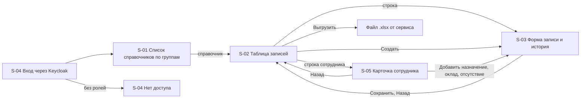

# 115 - Live-прототип

> Формат - см. [состав документов](documents-composition.md), документ 115.
> См. также [110 - UI/UX прототип](110.ui-ux.md).

Live-прототип - админ-панель из [110](110.ui-ux.md): отдельный компонент интерфейса в [`frontend/admin/`](../frontend/admin/README.md) с экранами S-01..S-05 и переходами между ними. Шаг 1 (2026-10-13) работал на имитации сервиса в памяти страницы. Шаг 2 (2026-10-31, issue #148) подключил панель к API сервиса по контракту [130](130.api-contracts.md) (ADR-022) и к Keycloak: вход Authorization Code с PKCE, роли из токена, имитации и переключателя роли больше нет. Данные приходят из сервиса, на локальном стенде - набор `deployments/seed/demo.sql`.

## Экраны и связки между ними

| Экран | Что есть в панели |
| --- | --- |
| S-01 | Справочники по группам G-2, G-3, G-1 с поиском по названию и числом записей первой страницы. Оклады и отсутствия видны только ролям кадрового контура |
| S-02 | Фильтр AIP-160 передаётся сервису как есть, сортировка `order_by`, флаг `allowDeleted`, размер страницы, переход по `pageToken`. Неверный фильтр - ответ 400 с причиной сервиса и подсветкой строки. Выгрузка - `POST /v1/{коллекция}/export`, файл сохраняется из ответа. "Создать запись" по уровню create |
| S-03 | Форма по схеме справочника: ссылочные поля с подсказкой из целевого справочника, перечисления, даты, числа. Ошибки у полей из `details` ответа 400, прочие ошибки баннером с `X-Trace-Id`, сохранение только изменённых полей в `updateMask`, ответ 409 с предложением перечитать, черновик в окне браузера. Справа сведения (`id`, `is_deleted`, `revision`, `last_changer`, время) и история: ревизии из `GET .../revisions` с операциями JSON Patch, состояние на ревизию собирается из операций |
| S-04 | Без токена - перенаправление в Keycloak и возврат на прежний экран; учётная запись без ролей сервиса - экран отказа с выходом; 403 по отдельному справочнику - баннер |
| S-05 | Карточка сотрудника: состояния, действующие подразделение, должность и оклад, вкладки назначений, окладов и отсутствий, закрытие действующей записи датой, добавление новой, "Уволить" с датой и подтверждением, "Повторить операцию с учётной записью" при PENDING |

## Что делает сервис, а что панель

| Поведение | Где |
| --- | --- |
| Проверка полей, уникальность, ссылки, периоды, иерархия подразделений | Сервис; панель показывает ошибки у полей |
| Права по ролям | Сервис (401, 403); панель только скрывает действия |
| Приём, увольнение, учётная запись Keycloak (FR-RM-53..58) | Сервис; панель вызывает `Create`, `dismiss`, `syncAccount` и показывает `account_state` |
| Фильтр и сортировка | Сервис; панель передаёт `filter` и `order_by` |
| Файл `.xlsx` | Сервис (`export`); панель сохраняет ответ |
| История | Сервис хранит ревизии; панель применяет операции JSON Patch для состояния на ревизию |
| Наименования ссылок | Панель читает первую сотню записей целевого справочника и кэширует их на время страницы |

Панель покрыта тестами (`task tests:frontend`): клиент API (параметры, ошибки, повтор при 429, выгрузка), вход (PKCE по примеру RFC 7636, обмен кода, обновление токена, выход), схемы (роли, тело запроса, маска обновления), JSON Patch.

## Сценарии для проверки

Проверяются на локальном стенде (`task up`, `task demo:accounts`) под пользователями локального realm, пароль равен логину.

| № | Сценарий | Проверяемое | Истории | Проверено 2026-10-31 |
| --- | --- | --- | --- | --- |
| P-01 | Войти как `hr-admin`, открыть список, перейти в `employees`, отобрать фильтром `employment_state = "EMPLOYED" AND org_unit_id = 5`, отсортировать по `hire_date desc` | Понятность фильтра AIP-160 и таблицы, наименования ссылок | US-RD-01, US-RD-02 | да |
| P-02 | Войти как `admin`, создать страну с неверным `currency_id`, получить ошибку у поля, исправить, сохранить | Ошибки у полей, выбор из другого справочника | US-AD-01, US-AD-02 | да |
| P-03 | Удалить запись, включить `allowDeleted`, открыть её, удалить окончательно | Подтверждения, состояние, восстановления нет (ADR-022) | US-AD-04, US-AD-05 | да |
| P-04 | Выгрузить справочник, открыть файл в Excel | Файл от сервиса открывается без предупреждений | US-RD-03, US-RD-04 | да |
| P-05 | Выйти, войти как `reader`, затем как `outsider` | Скрытие действий записи, экран отказа | US-AD-07, 070 | да |
| P-06 | Открыть панель истории, выбрать ревизию, увидеть операции и состояние на ревизию | Понятность истории | US-AD-08, US-RD-05 | да |
| P-07 | Принять сотрудника, увидеть ENABLED и учётную запись в консоли Keycloak; остановить контейнер Keycloak, принять второго, увидеть 503 и PENDING; запустить Keycloak, выполнить повтор | Понятность состояния учётной записи | US-HR-01, US-HR-06 | да, кроме остановки Keycloak |
| P-08 | Добавить назначение при незакрытом действующем и получить отказ по датам; закрыть действующее датой на карточке, добавить новое | Понятность датированных записей | US-HR-03 | да |
| P-09 | Уволить сотрудника с датой, увидеть DISMISSED и DISABLED, закрытые назначение и оклад, заблокированную учётную запись в Keycloak | Подтверждение и последствия увольнения | US-HR-05 | да |
| P-10 | Открыть карточку сотрудника ролями `hr-reader` и `reader` | Скрытие окладов и отсутствий, отсутствие действий | 070 | да |

## Упрощения и условие их снятия

Упрощения шага 1 сняты шагом 2. Осталось одно.

| Упрощение | Когда снимается | Как проверяется |
| --- | --- | --- |
| Временный пароль новой учётной записи не показывается, сотрудник входит после сброса пароля администратором Keycloak | Решение вопроса 18 требований (Infra, #163) | По принятому способу выдачи |
| Наименования ссылок берутся из первой сотни записей целевого справочника | Когда справочник превысит сотню записей: поиск по вводу через `filter` | Подсказка находит запись за пределами первой страницы |

## Критерий готовности

Шаг 2 принят, когда сценарии P-01..P-10 проходят на локальном стенде на реальном сервисе, тесты панели проходят в CI и в интерфейсе нет имитаций. Проверка 2026-10-31 выполнена в браузере на стенде из `task up` с набором `demo.sql`: пройдены P-01..P-06, P-08..P-10 и P-07 без остановки Keycloak.
