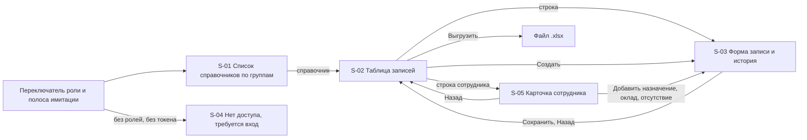

# 115 - Live-прототип

> Формат - см. [состав документов](documents-composition.md), документ 115.
> См. также [110 - UI/UX прототип](110.ui-ux.md).

Live-прототип - админ-панель шага 1 из [110](110.ui-ux.md): отдельный компонент интерфейса в [`frontend/admin/`](../frontend/admin/README.md) с экранами S-01..S-05 и переходами между ними. Сервис не вызывается. Его заменяет имитация в памяти страницы, которая повторяет контракт [130](130.api-contracts.md): методы, параметры, поля записей, ошибки `google.rpc.Status`, проверку ролей и обмен с Keycloak. Панель открывается как файл без сборки или собирается в образ nginx и отдаётся по `/admin/` (`task up`, порт 8081). Однофайловый прототип первой редакции сохранён в `frontend/prototype/index.html` как исходная точка, сценарии проверяются на панели.

Имитация сервиса в панели написана по прежней редакции контракта: имена ресурсов вида `currencies/USD`, поля `display_name`, `state`, `etag`, метод восстановления, выгрузка по заголовку `Accept`. С 2026-10-20 контракт приведён к коду (ADR-022, [130](130.api-contracts.md)). Имитация и экраны приводятся к нему на шаге 2 вместе с подключением к API (issue #148), до этого сценарии проверяются в прежней форме.

## Экраны и связки между ними

В панели есть все экраны из [110](110.ui-ux.md). Переключатель роли в шапке заменяет вход и задаёт токен имитации: admin, hr-admin, reader, hr-reader, учётная запись без ролей и запрос без токена. Права проверяет имитация сервиса, поэтому роль без нужного уровня получает PERMISSION_DENIED, а запрос без токена - UNAUTHENTICATED, как это сделает сервис. Полоса "Имитация сервиса" включает и выключает Keycloak, задаёт предел выгрузки и возвращает образцовые данные.

| Экран | Что есть в панели |
| --- | --- |
| S-01 | Справочники по группам G-2, G-3, G-1 с поиском по названию и числом активных записей. Оклады и отсутствия видны только ролям кадрового контура |
| S-02 | Фильтр AIP-160, сортировка, флаг удалённых, размер страницы, переход по `page_token`, `total_size`. Неверный фильтр подсвечивается с текстом из INVALID_ARGUMENT. Выгрузка текущего отбора в `.xlsx` и отказ сверх предела. "Создать запись" по уровню create |
| S-03 | Форма по схеме справочника: идентификатор при создании, ссылочные поля с подсказкой из целевого справочника, перечисления, даты. Ошибки у полей, баннеры ALREADY_EXISTS и FAILED_PRECONDITION, сохранение только изменённых полей в `update_mask`, черновик в окне браузера. Справа сведения и история: ревизии с различиями, состояние на ревизию |
| S-04 | Экран без ролей и экран без токена. Отказ по отдельному справочнику показан баннером с кодом и `request_id` |
| S-05 | Карточка сотрудника: блок состояний, действующие подразделение, должность и оклад, вкладки назначений, окладов и отсутствий, закрытие действующей записи датой, добавление новой, "Уволить" с датой и подтверждением, "Повторить операцию с учётной записью" при PENDING |

## Что имитируется

| Поведение сервиса | В панели |
| --- | --- |
| Приём сотрудника (FR-RM-53, FR-RM-55) | Профиль сохраняется с PENDING, учётная запись создаётся в имитации Keycloak, ответ ENABLED. При выключенном Keycloak ответ UNAVAILABLE с `ACCOUNT_PENDING`, карточка открывается с PENDING |
| Повтор операции (FR-RM-56) | `SyncAccount` доводит операцию по её идентификатору, вторая учётная запись с тем же логином не создаётся |
| Увольнение (FR-RM-54) | DISMISSED с датой, действующие назначение и оклад закрыты этой датой, учётная запись заблокирована, ревизии записаны. Повторное увольнение и удаление работающего сотрудника отклоняются |
| Изменение ФИО и почты (FR-RM-57) | Передаётся в учётную запись, при сбое состояние PENDING |
| Датированные записи (FR-RM-51, FR-RM-52, BR-RM-16) | Пересечение периодов и дата окончания раньше начала отклоняются ошибками у полей дат, идентификатор назначает имитация, прежние записи сохраняются |
| Иерархия подразделений (FR-RM-50) | Ссылка, образующая цикл, отклоняется |
| История (FR-RM-44..47) | Каждая операция записи даёт ревизию с различиями, автором, временем и `request_id` |
| Выгрузка (FR-RM-40..43, NFR-RM-45) | Файл `.xlsx` формируется из записей отбора, текст пишется строковыми ячейками, сверх предела - `EXPORT_TOO_LARGE` |
| Права (ADR-020) | Четыре роли над тремя группами, уровни C R U X D как в [070](070.role-matrix.md) |

Имитация покрыта тестами (`task tests:frontend`): фильтр, файл `.xlsx`, методы, ошибки, роли, приём со сбоем и повтором, увольнение, пересечение периодов.

## Сценарии для проверки на прототипе

| № | Сценарий | Проверяемое | Истории | Есть в прототипе |
| --- | --- | --- | --- | --- |
| P-01 | Открыть список, перейти в `countries`, отобрать фильтром `state = ACTIVE AND display_name:"Р"`, отсортировать по наименованию | Понятность фильтра AIP-160 и таблицы | US-RD-01, US-RD-02 | да |
| P-02 | Создать запись с ошибкой в ссылочном поле `currency`, исправить, сохранить | Ошибки у полей, выбор из другого справочника | US-AD-01, US-AD-02 | да |
| P-03 | Удалить запись, включить показ удалённых, восстановить | Подтверждения, состояние, новая ревизия | US-AD-04, US-AD-05 | да |
| P-04 | Выгрузить отбор; уменьшить предел выгрузки в полосе имитации, выгрузить сверх предела и получить отказ | Понятность отказа, файл открывается в Excel | US-RD-03, US-RD-04 | да |
| P-05 | Переключить роль на reader, затем на учётную запись без ролей и на запрос без токена | Скрытие действий записи, экраны отказа | US-AD-07, 070 | да |
| P-06 | Открыть панель истории, выбрать ревизию, увидеть различия и состояние на ревизию | Понятность истории | US-AD-08, US-RD-05 | да |
| P-07 | Принять сотрудника, увидеть ENABLED; выключить Keycloak, принять второго, увидеть PENDING; включить Keycloak и выполнить повтор | Понятность состояния учётной записи | US-HR-01, US-HR-06 | да |
| P-08 | Добавить назначение при незакрытом действующем и получить отказ по датам; закрыть действующее датой на карточке, добавить новое | Понятность датированных записей | US-HR-03 | да |
| P-09 | Уволить сотрудника с датой, увидеть DISMISSED и DISABLED, закрытые назначение и оклад | Подтверждение и последствия увольнения | US-HR-05 | да |
| P-10 | Открыть карточку сотрудника ролями hr-reader и reader | Скрытие окладов и отсутствий, отсутствие действий | 070 | да |

## Упрощения и условие их снятия

Упрощения допустимы в админ-панели шага 1. В интерфейсе, подключённом к API, их быть не должно: каждое снимается в указанной задаче, и приёмка среза не проходит, пока упрощение остаётся.

| Упрощение | Когда снимается | Как проверяется |
| --- | --- | --- |
| Вход через Keycloak заменён переключателем роли, токен имитируется | Шаг 2: вход OIDC с PKCE | Без токена интерфейс перенаправляет в Keycloak, переключателя роли нет |
| Данные и история хранятся в памяти страницы, кнопка "Сбросить данные" возвращает образцы | Шаг 2 | Интерфейс не содержит встроенных данных справочников |
| Keycloak заменён переключателем доступности в полосе имитации | Шаг 2: состояние учётной записи приходит от сервиса | Полосы имитации нет |
| Файл `.xlsx` формирует страница из записей отбора | Шаг 2: файл отдаёт сервис методом `POST /v1/{коллекция}/export` | Интерфейс вызывает метод выгрузки и сохраняет ответ |
| Фильтр AIP-160 разбирает страница: сравнения, `AND`, `OR`, `NOT`, скобки, `поле:*` | Шаг 2: фильтр разбирает сервис | Выражение передаётся в `filter` без разбора в интерфейсе |
| Состояние на ревизию складывается из различий в памяти страницы | Шаг 2: интерфейс применяет операции JSON Patch ревизий сервиса | Ревизии читаются из `GET .../revisions` |
| Параллельное изменение не имитируется | Шаг 2 интерфейса | При ответе 409 интерфейс перечитывает запись и предлагает повторить |
| Адреса экранов в фрагменте адреса (`#/employees/1001`), а не пути `/admin/employees/1001` | Шаг 2 вместе с выбором стека | Адреса из [110, раздел 3](110.ui-ux.md) открываются напрямую |
| Временный пароль не показывается | Решение вопроса 18 требований | По принятому способу выдачи |

## Критерий готовности

Прототип принят, когда администратор из команды справочников проходит сценарии P-01..P-06, а HR-администратор - сценарии P-07..P-10 без подсказок, и замечания перенесены в [110](110.ui-ux.md). Тесты имитации проходят в CI. После этого выбирается стек и начинается шаг 2.
