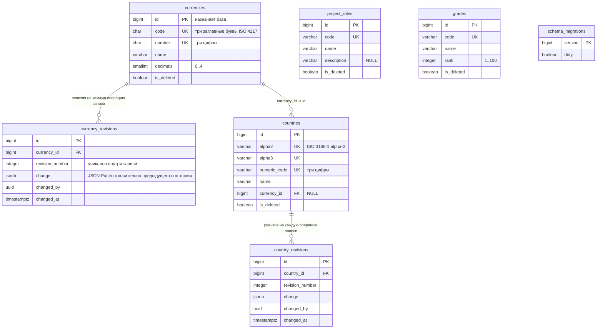
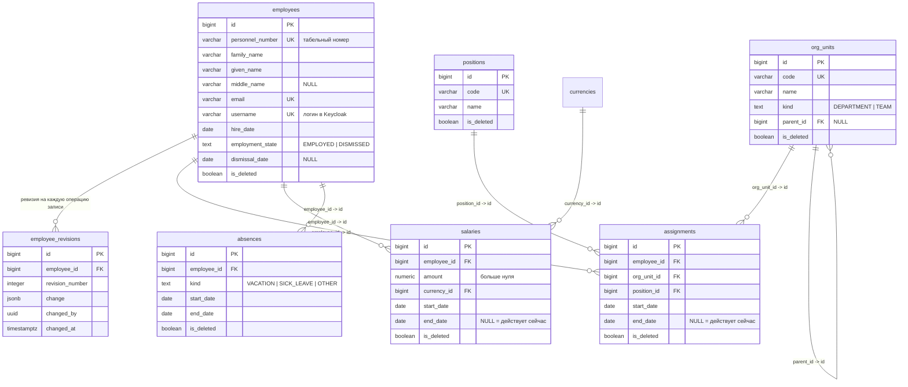

# 120 - Data Model

> Формат - см. [состав документов](documents-composition.md), документ 120.
> Источник - [системные требования, разделы 4, 6, 9](system-requirements.md), [сущности](050.entities.md), [ADR-001, 002, 016, 018, 022](145.architecture-decisions.md), миграции `deployments/migrations/`.

Редакция 2026-10-20: схема приведена к реализации справочника валют (ADR-022) и распространена на остальные справочники первой версии. Прежняя редакция описывала текстовые идентификаторы из кодов стандартов, столбцы `display_name`, `etag`, `delete_time` и ревизии со списком изменённых полей.

## 1. Принцип

Один справочник - одна таблица записей, одна таблица истории и одно представление с вычисленным жизненным циклом (BR-RM-01, FR-RM-45). Имя таблицы записей равно коллекции API (`countries`), таблица истории - `{справочник}_revisions` в единственном числе (`country_revisions`), представление - `v_expanded_{справочник}` (`v_expanded_country`). Ключ записи - суррогатный `BIGINT`, который назначает база. Коды стандартов и прочие деловые ключи хранятся в собственных столбцах с уникальными индексами. Собственные столбцы типизированы и ограничены средствами базы. Описания справочников в данных не хранятся. Сервисная таблица одна - версия схемы хранилища `schema_migrations`.

Таблицы валют создаёт миграция `000001`, таблицы остальных девяти справочников - миграции `000002`..`000010`, которые порождает генератор `backend/tools/gencatalog` из описания полей. Миграция `000011` дополняет представление сотрудников действующим назначением. Кадровые справочники следуют тому же принципу: датированные записи хранятся в собственных таблицах со ссылкой на сотрудника и периодом действия.

## 2. ER-диаграмма

### 2.1. Классификаторы

У `project_roles` и `grades` есть таблицы истории `project_role_revisions` и `grade_revisions` с теми же столбцами. На диаграмме они опущены.

### 2.2. Кадровые справочники

У таблиц `org_units`, `positions`, `assignments`, `salaries`, `absences` есть свои таблицы истории с теми же столбцами, что `employee_revisions`. На диаграмме они опущены.

## 3. Общие столбцы таблицы записей

| Столбец | Тип | Ограничения | Семантика |
| --- | --- | --- | --- |
| `id` | `bigint` | `PRIMARY KEY GENERATED ALWAYS AS IDENTITY` | Идентификатор записи в API; назначает база, не меняется (BR-RM-02) |
| `is_deleted` | `boolean` | `NOT NULL DEFAULT FALSE` | Мягкое удаление (BR-RM-05) |

Деловые ключи (`code`, `alpha2`, `personnel_number`, `email`, `username`) уникальны среди всех строк, включая удалённые (BR-RM-03). Кто и когда создал или изменил запись, в таблице не хранится: это ревизии (раздел 5), из которых представление вычисляет `revision`, `last_changer`, `created_at`, `updated_at`, `deleted_at`.

## 4. Столбцы справочников

### 4.1. Классификаторы

| Таблица | Столбец | Тип | Ограничения | Семантика |
| --- | --- | --- | --- | --- |
| `currencies` | `code` | `char(3)` | `NOT NULL`, уникальный индекс | Буквенный код ISO 4217 |
| `currencies` | `number` | `char(3)` | `NOT NULL`, уникальный индекс | Числовой код ISO 4217 строкой, чтобы сохранить ведущие нули |
| `currencies` | `name` | `varchar(128)` | `NOT NULL` | Наименование |
| `currencies` | `decimals` | `smallint` | `NOT NULL`, `CHECK (decimals BETWEEN 0 AND 4)` | Знаков дробной части |
| `countries` | `alpha2`, `alpha3`, `numeric_code` | `varchar` | `NOT NULL`, уникальные индексы | Коды ISO 3166-1 |
| `countries` | `name` | `varchar(128)` | `NOT NULL` | Наименование |
| `countries` | `currency_id` | `bigint` | `NULL`, `FOREIGN KEY` на `currencies(id)` | Основная валюта |
| `project_roles`, `grades`, `org_units`, `positions` | `code` | `varchar(64)` | `NOT NULL`, уникальный индекс | Стабильный код: строчные латинские буквы, цифры, дефис |
| `project_roles`, `grades`, `org_units`, `positions` | `name` | `varchar(128)` | `NOT NULL` | Наименование |
| `project_roles` | `description` | `varchar(512)` | `NULL` | Описание |
| `grades` | `rank` | `integer` | `NOT NULL`, `CHECK (rank BETWEEN 1 AND 100)` | Порядок грейда |

### 4.2. `employees`

| Столбец | Тип | Ограничения | Семантика |
| --- | --- | --- | --- |
| `personnel_number` | `varchar(10)` | `NOT NULL`, уникальный индекс, формат проверяет сервис | Табельный номер |
| `family_name`, `given_name` | `varchar(100)` | `NOT NULL` | Фамилия, имя |
| `middle_name` | `varchar(100)` | `NULL` | Отчество |
| `email` | `varchar(254)` | `NOT NULL`, уникальный индекс, формат проверяет сервис | Адрес почты |
| `username` | `varchar(64)` | `NOT NULL`, уникальный индекс | Логин в Keycloak; после создания не меняется |
| `hire_date` | `date` | `NOT NULL` | Дата приёма |
| `employment_state` | `text` | `NOT NULL DEFAULT 'EMPLOYED'`, `CHECK (employment_state IN ('EMPLOYED','DISMISSED'))` | Состояние занятости; меняется только увольнением |
| `dismissal_date` | `date` | `NULL`, `CHECK (dismissal_date IS NULL OR dismissal_date >= hire_date)` | Дата увольнения; заполнена тогда и только тогда, когда состояние DISMISSED (проверяет сервис) |

Поля записи `org_unit_id` и `position_id` в таблице не хранятся: представление `v_expanded_employee` берёт их из строки `assignments`, действующей на текущую дату (миграция `000011`). Столбцы учётной записи Keycloak (`account_state`, `account_user_id`, идентификатор операции) появятся вместе с реализацией FR-RM-53..58.

### 4.3. `org_units` и `positions`

| Таблица | Столбец | Тип | Ограничения | Семантика |
| --- | --- | --- | --- | --- |
| `org_units` | `kind` | `text` | `NOT NULL`, `CHECK (kind IN ('DEPARTMENT','TEAM'))` | Отдел или команда |
| `org_units` | `parent_id` | `bigint` | `NULL`, `FOREIGN KEY` на `org_units(id)` | Вышестоящее подразделение |
| `positions` | - | - | Только `code` и `name` | Код и название должности |

Цикл в иерархии базой не проверяется: сервис перед записью проходит предков нового родителя рекурсивным запросом и отклоняет ссылку на себя или на подчинённое подразделение (FR-RM-50).

### 4.4. `assignments`, `salaries`, `absences`

| Таблица | Столбец | Тип | Ограничения | Семантика |
| --- | --- | --- | --- | --- |
| все три | `employee_id` | `bigint` | `NOT NULL`, `FOREIGN KEY` на `employees(id)` | Сотрудник; не меняется |
| все три | `start_date` | `date` | `NOT NULL` | Действует с даты |
| `assignments`, `salaries` | `end_date` | `date` | `NULL`, `CHECK (end_date IS NULL OR end_date >= start_date)` | Действует по дату включительно; пусто - действует сейчас |
| `absences` | `end_date` | `date` | `NOT NULL`, `CHECK (end_date >= start_date)` | Последний день отсутствия |
| `assignments` | `org_unit_id`, `position_id` | `bigint` | `NOT NULL`, `FOREIGN KEY` | Подразделение, должность |
| `salaries` | `amount` | `numeric(14,2)` | `NOT NULL`, `CHECK (amount > 0)` | Оклад в месяц |
| `salaries` | `currency_id` | `bigint` | `NOT NULL`, `FOREIGN KEY` на `currencies(id)` | Валюта оклада |
| `absences` | `kind` | `text` | `NOT NULL`, `CHECK (kind IN ('VACATION','SICK_LEAVE','OTHER'))` | Вид отсутствия |

Непересечение периодов (FR-RM-52) в `assignments` и `salaries` задаёт ограничение исключения `EXCLUDE USING gist (employee_id WITH =, daterange(start_date, end_date, '[]') WITH &&) WHERE (NOT is_deleted)` (расширение `btree_gist`). Нарушение переводится в ответ 400 с сообщением о пересечении периодов. Существование и активность ссылок, а также состояние сотрудника для новой записи сервис проверяет до записи, чтобы вернуть ошибки по полям.

## 5. Столбцы таблицы истории

| Столбец | Тип | Ограничения | Семантика |
| --- | --- | --- | --- |
| `id` | `bigint` | `PRIMARY KEY GENERATED ALWAYS AS IDENTITY` | Внутренний ключ |
| `{справочник}_id` | `bigint` | `NOT NULL`, `FOREIGN KEY ... ON DELETE CASCADE` | Запись, к которой относится ревизия |
| `revision_number` | `integer` | `NOT NULL`, `CHECK (>= 1)`, `UNIQUE ({справочник}_id, revision_number)` | Номер ревизии внутри записи |
| `change` | `jsonb` | `NOT NULL` | JSON Patch (RFC 6902) относительно предыдущего состояния; ревизия 1 - относительно пустого документа. Документ состояния - собственные поля и `is_deleted` |
| `changed_by` | `uuid` | `NOT NULL` | Актор из токена |
| `changed_at` | `timestamptz` | `NOT NULL DEFAULT now()` | Когда |

Уникальность пары `({справочник}_id, revision_number)` защищает от параллельных изменений: операция записи читает запись, вставляет ревизию с номером на единицу больше и получает конфликт, если другой запрос успел раньше. Строки истории только добавляются; при удалении записи с `force=true` они удаляются каскадом вместе с ней.

## 6. Представления

`v_expanded_{справочник}` отдаёт столбцы записи и жизненный цикл, вычисленный по истории:

| Столбец | Вычисление |
| --- | --- |
| `revision` | `MAX(revision_number)` |
| `last_changer` | `changed_by` ревизии с наибольшим номером |
| `created_at` | `changed_at` ревизии 1 |
| `updated_at` | `MAX(changed_at)` |
| `deleted_at` | `MAX(changed_at)` ревизий, в `change` которых `/is_deleted` стало `true` |

Представление сотрудников дополнительно отдаёт `org_unit_id` и `position_id` из строки `assignments` с `start_date <= CURRENT_DATE`, пустым или не наступившим `end_date` и `is_deleted = FALSE`.

## 7. Индексы

Создаются одинаково для каждого справочника (NFR-RM-20, NFR-RM-46).

| Индекс | Определение | Назначение |
| --- | --- | --- |
| `uq_{таблица}_{столбец}` | `UNIQUE ({столбец})` | Уникальность деловых ключей, включая удалённые записи |
| `idx_{таблица}_active` | `(id) WHERE is_deleted = FALSE` | Список по умолчанию |
| `idx_{таблица}_{ссылка}` | `({ссылка}_id)` | Внешние ключи |
| `idx_{справочник}_revisions_{справочник}_id` | `({справочник}_id)` | История записи |
| `idx_{справочник}_revisions_covering_agg` | `({справочник}_id, revision_number DESC) INCLUDE (changed_at, changed_by, change)` | Вычисление жизненного цикла в представлении |
| `idx_{справочник}_revisions_changed_at` | `(changed_at)` | Сквозной просмотр истории справочника |

Индексы кадровых таблиц:

| Индекс | Определение | Назначение |
| --- | --- | --- |
| `idx_employees_employment_state` | `(employment_state) WHERE is_deleted = FALSE` | Список работающих сотрудников |
| `idx_org_units_parent` | `(parent_id) WHERE is_deleted = FALSE` | Подчинённые подразделения |
| `excl_assignments_employee_period`, `excl_salaries_employee_period` | Ограничение исключения по сотруднику и диапазону дат среди неудалённых строк | Непересечение периодов и поиск значения на дату |
| `idx_absences_employee_period` | `(employee_id, start_date, end_date) WHERE is_deleted = FALSE` | Отсутствия сотрудника за период |

## 8. Связи

| Связь | Кратность | Реализация | Каскад |
| --- | --- | --- | --- |
| Запись -> Ревизии | 1 : N | `{справочник}_id` -> `id` таблицы записей | `ON DELETE CASCADE`: при удалении с `force=true` история уходит вместе с записью |
| Запись -> Запись другого справочника | N : 1 | Столбец `{ссылка}_id` с `FOREIGN KEY` на `id` целевого справочника | Без каскада; ссылка на мягко удалённую запись остаётся корректной, на удалённую с `force=true` сослаться нельзя |
| Сотрудник -> Назначения, Оклады, Отсутствия | 1 : N | Столбец `employee_id` | Без каскада |
| Подразделение -> Подразделение | N : 1 | Столбец `parent_id` | Без каскада |
| Сотрудник -> Учётная запись Keycloak | 1 : 1 | Планируется столбец `account_user_id` (FR-RM-53..58) | Связь поддерживается интеграцией (BR-RM-15) |

## 9. Правила бизнес-логики на уровне данных

- Нарушение уникального индекса переводится в ответ 409. Нарушение `FOREIGN KEY`, `CHECK` и ограничения исключения - в ответ 400. Сервис проверяет правила полей, ссылок и периодов до обращения к базе, чтобы вернуть все ошибки разом (FR-RM-35).
- Мягкое удаление - обновление `is_deleted` с новой ревизией. Удалённая запись не изменяется методами API, потому что читается только с `allowDeleted=true`.
- Операция записи и вставка ревизии выполняются в одной транзакции. Откат отменяет обе (BR-RM-10). Номер ревизии - номер текущей плюс один. Занятый номер означает параллельное изменение.
- Эволюция схемы: добавление столбца только `NULL` или с `DEFAULT`; удаление и смена типа запрещены (BR-RM-06). Ревизии старых версий нового столбца не содержат.
- Увольнение в одной транзакции меняет `employment_state`, заполняет `dismissal_date` и проставляет `end_date` в действующих строках `assignments` и `salaries` сотрудника, каждая с собственной ревизией (FR-RM-54).
- Смена должности или оклада не изменяет прежнюю строку, кроме её `end_date`: новое значение вставляется новой строкой (BR-RM-16).

## 10. Учётные записи хранилища

| Учётная запись | Права | Кто использует |
| --- | --- | --- |
| Задание изменений схемы | Изменение схемы, все операции над данными | Задание изменений схемы (NFR-RM-21) |
| Сервис | Чтение, добавление, изменение таблиц записей; чтение и добавление таблиц истории; чтение версии схемы | Приложение (NFR-RM-16) |

Разделение учётных записей в коде ещё не выполнено (K-08 в [020](020.system-context.md)): сервис и миграции подключаются одной учётной записью, а удаление с `force=true` требует права на удаление строк. Доступ к окладам и отсутствиям ограничивается ролями API в сервисном слое, отдельной учётной записи хранилища для них нет.

## 11. Соответствие сущностям

| Сущность из 050 | Реализация |
| --- | --- |
| Справочник | Таблицы `{справочник}` и `{справочник}_revisions`, представление `v_expanded_{справочник}`, схема записи в спецификации |
| Запись справочника | Строка таблицы записей; `revision`, `last_changer`, `created_at`, `updated_at`, `deleted_at` вычисляются |
| Ревизия | Строка таблицы истории справочника |
| Сотрудник | Строка `employees`; `org_unit_id` и `position_id` вычисляются по `assignments` |
| Подразделение, должность | Строки `org_units`, `positions` |
| Назначение, оклад, отсутствие | Строки `assignments`, `salaries`, `absences` с периодом действия |
| Учётная запись | В хранилище нет; столбцы связи появятся с FR-RM-53..58 |
| Версия схемы | `schema_migrations.version`, сравнивается в проверке готовности |
