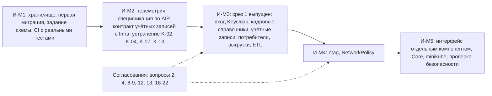

# 160 - Integration Plan

> Формат - см. [состав документов](documents-composition.md), документ 160.
> Источник - [системные требования, разделы 5, 9.2, 12](system-requirements.md), [контекст](020.system-context.md), [эпики](090.features-epics.md), [спецификация интеграционного решения](162.integration-spec.md).

Вехи интеграций И-M1..И-M5 привязаны к вехам проекта: И-M1, И-M2 - подготовка среза 1 (M4), И-M3 - выпуск среза 1 (M4), И-M4 - срез 2, И-M5 - срез 3 и приёмка (M5). Сроки в календарных датах определяет команда с преподавателем; здесь порядок и критерии.

## 1. Перечень интеграций

| № | С кем | Тип | Протокол | Направление | Веха | Ответственный со стороны сервиса | Ответственный с другой стороны | Критерий готовности |
| --- | --- | --- | --- | --- | --- | --- | --- | --- |
| I-01 | Хранилище (PostgreSQL) | База данных | TCP | Сервис -> хранилище | И-M1 | Команда справочников | Infra (стенд, кластер) | `/v1/health/readyz` 200; две учётные записи с правами по [120, раздел 9](120.data-model.md) (K-08); первая миграция применена (K-11) |
| I-02 | Задание изменений схемы | Infra | Задание, Job | Задание -> хранилище | И-M1 | Команда справочников | Infra | Цель Taskfile; Job в манифестах; сервис изменений схемы удалён из Compose (K-04) |
| I-03 | OpenTelemetry Collector | Телеметрия | OTLP | Сервис -> коллектор | И-M2 | Команда справочников | Infra | Трассы, метрики, журналы видны в бэкенде Infra; транспорт и адрес согласованы (вопрос 8) |
| I-08 | Keycloak: вход | Идентификация | OIDC, JWKS | Сервис -> Keycloak; пользователи -> Keycloak | И-M3 | Команда справочников | Infra, команда Keycloak | Пять ролей сервиса (R-01, R-02, R-04, R-05, R-06) и путь к ним в токене (вопрос 6); источник ключей (вопрос 7); сервисные учётные записи потребителей с ролями (раздел 4.3); запрос без токена отклоняется |
| I-11 | Keycloak: учётные записи сотрудников | Управление пользователями | Admin REST API, client credentials | Сервис -> Keycloak | И-M2 согласование, И-M3 реализация | Команда справочников: координация вызовов, состояния, повтор | Infra: realm, служебный клиент `reference-manager-provisioner`, минимальные права, секрет | Приём создаёт и включает учётную запись, увольнение блокирует; при недоступном Keycloak профиль в PENDING и повтор не создаёт дубль; способ выдачи временного пароля согласован (вопрос 18); новая учётная запись без ролей сервиса, роли назначает администратор Keycloak (ADR-024) |
| I-06 | Task Tracker | Потребитель | REST `/v1`, кэш на стороне Task Tracker | Task Tracker -> сервис | И-M3 | Команда справочников | Команда Task Tracker | Task Tracker под клиентом `tracker-directory` читает профили (`/v1/profiles?includeInactive=true`) и подразделения (`/v1/org_units/?allowDeleted=true`) постранично по расписанию; формат выдачи подтверждён вместо запрошенного `snapshot` |
| I-04 | Planning System | Потребитель | REST `/v1` | Planning System -> сервис | И-M3 | Команда справочников | Команда Planning System | Справочники `employees`, `org_units`, `positions`, `assignments`, `salaries`, `absences`, `project_roles`, `grades`, `currencies` заведены; чтение из их среды проходит; сервисной учётной записи выдана роль `reference-hr-reader` (вопрос 22); состав ролей и грейдов получен (вопрос 2) |
| I-12 | QA System (управление тестированием и качеством) | Потребитель | REST `/v1`, кэш на стороне QA System | QA System -> сервис | И-M3 | Команда справочников | Команда QA | QA System под клиентом `qa-executor` с ролью `reference-profile-reader` читает только профили (`/v1/profiles?includeInactive=true`) для подбора тестировщиков; решение по справочникам окружений и типов кейсов записано (вопрос 21); кейсы TC-RM проходят |
| I-05 | Reports | Потребитель | REST, кэш на стороне Reports | Reports -> сервис | И-M3 | Команда справочников | Команда Reports | Reports читает справочники для разрезов; решение по `competencies` (вопрос 4); статусы, приоритеты и серьёзность Reports получает из Task Tracker и QA System |
| I-13 | Аналитическое хранилище отчётности | ETL | REST `/v1`: `List` постранично с `allowDeleted` | Задание ETL Reports -> сервис | И-M3 | Команда справочников: контракт чтения, сервисная учётная запись | Команда Reports: задание, расписание, загрузка в хранилище; Infra: запуск по расписанию | Задание извлекает полный справочник не реже раза в час; число полученных записей совпадает с числом строк справочника |
| I-10 | Потребители выгрузок | Файл в ответе | REST, `POST /v1/{справочник}/export` | Пользователи -> сервис | И-M3 | Команда справочников | Reports, администраторы | Файл открывается в Excel без предупреждений, идентификаторы как текст; предел выгрузки согласован |
| I-09 | Infra: Kubernetes, CI/CD | Развёртывание | Манифесты, GitHub Actions | Infra -> сервис | И-M1..И-M5 | Команда справочников: манифесты модуля | Infra: кластер, общие сервисы, маршрутизация | Workflow с линтером, тестами, проверкой схемы и сборкой образов; развёртывание в minikube манифестами из [165](165.deployment-diagram.md); NetworkPolicy egress (NFR-RM-32); целевые показатели (вопрос 9) |
| I-07 | Core | Потребитель | REST | Core -> сервис | И-M5 | Команда справочников | Команда Core | Потребности Core учтены в составе; чтение проходит |

Виды интеграции проекта, которые модуль не использует:

| Вид | Решение | Где обосновано |
| --- | --- | --- |
| Очередь событий | Не используется: потребители перечитывают по REST, отказ подтверждён их документами | [135](135.event-catalog.md), [162, раздел 2](162.integration-spec.md) |
| Обмен файлами через объектное хранилище | Не используется: файл выгрузки отдаётся в ответе и не сохраняется, бакет не нужен. Бакет `arch-dev-reference-manager`, созданный Infra, получает только мок демонстрационного стенда Infra, вопрос о нём задан в #163 | [162, раздел 6](162.integration-spec.md) |

## 2. Порядок реализации

| Веха | Шаги | Выход |
| --- | --- | --- |
| И-M1 | Учётные записи хранилища; первая миграция по 120; цель Taskfile для изменений схемы; удаление сервиса из Compose; секреты из переменных окружения; workflow CI с реальными тестами | Хранилище и конвейер готовы к первому справочнику |
| И-M2 | Спецификация OpenAPI по AIP для справочников первой версии; экспорт телеметрии, `X-Request-Id`, `X-Trace-Id`; ограничения в конфигурацию; транспорт OTLP; согласование с Infra профиля, идентификатора связи, состояний и способа выдачи временного пароля | Контракт и наблюдаемость готовы, расхождения с требованиями закрыты, контракт учётных записей согласован |
| И-M3 | ADR-011; методы по описанию справочника; история как ревизии; проверка токена и ролей; кадровые справочники; создание и блокировка учётных записей; классификаторы; выгрузка; общий набор тестов; чтение из сред потребителей; задание ETL Reports | Первая версия по критериям 1-14 раздела 11 требований |
| И-M4 | NetworkPolicy | Исходящий трафик ограничен |
| И-M5 | Админ-панель на имитированных данных, стек интерфейса, интерфейс отдельным компонентом; потребности Core; манифесты и развёртывание в minikube; отчёт проверки безопасности; отложенные вопросы 3, 11, 13, 16 | Полный контур, приёмка по критерию 15 |

Админ-панель на имитированных данных от API не зависит и может выполняться параллельно с И-M1..И-M3.

## 3. Открытые согласования

| Вопрос требований | Тема | Стороны | Ответственный | Блокирует |
| --- | --- | --- | --- | --- |
| 2 | Состав проектных ролей и грейдов: решён со стороны модуля 2026-11-24 (раздел 5), ждёт подтверждения Planning System в #143 | Planning System | Команда справочников передаёт перечень и правило пополнения, Planning System подтверждает | I-04 |
| 3 | Инкрементальная выдача изменений | Все потребители | Команда справочников | E-09 |
| 4 | Закрыт 2026-10-29: компетенции в первой версии не нужны (Q-REP-09 Reports) | Reports | Команда Reports | I-05 |
| 6, 7 | Закрыты 2026-10-29, уточнены 2026-11-23: четыре роли клиента `reference-manager`, путь `resource_access.reference-manager.roles` (изменение #194), ролей по умолчанию нет (ADR-024); источник ключей - JWKS realm. Роли в realm Infra заданы изменением #194, выдача на стенде - #163 | Infra, команда Keycloak | Infra | I-08, I-11 |
| 8 | Закрыт 2026-10-29: OTLP gRPC `otel-collector:4317`, HTTP `:4318` (D-OTLP Infra) | Infra | Infra | I-03 |
| 9 | Целевые показатели | Infra | Infra | приёмка NFR-RM-18, 19 |
| 10 | Закрыт 2026-10-29: данные вводятся через API после развёртывания, для стенда - `deployments/seed/demo.sql` | Команда справочников | Команда справочников | I-04 |
| 11 | Точка со списком справочников | Потребители, интерфейс | Команда справочников | E-09 |
| 12 | Переиспользование кода методов | Команда справочников | Команда справочников | И-M3 |
| 13 | Закрыт 2026-10-20: выгрузка методом `POST /v1/{справочник}/export` | Reports, администраторы | Команда справочников | I-10 |
| 16 | Локализация | Потребители | Команда справочников | E-09 |
| 18 | Способ выдачи временного пароля | Infra | Команда справочников с Infra | I-11 |
| 19 | Закрыт 2026-10-29: потребности в `units`, `funding_types`, `cost_items`, `languages`, `tax_categories` у потребителей нет, вне состава первой версии | Planning System, Reports | Команда справочников | состав следующей версии |
| 20 | Закрыт 2026-10-29: календари и нормы ведёт Planning System, сервис - отсутствия | Planning System | Команда Planning System | состав следующей версии |
| 21 | Закрыт 2026-10-29: окружения и типы тест-кейсов ведёт QA System (их 050, раздел 1а) | QA System | Команда QA | I-12 |
| 22 | Закрыт 2026-10-29: `reference-hr-reader` - сервисной учётной записи `planning-service`, Reports роль не нужна, остальные читают под `reference-reader` (выдача - #163) | Planning System, Reports, Infra | Команда справочников | I-04 |

Закрыто 2026-10-02: вопрос 1 (статусы и приоритеты задач ведёт Task Tracker, серьёзность дефектов - QA System), вопрос 14 (загрузка из файла - в конце, если останется время), вопрос 17 (сотрудники входят в состав модуля), ожидание событий у Planning System (их документы описывают чтение по REST).

## 4. Состояние обращений

Таблица ниже - сверка на 2026-11-04 с документами Infra (влиты в `main` предложением #128), ответами команд и кодом после замечаний от 2026-10-25 и разбора от 2026-11-01. Разделы 4.1-4.4 - сверка на 2026-11-24 по проверке руководителя проекта от 2026-11-23. Локальный стенд модуля содержит служебные клиенты потребителей `reports-client`, `planning-service`, `tracker-directory` и `qa-executor` с теми же именами и ролями, что в realm Infra ([165, раздел 7](165.deployment-diagram.md), до 2026-11-24 два последних назывались `task-tracker-service` и `qa-service`), на нём каждая команда может проверить чтение до выдачи доступов на общем стенде.

| Обращение | Состояние | Подтверждение |
| --- | --- | --- |
| I-01 | Выполнено на локальном стенде: `readyz` 200, две учётные записи хранилища (K-08 закрыто 2026-10-29), миграции `000001`..`000012` | [120, раздел 10](120.data-model.md); стенд Infra - `compose.modules.yaml` |
| I-02 | Открыто: в Compose изменения схемы по-прежнему выполняет сервис `reference-manager-migrations` (K-04); Job в манифестах - срез 3 | - |
| I-03 | Подтверждено Infra: коллектор `otel-collector:4317` gRPC и `:4318` HTTP (D-OTLP). Вопрос 8 закрыт | `infra/docs/160.integration-plan.md` |
| I-08 | Частично: источник ключей - JWKS realm (D-JWKS, вопрос 7 закрыт); в realm Infra есть клиент `reference-manager` и роль `reference-hr-reader`, роли `reference-reader`, `reference-admin`, `reference-hr-admin` отсутствуют - запрошены у Infra (#163) | `infra/keycloak/realm/desired.json`, `infra/docs/070.role-matrix.md` |
| I-11 | Подтверждено Infra и реализовано 2026-10-29: клиент `reference-manager-provisioner` с ролями `manage-users`, `view-users`, `query-users`, `view-realm`; приём создаёт и включает учётную запись, увольнение блокирует, `syncAccount` повторяет без дубля. Открыт вопрос 18 (D-PASSWORD) | `infra/keycloak/realm/desired.json`; [130, раздел 8](130.api-contracts.md); сценарии `tests/features/catalogs/accounts.feature` |
| I-06 | Подтверждено документами и кодом Task Tracker: единый snapshot отвергнут, клиент каталога читает `/v1/employees/` и `/v1/org_units/` постранично по `nextPageToken` (их 162, DEC-TT-03, PR #177). Совместная проверка на живых сервисах не проведена, запрос письменного подтверждения и прогона на стенде модуля с клиентом `tracker-directory` (до 2026-11-24 `task-tracker-service`) - #182 (#96). С 2026-11-24 - раздел 4.1 | `task-tracker/docs/block-i-integration-and-deployment/162.integration-spec.md` |
| I-04 | Подтверждено документами Planning System: контракт чтения принят, `employeeId` - ключ записи, субъект - `account_user_id` (их 162, INT-02); роль `reference-hr-reader` выдаётся `planning-service` (вопрос 22 закрыт). Ответ на их запрос #143 дан 2026-11-04: поля и версия `1.1.0`, идентификатор и `account_user_id` при переименовании не меняются, увольнение - `employment_state` DISMISSED с датой, демонстрационные сотрудники 1..8 набора `deployments/seed/demo.sql`, календари и нормы ведёт Planning System. Адрес на стенде модуля - `http://localhost:8083/v1/` (вопрос MY-16 разбора) | `planning-system/docs/162.integration-spec.md` |
| I-12 | Подтверждено документами QA: `employees` и `org_units` читаются постранично, `account_user_id` = `sub` (их 020, 030). Расхождение: в их 130 параметры `show_deleted` и `page_size`, у сервиса `allowDeleted` и `pageSize`. Запрос исправить и проверить чтение на стенде модуля с клиентом `qa-executor` (до 2026-11-24 `qa-service`) - #183. С 2026-11-24 QA читает только профили, раздел 4.1 | `qa/docs/020.system-context.md` |
| I-05 | Закрыто 2026-10-29: компетенции в первой версии не нужны (Q-REP-09 Reports, вопрос 4 закрыт) | ответ Reports в #115 |
| I-13 | Подтверждено Reports 2026-10-29: перечень `employees`, `org_units`, `positions`, `project_roles`, `grades`; раз в час и полная сверка в 02:00; `allowDeleted=true`, `pageSize` до 100, роль `reference-reader`; расписание и роль запрошены у Infra (#158). Связь сотрудника: `id` - ключ, `account_user_id` = `sub`, `username` = логин (ответ на Q-REP-16). Прогон ETL Reports на живых сервисах (их PR #180) пропустил модуль: на стенде не было клиента с ролью `reference-reader`. С 2026-11-04 он есть: `reports-client` | ответ Reports в #115 и наш ответ там же; `reports/docs/020.system-context.md` |
| I-10 | Выполнено: `POST /v1/{справочник}/export`, предел выгрузки снят (FR-RM-43 отозвано). С 2026-11-04 выгрузка принимает отбор списка и момент среза (FR-RM-62) | [130, раздел 3](130.api-contracts.md) |
| I-09 | Частично: workflow проверок и workflow выпуска в GHCR (K-15 закрыто 2026-10-29); Infra добавила шаблон `reference-manager-pipeline.yml` на `reusable-service-ci.yml`; манифесты minikube - срез 3 | `.github/workflows/`, [165, раздел 8](165.deployment-diagram.md) |
| I-07 | Закрыто 2026-10-29: команды и сервиса Core нет (глоссарий Infra: Core - прежнее имя схемы "приложение и его база"); потребности базы и развёртывания учтены в I-01 и I-09 | `infra/docs/010.glossary.md` |

Сверка 2026-11-10 с `main` после демонстрационного стенда Infra (предложение #189). Этот стенд запускает моки вместо приложений команд и, по словам самой Infra, бизнес-интеграции команд не подтверждает (`infra/k8s/demo/README.md`). В `infra/keycloak/realm/desired.json` у клиента `reference-manager` по-прежнему одна роль `reference-hr-reader`. У служебной учётной записи `planning-service` есть аудитория `reference-manager`, но нет роли, поэтому сервис ответит ей 403. У `reports-client` нет аудитории `reference-manager`, сервис ответит 401. Демонстрационным пользователям `member`, `lead` и `admin` роли справочников не выданы. Напоминание отправлено в #163. Бакет `arch-dev-reference-manager` получает мок, сервис бакет не использует ([162, раздел 6](162.integration-spec.md)).

### 4.1. Четыре связи с соседями на 2026-11-24

| Связь | Кто и что | В каком виде | С какого момента | Подтверждение | Состояние |
| --- | --- | --- | --- | --- | --- |
| Infra: роли клиента и служебных входов | Модуль определяет и проверяет роли, Infra выдаёт роли клиента `reference-manager` служебным входам потребителей и демонстрационным пользователям | Роли клиента в `infra/keycloak/realm/desired.json`, назначения делает конвергенция при создании клиента | В `desired.json` с 2026-11-16 (#194) | Раздел 4.3: на пустом томе Keycloak роли получают все четыре клиента | Ждёт Infra: на стенде, где Keycloak создан до #194, роли не выданы (#163) |
| Infra: роль новой учётной записи | Модуль создаёт учётную запись сотрудника без ролей сервиса, роли назначает администратор Keycloak | ADR-024, FR-RM-53 | 2026-11-23 | `accounts.feature`: у новой учётной записи нет ролей клиента `reference-manager`, в том числе через группы и роли по умолчанию | Решено, сообщено в #163 и #164 |
| Task Tracker: чтение и изменения | Task Tracker под `tracker-directory` (`reference-reader`) читает профили и подразделения | `/v1/profiles?includeInactive=true` и `/v1/org_units/?allowDeleted=true` по 100 записей. Полное перечитывание по расписанию, изменение замечается по сумме SHA-256 данных, удаление - по `isDeleted` и `is_deleted` | Код Task Tracker после #195 (`DirectoryService.java`) | `consumers.feature`: чтение, переименование подразделения, удаление сотрудника | Ждёт письменного подтверждения Task Tracker (#182) |
| QA System: параметры чтения | QA System под `qa-executor` (`reference-profile-reader`) читает только профили | `/v1/profiles?includeInactive=true&pageSize=100` с `pageToken`, издатель профиля сверяется с настройкой QA | Код QA (`qa/backend/app/profiles.py`) | `consumers.feature`: профили 200, сотрудники 403 с причиной | Прежнее расхождение `show_deleted` и `page_size` к профилям не относится. Ждёт подтверждения QA (#183) |
| Planning System: кадровое чтение | Planning System под `planning-service` (`reference-hr-reader`) читает сотрудников, назначения, должности, подразделения и отсутствия | Постранично с общим `readTime` и `allowDeleted=true`. Ключ - `id`, субъект - `account_user_id` | Клиент Planning `server/reference_manager.py` (#188) | `consumers.feature`; наш ответ в #143 от 2026-11-04 | Переименование и удаление не меняют `id`. Роли и грейды - раздел 5, ждёт подтверждения в #143 |

### 4.2. Потребители: что читают и чем это подтверждается

| Потребитель | Клиент | Роль | Что читает | Проверка |
| --- | --- | --- | --- | --- |
| Planning System | `planning-service` | `reference-hr-reader` | `employees`, `assignments`, `positions`, `org_units`, `absences` (клиент #188); `project_roles` и `grades` - по разделу 5 после подтверждения | `consumers.feature`: 200 на каждый путь, включая роли и грейды |
| Reports | `reports-client` | `reference-reader` | `employees`, `org_units`, `positions`, `project_roles`, `grades`, профили | `consumers.feature`: 200, оклады - 403 с причиной |
| Task Tracker | `tracker-directory` | `reference-reader` | Профили, `org_units` | `consumers.feature`: 200. Переименованное подразделение видно в профиле, удалённый сотрудник читается с `allowDeleted=true` и уходит из активных профилей. Отсутствия - 403 |
| QA System | `qa-executor` | `reference-profile-reader` | Только профили | `consumers.feature`: 200 на профили, 403 с причиной на сотрудников |

Сценарии идут на локальном realm модуля, клиенты и роли которого совпадают с realm Infra. Прогон 2026-11-24: 248 сценариев, все прошли, из них 23 сценария `consumers.feature`.

### 4.3. Роли служебных входов на общем стенде

Проверка руководителя проекта 2026-11-23 получила от сервиса 403 для Planning System и Reports. 2026-11-24 причина воспроизведена на Keycloak и конвергенции Infra из корневого `compose.yaml` в отдельном проекте Compose. Токен каждого клиента получен по client credentials:

| Состояние тома Keycloak | `planning-service` | `reports-client` | `tracker-directory` | `qa-executor` |
| --- | --- | --- | --- | --- |
| Пустой том, одна конвергенция по текущему `desired.json` | `reference-hr-reader` | `reference-reader` | `reference-reader` | `reference-profile-reader` |
| Том создан конвергенцией до #194, затем текущая конвергенция | нет ролей | нет ролей | `reference-reader` | нет ролей |

Во втором случае у всех четырёх клиентов в токене есть аудитория `reference-manager`, поэтому сервис принимает токен и отвечает 403. `infra/scripts/keycloak_converge.py` назначает роли служебной учётной записи только при создании клиента (`if created and grants`). Это правило Infra записано в `infra/keycloak/migration.md`: конвергенция не восстанавливает отозванные назначения. Поэтому клиенты, созданные до #194, ролей не получают, а `tracker-directory`, созданный позже, получает. Проверка воспроизводит механизм, а не сам стенд руководителя проекта. Решение за Infra: пересоздать том Keycloak стенда или один раз выдать роли, вопрос задан в #163.

### 4.4. Потребитель без роли

Сервис отвечает такому потребителю 403 с перечнем ролей, которые дают нужный доступ, и пишет отказ в журнал строкой `access denied` с `sub`, `azp`, ролями токена, методом и путём (FR-RM-65, [130, раздел 5.10](130.api-contracts.md)). По ответу команда потребителя видит, какую роль просить, а Infra по журналу находит служебный вход без роли. Роль выдаёт Infra по заявке в задаче команды.

Изменение #194 (влито 2026-11-16 без проверки владельцами кода модуля) изменило код модуля: убрало роль новой учётной записи, перевело роли в роли клиента, добавило профили и пятую роль. 2026-11-24 изменения описаны (ADR-024, ADR-025), сломанный сценарий приёма и начальное наполнение стенда, которое падало без файла `profiles.sql`, исправлены.

## 5. Состав проектных ролей и грейдов

Владелец перечня - команда справочников, значения ведёт роль `reference-admin` (группа G-1). Planning System читает их по REST: `GET /v1/project_roles/` и `GET /v1/grades/` с `allowDeleted=true`, постранично, вместе с кадровыми справочниками не реже раза в час (INT-RM-05). Перечень первой версии - набор `deployments/seed/demo.sql`:

| Справочник | Код | Наименование | Порядок |
| --- | --- | --- | --- |
| `project_roles` | `developer` | Разработчик | - |
| `project_roles` | `qa-engineer` | Тестировщик | - |
| `project_roles` | `analyst` | Аналитик | - |
| `project_roles` | `project-manager` | Руководитель проекта | - |
| `project_roles` | `devops` | Инженер DevOps | - |
| `grades` | `junior` | Junior | 1 |
| `grades` | `middle` | Middle | 2 |
| `grades` | `senior` | Senior | 3 |
| `grades` | `lead` | Lead | 4 |

Правила пополнения и чтения:

- Новое значение команда, которой оно нужно, просит задачей с меткой `reference-manager`, администратор справочников заводит запись. Изменения редкие, отдельного расписания у них нет.
- Ключ значения у потребителя - `id`. Код и наименование могут измениться, `id` не меняется.
- Удалённое значение остаётся читаемым с `allowDeleted=true` и `is_deleted: true`, его `id` не переиспользуется.
- Если Planning System нужна роль или грейд, которых нет в перечне, она не заводит значение у себя, а просит его добавить. До добавления значение в планировании не используется.
- Если Planning System встретила `id`, которого нет в её копии, она читает запись `GET /v1/project_roles/{id}` или `GET /v1/grades/{id}`. Ответ 404 значит, что запись удалена окончательно, ссылка на неё показывается как неизвестная.

Перечень и правила переданы Planning System в #143, вопрос 2 закрывается после их подтверждения.
