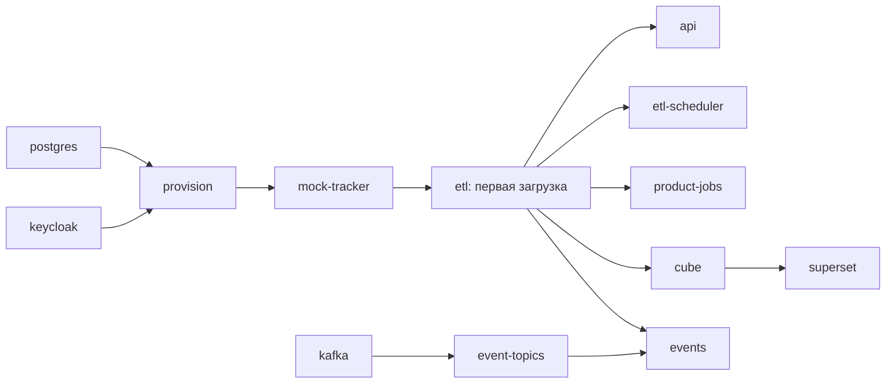

# Конвейер ETL: шаги, контейнеры и свежесть данных

Как данные четырёх источников попадают в хранилище Reports, какие контейнеры
это делают на стенде и через сколько изменение у источника видно в отчёте.
Короткое объяснение без деталей — [как это работает](how-it-works.md);
термины — [глоссарий](010.glossary.md), раздел 4; решения — ADR-004, ADR-007,
ADR-017 в [145](145.architecture-decisions.md); целевое развёртывание —
[165](165.deployment-diagram.md). Состояние на 03.11.2026.

## 1. Источники

| Источник | Что читаем | Как | Порция | Код |
| --- | --- | --- | --- | --- |
| Task Tracker | `work-items`, `time-logs`, `iterations`, `history`, `statuses` | REST `GET /api/v1/reports/*`, полный проход страниц | 100 строк (`page`, `pageSize`) | `adapters.numbered`, `etl.tracker_extract` |
| Planning System | `plan`, `demand`, `allocation`, `availability`, `forecast` | `POST /exports` с `Idempotency-Key` → manifest → страницы строк | до 200 строк (`cursor`) | `adapters.planning`, `etl.planning_extract` |
| Reference Manager | `employees`, `org_units`, `positions`, `project_roles`, `grades` | AIP `List` с `allowDeleted=true` | 100 строк (`pageToken`) | `adapters.reference` |
| QA System | `test-cases`, `test-plans`, `test-runs`, `test-results`, `defects` | REST `GET /api/v1/reports/{resource}` | по их контракту | `adapters.numbered(tracker=False)` |

QA объявила выгрузку в OpenAPI как «Planned, not implemented yet»
([qa/api](../../qa/api/openapi/v1/openapi.yaml), `listReportData`). Пока её нет,
метрики качества в DWH на стенде берутся только из демо-набора — внешний
блокер в [review-status](review-status.md).

**Прогон на живых сервисах, 04.11.2026.** Сервисы соседей подняты локально их
собственными `compose`, каждый отдельно: связь между ними не нужна, ETL читает
каждый источник напрямую. Сценарий — `pilots/check_live_sources.py`, [протокол](../pilots/artifacts/live-sources-verification.json).

| Источник | Результат |
| --- | --- |
| Planning System | Пройден. Отказ без токена (401); демо-план проведён их API через DRAFT → ON_REVIEW → APPROVED → ACTIVE; партия выгружена — план, потребность, 2 назначения, 10 строк доступности; повтор вернул ту же партию, 14 строк в обеих загрузках, без удвоения. Черновики, как и договорено, в партию не попадают |
| Task Tracker | Отклонён по контракту владельца. Отказ без токена (401) и вход нашего `reports-client` работают, но ответы расходятся с OpenAPI трекера: нет обязательного `total` во всех `/api/v1/reports/*`; у `work-items` нет `title`, `description`, `statusId`, `version`, `children`; `time-logs.loggedDate` — дата-время вместо даты. Адаптер правильно отказывает: без `total` нельзя проверить полноту выгрузки, без `statusId` и `version` — статусы и версии задач |
| Reference Manager | Не прогонялся: в их реалме нет сервисного клиента с ролью `reference-reader` |
| QA System | Невозможно: выгрузки для отчётности нет |

Данные у сервисов разные, поэтому прогон проверяет обмен с каждым источником,
а не согласованность данных между системами.

## 2. Шаги одной загрузки

Одна загрузка — один источник, один пакет `etl.batch`, одна транзакция
PostgreSQL. Код — `etl.load`.

| Шаг | Что происходит | Что считается ошибкой |
| --- | --- | --- |
| 1. Блокировка | `pg_try_advisory_xact_lock('reports-etl:<источник>')` на всё время чтения и записи | Второй экземпляр того же источника получает отказ `SOURCE_LOAD_IN_PROGRESS` и ничего не меняет |
| 2. Извлечение | Не чаще 5 запросов в секунду (интервал 0,2 с); тайм-аут 10 с; ответ не больше 16 МиБ; GET и POST с `Idempotency-Key` повторяются до 4 раз с паузой 2, 4, 8 с при 429, 5xx и обрыве сети. Перенаправления запрещены, чтобы токен не ушёл другому серверу | Страница не той длины, «плавающее» число страниц, `total` не сходится, пустая страница внутри, больше 10 000 страниц, строка не по схеме владельца |
| 3. Проверка | Строки трекера проверяются по схемам его OpenAPI (`contracts.py`); ID уникальны в ресурсе; у Planning manifest совпадает до и после чтения, статус `READY`, `schemaVersion` 1.0.0, партия не истекла | Любое нарушение — пакет `REJECTED` с кодом причины |
| 4. Преобразование | Часы — в целые центы; запись времени получает проект своей задачи; сотрудник связывается с Keycloak `sub` по `account_user_id` Reference Manager, запасной вариант — явная связь `hr-employee`; удаление у источника — явный признак, а не отсутствие строки (кроме полной партии Planning, где пропавшая строка закрывается) | Неизвестная связь не угадывается: строка попадает в «не задано» |
| 5. Загрузка | Строки пакета на время транзакции — `stg.record`, после успеха удаляются; принятые строки — `dwh.source_record`; версии справочников — SCD2 в `dwh.dimension_version`; первый успешный пакет за UTC-день пишет снимок `dwh.source_snapshot`; затем пересобирается звезда (`star.refresh`): измерения с SCD2, факты с суррогатными ключами и ключом −1 для неизвестного | Ошибка БД откатывает всю транзакцию |
| 6. Сверка | `maintenance.reconcile`: число и ID записей DWH сравниваются с только что прочитанным составом источника; итог — в `etl.reconciliation` | Расхождение (`*_DRIFT`) само ставит запрос на перезагрузку источника |
| 7. Отметка | `etl.checkpoint` и `etl.source_state` с `dataAsOf`; пакет `LOADED` | При `REJECTED` checkpoint и данные остаются прежними, API показывает `STALE` |

Повторная загрузка тех же данных ничего не удваивает: строки ключуются ID
источника, а меры считаются по текущему состоянию, а не суммой пакетов.

## 3. Контейнеры локального стенда

Стенд описан в [pilots/compose.yaml](../pilots/compose.yaml) и запускается
только через `launch.py`: он подставляет секреты из `~/secrets.env` в
окружение, не записывая их в файлы. Все прикладные контейнеры собираются из
одного образа `pilots/Dockerfile` (Python 3.12) и различаются командой.

| Контейнер | Роль в конвейере | Команда | Режим | Порт наружу |
| --- | --- | --- | --- | --- |
| `postgres` | Одна БД со схемами `etl`, `stg`, `dwh`, `ops`, `app`; роли `reports_owner`, `reports_app`, `reports_cube` | образ `postgres:16.13` | постоянно | — |
| `keycloak` | Вход пользователей и токены | `keycloak:26.8.1 start-dev` | постоянно | 8180 |
| `provision` | Создаёт realm, клиенты, роли, демо-пользователей, роли БД; связывает `sub` с пользователем трекера | `python provision.py` | один раз | — |
| `mock-tracker` | Заменитель Task Tracker: отдаёт пять ресурсов по его OpenAPI | `python demo.py` | постоянно | — |
| `etl` | Первая загрузка трекера по HTTP и загрузка демо-партий Planning, QA, справочников | `etl.py --url http://mock-tracker:8080` и `product_demo.py` | один раз | — |
| `etl-scheduler` | Повторная загрузка трекера каждые 60 с; пропущенные такты не догоняются; здоровье — по последнему циклу | `etl.py ... --every 60` | постоянно | — |
| `kafka` | Локальный брокер событий | `apache/kafka:3.9.1` | постоянно | — |
| `event-topics` | Создаёт топики трекера, QA, Planning, а также `dev.reports.delivery.v1` и `dev.reports.dlq.v1` | `event_runner.py --init` | один раз | — |
| `events` | Читает события, пишет в `ops` и `dwh` в одной транзакции с журналом `eventId`; offset фиксируется только после записи в БД; ошибочное событие — в `etl.event_dlq`, повтор вручную `event_runner.py --replay`; раз в 10 с — публикация outbox, запросы перезагрузки и суточное обслуживание после 02:00 (снимки, пропуски) | `event_runner.py` | постоянно | — |
| `api` | API и Reports UI; `/readyz` требует свежую успешную загрузку | `api.py` | постоянно | 8081 |
| `product-jobs` | Очередь выгрузок CSV/XLSX и подписок; такт 10 с; права получателей сверяет с Keycloak | `product_jobs.py` | постоянно | — |
| `cube` | Семантический слой: 11 кубов; у семи есть предагрегации (ADR-018), предагрегации и кэш результатов обновляются раз в минуту | `cubejs/cube:v1.6.75` | постоянно | 4000 |
| `superset` | Дашборды через Cube SQL API: R-01 (участник — RLS по `sub`) и R-06 план-факт для аналитиков (ADR-019) | `superset/Dockerfile` | постоянно | 8088 |

Разовые контейнеры `provision`, `etl`, `event-topics` после запуска находятся
в состоянии `Exited (0)` — это норма. Тома `pg-data` и `kc-data` хранят данные и
пользователей; удалять их можно только вместе, иначе `sub` пользователей
разойдутся с правилами доступа Superset.

**Отличия стенда от целевой схемы.** На стенде трекер заменён `mock-tracker`,
а Planning, QA и справочники загружаются один раз из демо-набора, без
расписания. Реальные источники подключаются командой `run_etl.py --source
tracker|planning|reference|qa --url …` с токеном из `~/secrets.env`
([пилоты](../pilots/README.md), раздел 5).

## 4. Целевое развёртывание

| Стенд | Общая среда Infra (Kubernetes, namespace `arch-reports`) |
| --- | --- |
| `etl` и `etl-scheduler` | CronJob на источник: Task Tracker, QA, Reference Manager — раз в час; Planning System — 02:00 Europe/Moscow и по сигналу; полная сверка — 02:00 |
| `events` | Deployment потребителя с группами `reports-task-tracker`, `reports-qa-ingest` |
| `postgres` | `reports-db` и потоковая реплика `reports-db-replica` Infra |
| `keycloak`, `provision` | Общий realm Infra; клиенты и роли выдаёт Infra ([#158](https://github.com/MEPhI-C22-501/arch-info-system-monorepo/issues/158)) |
| `kafka`, `event-topics` | Общий брокер и топики Infra |
| `product-jobs` | Deployment воркера; файлы — в бакете `arch-dev-reports` |
| `cube` | Cube API и refresh worker с Cubestore для общих кэша и очереди (ADR-017) |

Подробно — [165](165.deployment-diagram.md).

## 5. Свежесть: через сколько изменение у источника видно в отчёте

Числа «стенд» — расчёт по настройкам контейнеров выше. Число «цель» — порог из
[075](075.nfr.md), при превышении которого отчёт помечается как устаревший.

| Путь | Стенд | Цель | Из чего складывается |
| --- | --- | --- | --- |
| Task Tracker → Reports UI и API (R-01…R-11) | до 2 мин | 15 мин по REST, 5 мин после Kafka | Такт `etl-scheduler` 60 с + время загрузки; сервис отчётов читает DWH без кэша |
| Task Tracker → Superset R-01 | до 4 мин | 1 ч | Такт ETL 60 с + пересборка предагрегации 1 мин + кэш графика Superset 60 с + загрузка |
| Task Tracker → прочие кубы через Cube REST | до 3 мин | 1 ч | Такт ETL 60 с + пересборка предагрегации или обновление кэша результатов Cube раз в минуту (`refreshKey`) + загрузка |
| События Task Tracker и QA → `ops` и `dwh` | секунды | 5 мин и 2 мин | Опрос брокера раз в секунду, запись сразу |
| Planning System → DWH | при старте стенда | 24 ч, 1 ч после сигнала | Ежедневная полная партия и внеочередная по `PlanActivated` (Q-REP-05) |
| Reference Manager → DWH | при старте стенда | 1 ч | Ежечасный `List` |
| QA System → DWH | при старте стенда | 1 ч | Выгрузки у QA нет |

**Фактическое поведение стенда, 03.11.2026.** За 45 минут работы
`etl-scheduler` выполнил 46 загрузок трекера: интервал между запусками —
58,7 с в среднем, не больше 60 с; загрузка длится 0,9 с в среднем, не больше
2,6 с; одна загрузка получила `SOURCE_LOAD_IN_PROGRESS`, когда параллельно
стартовала разовая `etl`, — блокировка сработала. Cube с
`CUBEJS_REFRESH_WORKER=true` собрал все 9 предагрегаций за 40 с после старта
и дальше пересобирал их каждые 60 с без единого запроса (по новым версиям
таблиц в схеме `reports_preaggregations`). Без этого флага Cube собирал
предагрегации только при запросе: за 48 минут без запросов таблица часов не
обновилась ни разу. Сквозное изменение «источник → отчёт» на стенде не
измерить: заглушка трекера отдаёт неизменный набор; верхняя граница — сумма
измеренных звеньев из таблицы выше.

## 6. Скорость кубов

Замер 03.11.2026 — `check_cube_matrix.py`, артефакты
[с индексами](../pilots/artifacts/cube-matrix-benchmark.json) и
[без индексов](../pilots/artifacts/cube-matrix-benchmark-no-indexes.json).
Временный PostgreSQL 16.2 и Cube 1.6.75 в Linux-контейнере
([`ci/checks.Dockerfile`](../ci/checks.Dockerfile)), x86_64, 12 CPU, кэш и
очередь Cube — в памяти (ADR-017). Объём близок к NFR-03: 1 000 000 записей
трудозатрат, 10 000 задач, 20 000 дефектов, 40 000 переходов дефектов,
200 000 результатов тестов, 2 000 прогонов, потребности, назначения и
доступность — 50 проектов, 300 пользователей.

Как мерили: каждый куб в каждом режиме — отдельный свежий процесс Cube,
который загружает только этот куб. **Холодный** — первый запрос, включая сборку
его предагрегации. **Под нагрузкой** — 100 запросов от 20 одновременных
клиентов; к каждому запросу добавлен уникальный безвредный фильтр, поэтому он
выполняется заново, а не берётся из кэша ответа. Режим «по фактам» — та же
модель с удалённым блоком предагрегаций. Нижняя граница около 0,2 с — проверка
токена и прав в Cube, а не чтение данных.

| Куб | Предагрегация | Холодный, с | С предагрегацией: p50 / p95, с | По фактам: p50 / p95, с |
| --- | --- | --- | --- | --- |
| TimeLogs | `daily` | 1,07 | **0,20 / 0,25** | 7,90 / 10,30 |
| Resources | `utilizationDaily` | 1,33 | **0,21 / 0,28** | 11,03 / 11,28 |
| TestResults | `recordedDaily` | 0,38 | **0,26 / 0,37** | 1,48 / 1,53 |
| Defects | `createdDaily` | 0,21 | **0,21 / 0,27** | 0,66 / 0,69 |
| Quality | `byProject` | 0,20 | **0,18 / 0,21** | 0,70 / 0,74 |
| WorkItems | `byProject`, `completedDaily` | 0,18 | **0,23 / 0,28** | 0,26 / 0,33 |
| TestRuns | `finishedDaily` | 0,16 | **0,24 / 0,29** | 0,18 / 0,23 |
| WorkItems: медианы | нет (ADR-018) | 0,11 | — | 0,25 / 0,29 |
| DefectFlow | нет (ADR-018) | 0,16 | — | 0,81 / 0,84 |
| Forecasts | нет (ADR-018) | 0,08 | — | 0,14 / 0,18 |
| StatusFlow | нет (ADR-018) | 0,84 | — | **8,60 / 8,83** |
| PlanFact | нет (ADR-018) | 0,93 | — | **9,43 / 9,55** |

Выводы:

- Предагрегация даёт выигрыш там, где фактов много: часы — в 40 раз, ресурсы —
  в 50, результаты тестов — в 6. На маленьких таблицах (задачи, прогоны)
  разницы нет: время уходит на проверку прав.
- **StatusFlow и PlanFact под нагрузкой не укладываются в NFR-01** (p95 ≤ 3 с
  при 20 пользователях): одиночный запрос — около 0,9 с, но 20 одновременных
  пересчётов по фактам встают в очередь. Для план-факта быстрый путь есть —
  `TimeLogs.hours` и `WorkItems.plannedHours`, обе из предагрегаций, 0,20 и
  0,23 с. Для StatusFlow путь исправления — материализовать дневной WIP в
  хранилище на этапе ETL, тогда средний WIP станет аддитивным.

**Индексы на фактах.** Замер без них выявил квадратичный рост: представления
`current_*` для каждой строки искали последний снимок полным перебором, а
средний WIP и доступность — переходы и смены по всей таблице. В `star.migrate`
добавлены четыре индекса; они создаются при следующем запуске ETL.

| Запрос по фактам | Без индексов: холодный / под нагрузкой, с | С индексами: холодный / под нагрузкой, с |
| --- | --- | --- |
| StatusFlow | 135,7 / 328,3 | 0,84 / 8,60 |
| Quality | 29,3 / 71,8 | 0,14 / 0,70 |
| Defects | 25,4 / 58,0 | 0,15 / 0,66 |
| WorkItems | 6,3 / 14,9 | 0,11 / 0,26 |
| PlanFact | 7,2 / 17,1 | 0,93 / 9,43 |

Без индексов медленными были и сами предагрегации: сборка `Defects` шла 24 с,
`Quality` — 31 с, с индексами — 0,2 с. Под нагрузкой без индексов медленные кубы
мерились 5 запросами от 5 клиентов, иначе прогон занимал часы.

Повторить: собрать образ по комментарию в `ci/checks.Dockerfile`, затем
`python check_cube_matrix.py --record` (около 15 минут) и с
`--fact-indexes off` для сравнения (около 40 минут).

## 7. Эксплуатация

| Задача | Как |
| --- | --- |
| Посмотреть состояние | `launch.py ps`; `GET /readyz` (503 — данных нет или они устарели) |
| Журнал загрузок | Reports UI, «Актуальность»: пакеты с числом записей и ошибкой, сверки, заявки (`GET /api/v1/etl/*`, RL-05 и RL-06); `launch.py logs etl-scheduler`; таблица `etl.batch` |
| Обновить источник сейчас | Reports UI, «Актуальность» → «Обновить из источника» (RL-06): заявка в `etl.reload_request`, её закрывает ближайшая успешная загрузка этого источника, начатая после заявки; на стенде — не позже 10 с (сервис `events`) или минуты (`etl-scheduler`) |
| Ручной запуск по реальному источнику | `run_etl.py --source <источник> --url <адрес>` |
| Повторить загрузку после сбоя | Ничего не делать: следующий такт читает источник заново; checkpoint после `REJECTED` не сдвигается |
| Восстановить БД | `pg_dump`/`pg_restore` проверены на часах, версиях, снимках и checkpoint — [протокол](../pilots/artifacts/restore-verification.json) |
