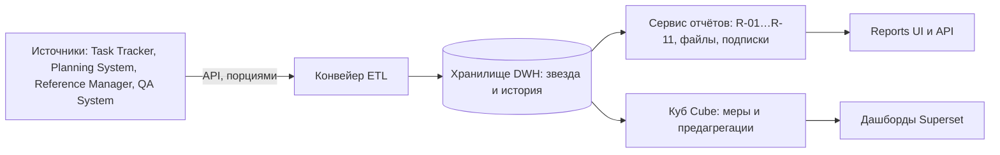

# Как данные попадают в отчёты

Короткое объяснение для тех, кто не участвовал в проекте: соседних команд,
заказчика, новых участников. Термины подробно — в [глоссарии](010.glossary.md),
устройство конвейера и контейнеров — в [описании ETL](etl-pipeline.md).

Reports ничего не создаёт сам: он собирает данные четырёх подсистем и
показывает их в отчётах и на дашбордах. Писать в чужие подсистемы и читать их
базы Reports не может — только их API.

**Конвейер (ETL)** доставляет данные к себе в три шага:

1. **Забрать** у источника порциями: страницами по 100–200 строк, не чаще
   5 запросов в секунду, с повтором при сбое. Партия Planning System читается
   целиком по описанию партии (manifest), справочники — вместе с удалёнными
   записями.
2. **Проверить и привести к одному виду.** Строки проверяются ещё при чтении:
   число строк, уникальность ID, полнота страниц, схема владельца. Затем записи
   одного человека и одного проекта из разных подсистем связываются только по
   подтверждённым правилам: сотрудник — по Keycloak `sub` (у Reference
   Manager это поле `account_user_id`), проект — по явной связи Planning ↔
   Task Tracker. Совпавшие имена или номера связью не считаются. Повтор ID
   в одной выгрузке отклоняет её, повторная загрузка тех же записей их не
   удваивает, удаление у источника отмечается, а не теряется.
3. **Положить** в хранилище одной транзакцией. Если проверка не прошла, пакет
   отклоняется целиком, и отчёты продолжают показывать прошлые данные с
   пометкой «нуждается в обновлении».

**Хранилище (DWH)** нужно отдельно от баз источников по трём причинам: чужую
базу нельзя нагружать отчётами; в ней нет истории — задачу перезаписали, и
вчерашнее состояние потеряно; периоды нужно сравнивать между собой. Поэтому
данные переносятся к себе и сохраняются версиями и ежедневными снимками.
Внутри — «звезда»: **измерения** — то, по чему разрезаем (проект, сотрудник,
статус, дата), и **факты** — то, что считаем (часы, планы, прогоны, дефекты).

**Мера, измерение, предагрегация** — на примере часов. Мера «Факт, ч» — это
сумма часов из записей трудозатрат. Измерения — проект, сотрудник, день.
Отчёт «часы по проектам за октябрь» — это мера, сложенная по измерению
«проект» за период. На миллионе записей такую сумму долго считать при каждом
открытии, поэтому куб заранее хранит итог «часы по проекту, сотруднику и дню».
Этот готовый итог называется **предагрегацией**: он пересобирается раз в минуту,
а запрос читает уже сложенные строки. Поэтому R-01 в Superset отвечает за
десятки миллисекунд даже на миллионе записей.

**Почему план-факт пока считается «на живую».** План приходит из Planning
System, факт — из Task Tracker; показатель объединяет оба набора за
произвольный период. Предагрегации для него пока не объявлено, поэтому куб
считает его в момент запроса по фактам хранилища. На демо-объёме это незаметно,
на большом объёме будет медленнее.

**Два пути чтения.** Reports UI и API считают все одиннадцать отчётов в
сервисе отчётов прямо по хранилищу — там же проверяются роль и область данных
пользователя. Этот путь рассчитан на объём отчёта до 100 000 строк; больший
запрос получает отказ с просьбой сузить период или разрез. Дашборды Superset читают данные через куб: куб проверяет роль и
обязательные условия запроса, например явный период для план-факта. Сейчас
через куб на дашборд выведен только R-01 «Трудозатраты».

**Одной строкой:** конвейер приносит данные в хранилище и сохраняет историю,
сервис отчётов и куб превращают их в показатели, интерфейс и дашборды
показывают их людям с учётом прав.
