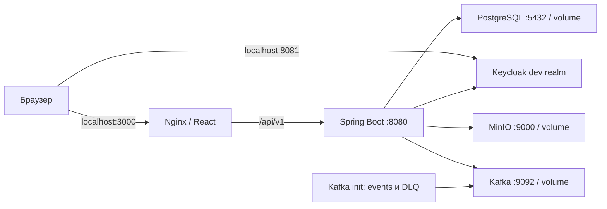
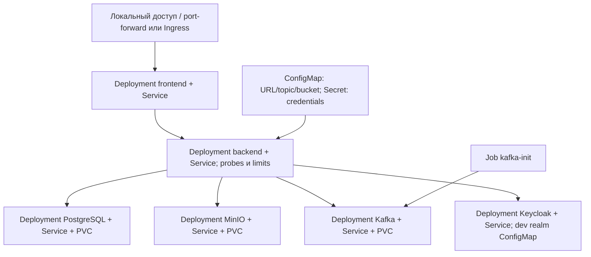

# 165 — Развёртывание

## Целевая локальная среда Compose



Целевая конфигурация Compose должна запускать отдельную dev-сеть и named volumes БД/объектов/событий. Публикуемые порты привязаны к loopback. MinIO собирается из фиксированного исходного commit согласно Infra ADR-003; bucket должен создаваться в демонстрационной среде. Это отдельный учебный realm, не общий Keycloak команды Infra. Dev-пароли не подходят для production.

## Локальный Kubernetes



Это проектная схема финального этапа: Deployment, Service, ConfigMap, Secret, PVC, probes, limits и маршрутизация. Манифесты и проверка запуска должны быть подготовлены на И-M5. Backend/frontend используют собранные версионированные образы; PVC сохраняются при замене pods. Реплика каждого stateful-сервиса одна, стратегия Recreate, HA не заявляется. Общий staging предоставляется Infra; production-топология, резервирование и численные RPO/RTO утверждаются по NFR-008, а не выводятся из этой схемы.

## Фактическая среда и CI/CD

Текущий `compose.yaml` запускает PostgreSQL, Keycloak, backend и frontend. MinIO, Kafka и Kubernetes на диаграммах выше — целевая среда; сейчас вложения лежат в bytea, издателя событий нет.

[Workflow Task Tracker](../../../.github/workflows/task-tracker-checks.yaml) запускается для PR с изменениями `task-tracker/**` или самого workflow, push в main и вручную. Java 21, Node 24; зависимости берутся из pom и lock-файла. Порядок: установка npm → Checkstyle Java (основной код и тесты: запрещённые импорты, пустые операторы, equals/hashCode, имя внешнего типа) → строгая проверка TypeScript (`npm run lint`) → `mvn test` → `npm test` → сборка frontend → `docker compose config --quiet` → сборка обоих образов. Каждый шаг блокирует последующие при ошибке; отчёты Surefire сохраняются даже при падении. Публикация и автоматическое развёртывание пока не настроены; общий стенд зависит от Infra.

Проверка отказа: временно заменить ожидаемое значение в существующем тесте, запустить ту же команду и убедиться в ненулевом exit code, затем вернуть тест. Проверка реального запуска workflow в GitHub выполняется после публикации ветки; локальные результаты приведены в [отчёте](../security-check.md).

## Демо-данные для чистой среды

Realm и `DEV_DIRECTORY=true` создают member/lead/admin и локальные допуски; миграция — статусы, приоритеты, типы и права. После старта backend и миграций загрузить [dev/demo.sql](../../dev/demo.sql) из папки task-tracker:

```sh
docker compose exec -T postgres psql -v ON_ERROR_STOP=1 -U task_tracker -d task_tracker < dev/demo.sql
```

Fixture выполняется одной транзакцией, повтор не создаёт дубли и не перезаписывает изменения. Состав: проект, эпик, две задачи участника (в работе/завершена), плановая итерация, обе задачи в ней, ёмкость 16 ч, запись времени 2 ч и комментарий. План листьев 12 ч, факт 2 ч, остаток 10 ч. UUID с префиксом `dddddddd` — только демо. Загружать вручную только в учебную БД; автоматического наполнения production нет. После входа lead видит иерархию и итерацию, member — назначенные задачи и трудозатраты.

Общий seed-манифест Infra в репозитории не найден. Перед совместным стендом Infra должна включить этот fixture с теми же UUID, составом и пользователями; согласованность пока не подтверждена (DEC-TT-05). SQL использует текущую схему Task Tracker, не заменяет будущую передачу плана из Planning.
